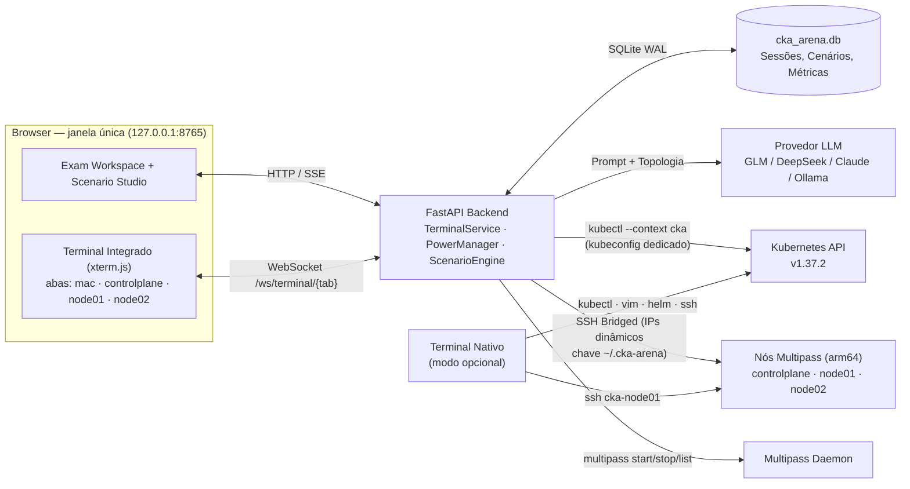
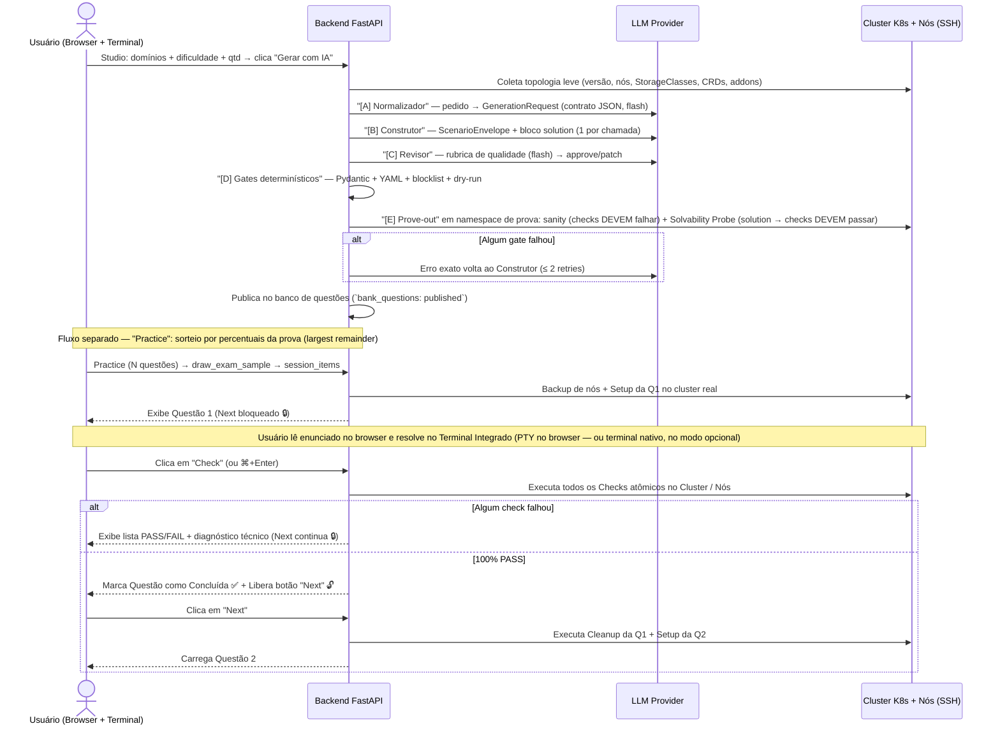
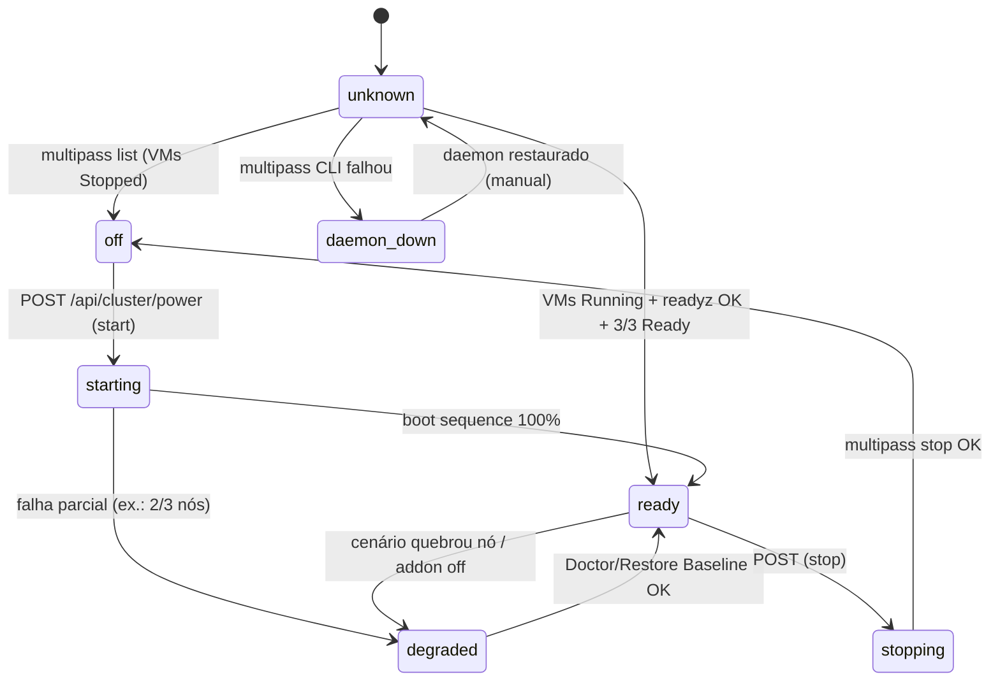

# Arquitetura Técnica — CKA Arena

Este documento detalha os componentes do sistema, o fluxo de dados entre o navegador, o backend local, a LLM, a API do Kubernetes e os nós Linux Multipass, além do modelo de dados e da estratégia de rollback seguro.

---

## 1. Visão Geral da Arquitetura

O **CKA Arena** funciona como um **orquestrador local de estado, validação e acesso**: o navegador concentra o enunciado, o Check, o Estúdio IA **e o próprio terminal** (PTY real do host renderizado em xterm.js), além de gerenciar o ciclo de vida das VMs Multipass (ligar/desligar/reparar). O terminal nativo do macOS permanece como modo opcional para quem prefere dual-window.



---

## 2. Fluxo Completo do Ciclo de Vida de um Cenário



---

## 3. Ponte de Acesso ao Cluster (`ClusterBridge & SSH Runner`)

### Problema Real Descoberto no Ambiente
O script `deploy-virtual-machines.sh` cria 3 VMs Multipass (`controlplane`, `node01`, `node02`) com **duas interfaces de rede**:
- Rede NAT Multipass (`192.168.252.x`): utilizada internamente por `multipass exec`, que falha de forma intermitente com `ssh connection failed: 'Failed to connect: No route to host'`.
- Rede **Bridged** (`192.168.1.123`, `192.168.1.124`, `192.168.1.125`): acessível diretamente pelo Mac com latência `< 1 ms` e com `PasswordAuthentication yes` + usuário `ubuntu` configurados por `01-setup-hosts.sh`.

### Solução Arquitetural
1. **Descoberta Dinâmica de IPs:**
   - O backend executa `kubectl --context cka get nodes -o json` e lê `.status.addresses[type=="InternalIP"].address` de cada nó (`controlplane`, `node01`, `node02`).
   - Como os nós foram iniciados com `--node-ip ${PRIMARY_IP}` (IP Bridged), o `InternalIP` retornado pelo `kubectl` é exatamente `192.168.1.123`, `.124`, `.125`.
2. **Provisionamento de Chave SSH Dedicada (`~/.cka-arena/id_ed25519`):**
   - Na inicialização (ou via botão *Configurar Acesso SSH* no Cluster Doctor), a plataforma gera um par `ed25519` em `~/.cka-arena/` (sem passphrase) e copia a chave pública para `~/.ssh/authorized_keys` do usuário `ubuntu` nos 3 nós via IP Bridged.
   - Adiciona um bloco isolado no `~/.ssh/config` do Mac:
     ```sshconfig
     # >>> CKA-ARENA MANAGED START >>>
     Host cka-controlplane controlplane
       HostName 192.168.1.123
       User ubuntu
       IdentityFile ~/.cka-arena/id_ed25519
       StrictHostKeyChecking accept-new

     Host cka-node01 node01
       HostName 192.168.1.124
       User ubuntu
       IdentityFile ~/.cka-arena/id_ed25519
       StrictHostKeyChecking accept-new

     Host cka-node02 node02
       HostName 192.168.1.125
       User ubuntu
       IdentityFile ~/.cka-arena/id_ed25519
       StrictHostKeyChecking accept-new
     # <<< CKA-ARENA MANAGED END <<<
     ```
   - **Benefício duplo:** o backend consegue quebrar/inspecionar `kubelet`, `/etc/kubernetes/manifests` e `etcd` instantaneamente via SSH, e você pode digitar `ssh controlplane` ou `ssh node01` direto no seu terminal sem precisar de `multipass shell`!
3. **Execução SSH Persistente (`ControlMaster` / `asyncssh`):**
   - Conexões SSH usam multiplexing ou `asyncssh` com timeout curto (`10s`) e `ConnectTimeout=4`, evitando travamentos caso um nó seja propositalmente parado em um cenário.
4. **Kubeconfig dedicado (`~/.cka-arena/kubeconfig`):**
   - Copiado do `/etc/kubernetes/admin.conf` do controlplane no primeiro provisionamento (via SSH) e usado por **todo** `kubectl` do backend com `--kubeconfig ~/.cka-arena/kubeconfig --context cka`.
   - Motivo: o `~/.kube/config` global do usuário contém contextos EKS de trabalho e um `current-context` volátil — o backend nunca deve depender dele (nem executar comandos contra o cluster errado).
5. **Bootstrap da chave sem `sshpass` + IPs Dinâmicos:**
   - `sshpass` não existe no macOS; o primeiro provisionamento usa **`SSH_ASKPASS` com `SSH_ASKPASS_REQUIRE=force`** (OpenSSH ≥ 8.4 — o host roda 10.5) para instalar `~/.cka-arena/id_ed25519.pub` em `~/.ssh/authorized_keys` dos 3 nós (mkdir/chmod + append idempotente via `grep -qxF`), com a senha do lab (`ubuntu`, env `CKA_LAB_PASSWORD`). Sem expect: o askpass é determinístico e não depende de casar prompts de TTY.
   - Os IPs Bridged vêm de **DHCP**: com o cluster ligado, a fonte primária é `kubectl get nodes -o json` (`InternalIP`); com o cluster desligado ou bootando, a fonte é `multipass list --format json`. A cada boot, o `ClusterPowerManager` **regenera o bloco gerenciado** do `~/.ssh/config` com os IPs atuais (§9.3).

---

## 4. Segurança, Isolamento e Auto-Cura (`Safety & Rollback Engine`)

Cenários de CKA de nível **Troubleshooting (30%)** frequentemente modificam arquivos críticos do Control Plane (`/etc/kubernetes/manifests/kube-apiserver.yaml`, `/var/lib/kubelet/config.yaml`, `systemctl stop kubelet`). Se algo der errado na aplicação ou se o usuário quiser desistir, o cluster não pode ficar quebrado.

### Mecanismo em 3 Camadas

1. **Snapshot Baseline Global (Bootstrap):**
   - Ao rodar o `ClusterDoctor` pela primeira vez (com o cluster saudável), é tirado um snapshot imutável dentro de cada nó em `/var/backups/cka-arena/baseline/`:
     - `/etc/kubernetes/manifests/*`
     - `/etc/systemd/system/kubelet.service.d/*`
     - `/var/lib/kubelet/config.yaml`
     - `/etc/containerd/config.toml`
2. **Snapshot Pré-Cenário (`backup_paths`):**
   - Todo comando de nó listado em `setup.node_commands` deve declarar `backup_paths` (e o parser rejeita comandos que alterem `/etc/kubernetes`, `/var/lib/kubelet` ou `/etc/systemd` sem `backup_paths` declarado).
   - Antes de executar o comando de quebra, o backend executa via SSH:
     `sudo mkdir -p /var/backups/cka-arena/<scenario_id> && sudo cp -a <path> /var/backups/cka-arena/<scenario_id>/`
3. **Guardrails de Destruição (Blocklist na Camada de Parser):**
   - O `ScenarioValidator` bloqueia **antes da execução** qualquer manifesto ou comando gerado pela LLM que contenha padrões destrutivos fora de escopo:
     - `rm -rf /`, `mkfs`, `dd if=`, `kubeadm reset`, `iptables -F` global sem restauração, deleção de `kube-system` inteiro ou remoção de `/etc/kubernetes/pki`.
     - Namespaces protegidos: `kube-system`, `kube-public`, `kube-node-lease`, `default` nunca podem receber `kubectl delete namespace`.
   - **Política de labels (única, aplicada pelo `apply_setup` a todo recurso criado):** `cka-arena.io/managed: "true"` (global — alimenta a varredura L1 do teardown) **e** `cka-arena.io/scenario: "<question_id>"` (por questão — habilita o cleanup cirúrgico L0); sondas efêmeras usam `cka-arena.io/probe: "true"` (TTL 120s). Nenhum outro rótulo de gerenciamento existe.
4. **Botão de Emergência ("Cluster Doctor · Restore Baseline"):**
   - Caso a API do Kubernetes (`6443`) esteja fora do ar (ex.: durante um cenário de `kube-apiserver` quebrado) e o usuário clique em *Reset* ou *Restore Cluster*, o backend usa **SSH direto no IP `192.168.1.123`** (que não depende do `kube-apiserver`) para restaurar os arquivos de `/var/backups/cka-arena/<id>/` ou `/var/backups/cka-arena/baseline/` e reiniciar `kubelet`/`containerd`.

---

## 5. Estrutura de Diretórios Proposta (Código Futuro)

```text
/Users/fabio/Projects/cka-arena/
├── PLAN.md                      # Plano mestre e roadmap
├── ARCHITECTURE.md              # Este documento
├── LLM_SCENARIO_SPEC.md         # Contrato JSON, checks e system prompt
├── UX_UI_SPEC.md                # Diretrizes de interface e UX
├── README.md                    # Visão geral
├── pyproject.toml               # Dependências Python (uv)
├── .gitignore                   # Ignora .venv, *.db, llm_config.json, .env
├── llm_config.json              # Config local de provider LLM (gitignored)
├── scenarios/
│   └── seed/                    # 15 cenários curados offline (JSON/YAML)
├── app/
│   ├── __init__.py
│   ├── main.py                  # App FastAPI, rotas REST + SSE e static files
│   ├── config.py                # Paths, contextos kubectl, leitura de env/config
│   ├── db.py                    # SQLite schema & queries (sessões, banco de questões, tentativas, telemetria)
│   ├── models.py                # Modelos Pydantic (ScenarioEnvelope, CheckSpec, etc.)
│   ├── cluster.py               # Wrapper assíncrono kubectl + descoberta de topologia
│   ├── ssh_runner.py            # Provisionamento de chave SSH + execução nos nós
│   ├── terminal.py              # TerminalService: PTY do host + WebSocket + registro de sessões
│   ├── sessions.py              # Prática: draw → setup → check → next/skip/reset → finish L1/L2
│   ├── provider/                # Node provider: multipass VMs (macOS/Linux) × kind containers (WSL2/Docker)
│   ├── power.py                 # ClusterPowerManager: power on/off via provider + boot instrumentado + self-heal kubeconfig
│   ├── scenario_engine.py       # Orquestrador Setup -> Check -> Cleanup + Backups
│   ├── validator.py             # Motor determinístico dos 10+ tipos de Check
│   ├── llm_client.py            # Cliente multi-provider (GLM, DeepSeek, Claude, Ollama)
│   ├── pipeline.py              # Pipeline A→E: prompt builder, estágios LLM (Normalizador/Construtor/Revisor), gates determinísticos e loop de auto-reparo (absorve o antigo llm_generator)
│   ├── bank.py                  # Banco de questões: dedup semântico, publish, cobertura, draw_exam_sample
│   ├── commands.py              # Dispatcher kubectl/helm para setup/solution/cleanup
│   ├── telemetry.py             # Telemetria por domínio + recomendação do próximo foco
│   ├── seed.py                  # CLI `python -m app.seed`: valida e publica os seeds de scenarios/seed/ no banco
│   ├── teardown.py              # Teardown L0/L1/L2-clean (baseline de arquivos + restart de agentes) + drift
│   └── doctor.py                # ClusterDoctor (saúde, addons, baseline de arquivos dos nós)
├── static/
│   ├── index.html               # Shell principal: Workspace + Terminal integrado + Studio
│   ├── css/
│   │   ├── tokens.css           # Paleta, tipografia, espaçamentos
│   │   └── app.css              # Layout 40/60, cards, pills, drawer, barra fixa
│   └── js/
│       ├── api.js               # Cliente REST + SSE
│       ├── workspace.js         # Tela de Estudo/Exame (Check -> Next lock, timer)
│       ├── studio.js            # Scenario Studio (seleção de domínios + streaming)
│       ├── settings.js          # Config LLM + Cluster Doctor
│       ├── terminal.js          # Terminal xterm.js: abas, resize, reconnect, paste
│       ├── power.js             # Pill de estado do cluster + boot overlay + CTA Power On
│       ├── app.js               # Orquestrador: views, status strip, sessão, atalhos globais
│       └── ui.js                # Toast, confirmação, clipboard
│   └── vendor/                  # xterm.js + addon-fit vendored (sem CDN, offline-first)
└── tests/
    ├── test_models_guardrails.py
    ├── test_validator.py        # Comparadores, FAIL×ERROR, retry, all-or-nothing, can-i
    ├── test_models.py           # Seeds: validação Pydantic, domínios, exam voice
    ├── test_scenario_engine.py  # Setup/cleanup/backups (stubs de kubectl/SSH)
    ├── test_llm_parser.py
    ├── test_pipeline.py         # Estágios A–E com LLM e cluster stubados (retry, quarentena draft)
    ├── test_bank.py             # Dedup semântico por hash, publish, cobertura
    ├── test_sessions.py         # Fluxo de sessão: check bloqueia Next, skip, finish L1/L2
    ├── test_telemetry.py        # Agregação por domínio + recomendação
    ├── test_terminal.py         # TerminalService (sessões PTY, resize, echo, limites)
    └── test_power.py            # ClusterPowerManager (máquina de estados, self-heal kubeconfig)
```

---

## 6. Esquema de Banco de Dados (`SQLite`)

O estado local é persistido em `data/cka_arena.db` (modo `WAL`) para preservar seu histórico entre reinícios do servidor ou das VMs:

| Tabela | Colunas Principais | Propósito |
| :--- | :--- | :--- |
| `sessions` | `id`, `title`, `mode` (`study` \| `mock_exam`), `difficulty_filter`, `domains_json`, `sample_json`, `status`, `started_at`, `finished_at`, `total_weight`, `earned_weight` | Sessão de prática **sorteada do banco** (`sample_json` guarda a distribuição efetiva por domínio). |
| `bank_questions` | `id`, `envelope_json`, `envelope_hash`, `domain`, `subtopics_json`, `difficulty`, `weight_pct`, `estimated_minutes`, `source` (`llm`\|`seed`), `state` (`draft`\|`probed`\|`published`\|`retired`), `probe_result_json`, `times_used`, `last_used_at`, `first_try_pass_count`, `avg_solve_seconds`, `generator_meta_json`, `supersedes_question_id`, `retired_reason`, `created_at` | **Banco de questões**: envelope imutável após publicado (correção = nova versão), dedup por `envelope_hash` semântico, métricas de qualidade por questão (`LLM_PIPELINE_SPEC.md` §3). |
| `session_items` | `id`, `session_id`, `bank_question_id`, `order_index`, `state` (`pending`\|`active`\|`passed`\|`skipped`), `started_at`, `passed_at`, `attempts` | Fila da sessão referenciando o banco (substitui a antiga `scenarios` acoplada à sessão). `Next` liberado quando `state == 'passed'` (ou `skipped` após desistência). |
| `generation_requests` | `id`, `request_json`, `status`, `scenarios_attempted`, `scenarios_published`, `created_at` | Auditoria do pipeline: o que foi pedido × o que sobreviveu aos gates A–E. |
| `check_runs` | `id`, `session_item_id`, `ran_at`, `all_passed`, `duration_ms`, `results_json` | Cada clique em **Check** com status por item (`PASS`/`FAIL`/`SKIP`/`ERROR` — contrato em `LLM_PIPELINE_SPEC.md` §5). |
| `llm_generations` | `id`, `created_at`, `stage` (`A`\|`B`\|`C`), `provider`, `model`, `prompt_params_json`, `attempts_used`, `raw_response`, `status`, `error_message` | Auditoria por estágio do pipeline (permite diagnosticar prompts que geraram YAML inválido). |
| `terminal_sessions` | `id`, `tab_id`, `preset` (`host` \| `node`), `node_name`, `session_item_id` (nullable), `created_at`, `last_activity`, `closed_at`, `exit_status` | Registro das abas de terminal abertas (sobrevive a reloads do browser; alimenta telemetria e audit opcional). |
| `command_audit` *(opt-in)* | `id`, `session_id`, `session_item_id`, `command_text`, `ran_at` | Captura **opcional** dos comandos do terminal integrado durante um item ativo (análise imperativo × declarativo). Local-only, purgada por sessão; desligado por padrão. |

---

## 7. Add-ons do Cluster (instalados em 17/11/2026)

Estado atual após instalação/validação:

- **metrics-server** (patch `--kubelet-insecure-tls`) — `kubectl top` funcional.
- **Gateway API 1.2 (CRDs) + Envoy Gateway v1.2.0** (Helm OCI; GatewayClass `eg` + data plane validado com HTTP 200 via ClusterIP).
- **local-path-provisioner v0.0.30** — StorageClass `local-path` (WaitForFirstConsumer).
- **NetworkPolicy enforcement** — `weave-npc` roda como container do DaemonSet `weave-net` (detecção por container no doctor).
- **helm/etcdctl** no host/controlplane; o reset L2-clean preserva os addons (sem snapshots de VM: não suportados no backend Multipass/macOS).

Histórico de recomendações (mantido como referência de cobertura):

O cluster atual tem `CoreDNS`, `Weave Net` e os componentes padrão de control plane. Para que a LLM possa gerar cenários reais de todos os tópicos do novo currículo CKA, o `ClusterDoctor` verificará e oferecerá instalação em 1 clique de:

1. **`metrics-server`** (necessário para questões de `kubectl top nodes/pods` e `HPA` em Troubleshooting/Workloads; scripts de referência já existem em `certified-kubernetes-administrator-course/metrics-staging-scripts/`).
2. **`helm` CLI no Mac** (verificar via `which helm`; instalar via `brew install helm` se ausente).
3. **Gateway API CRDs (`v1.2+`) + Controlador leve compatível com `arm64`** (ex.: NGINX Gateway Fabric ou Envoy Gateway) para cenários reais de `GatewayClass`, `Gateway` e `HTTPRoute`.
4. **Provisionador local de Storage (`local-path-provisioner` da Rancher)** para permitir cenários com `StorageClass` dinâmica (`WaitForFirstConsumer`), além de PVs estáticos (`hostPath`/`local`).
5. **`etcdctl` no nó `controlplane`** (verificar presença para cenários de `etcd` snapshot save/restore sem precisar baixar durante o treino).
6. **`weave-npc` (NetworkPolicy enforcement):** sem os pods `weave-npc-*`, cenários de `NetworkPolicy` passam sempre (política não é aplicada). O `ClusterDoctor` reporta o addon `network_policy_enforcement: on/off` e o gerador de cenários só propõe NetworkPolicy quando `on`.

---

## 8. Terminal Web no Browser (`TerminalService`)

> Requisito do usuário: executar os comandos dos cenários **no próprio browser** e pedir a validação (Check) sem sair da plataforma. Especificação completa do componente.

### 8.1 Decisão de Design: PTY in-process no host macOS

| Alternativa | Veredito | Motivo |
| :--- | :--- | :--- |
| **PTY in-process (`pty.openpty`) + WebSocket + xterm.js** | ✅ **Escolhida** | Zero dependências externas (FastAPI/uvicorn já fazem WS; `pty`/`fcntl` são stdlib); permite audit de telemetria, controle de ciclo de vida, abas preset e reconexão. Roda no host onde vivem `kubectl`, `helm` e o `~/.ssh/config` gerenciado. |
| `ttyd` / `gotty` (binário externo) | ❌ | Não instalados (verificado); processo separado sem controle de sessão, sem audit, sem integração com abas de nó. |
| `tmux` attach | ❌ | Não instalado no host (verificado); desnecessário — o registro de PTYs no backend já dá persistência entre reloads. |
| SSH do browser direto aos nós (asyncssh→WS) | ❌ como base | O usuário precisa do shell do **Mac** (kubectl/helm/vim); abas de nó resolvem com `ssh cka-<nó>` dentro do mesmo PTY. |

### 8.2 Como Funciona

1. **Criação de aba (spawn lazy):** `POST /api/terminal/tabs` com `{preset: "host"}` ou `{preset: "node", node: "node01"}` registra a aba; o shell só nasce quando o **primeiro xterm conecta** no WebSocket — assim o prompt (ex.: powerlevel10k) já encontra o terminal pronto para responder às queries de capacidades.
   - `host` → spawn de `zsh -l` (login shell do usuário, com seus aliases) num PTY via `pty.openpty()` + `os.fork`/`subprocess` com `start_new_session`.
   - **Ambiente do PTY isolado:** `terminal_env()` remove `EDITOR`/`VISUAL`/`KUBE_EDITOR`/`GIT_EDITOR` herdados do servidor, fixa `TERM=xterm-256color`, **sobrescreve `KUBECONFIG`** para o kubeconfig dedicado (`~/.cka-arena/kubeconfig`, context `cka` — nunca a config global do usuário) e, para abas `host`, exporta `CKA_ARENA_WORKDIR`/`TMPDIR` apontando para a scratch da aba.
   - `node` → spawn de `ssh cka-<node>` (usa o bloco gerenciado do `~/.ssh/config`; cai para password prompt só se o bridge ainda não foi provisionado — o Cluster Doctor orienta).
   - **Workdir scratch por aba:** toda aba `host` nasce em `~/.cka-arena/scratch/<tab_id>` (`cwd` + `TMPDIR`) — YAMLs e temporários criados no terminal ficam lá, nunca na pasta do projeto. A workdir é apagada no `close()` da aba (fechamento explícito, idle-timeout ou prune) com **guarda de caminho** (`remove_scratch` recusa qualquer caminho fora de `SCRATCH_ROOT`); `sweep_scratch()` no startup do servidor remove workdirs órfãs de crashes. Registra `{tab_id, master_fd, pid, preset, workdir, created_at}` no `TerminalRegistry`.
2. **WebSocket:** `WS /ws/terminal/{tab_id}` — mensagens do cliente: `{"type":"input","data":"..."}` e `{"type":"resize","cols":N,"rows":N}` (aplicada via `fcntl.ioctl(master_fd, TIOCSWINSZ, ...)`); do servidor: frames de saída do PTY (texto puro) e `{"type":"exit","status":N}`.
   - **Um único assinante por PTY:** se a aba já tem WebSocket conectado, um segundo attach recebe `4409` (evita dois xterms respondendo às mesmas queries do prompt). Reload reutiliza apenas abas sem assinantes.
   - **Replay sanitizado:** o buffer de replay remove sequências que **solicitam respostas** do terminal (OSC `4;?`/`10;?`/`11;?`/`12;?`, DA, DSR, DECRQM `$p/$y`, CPR, window-ops, DCS) e respostas de cor (`rgb:...`) — sem isso, prompts como powerlevel10k re-perguntavam ao terminal a cada reconexão, gerando loop de respostas (`rgb:...`/`$y` no prompt). SGR/cores, títulos OSC e movimentos de cursor são preservados.
3. **Streaming de saída:** um reader asyncio por PTY (`loop.add_reader` no master fd, ou thread dedicada → asyncio queue) publica os bytes para todos os WS conectados à aba e mantém um **ring buffer de replay** (últimos 256 KB por aba).
4. **Reconexão:** reload do browser ou queda de rede → cliente chama `GET /api/terminal/tabs`, reatacha ao PTY vivo e recebe o replay do ring buffer. Reinício do backend encerra as sessões (comportamento documentado e sinalizado na UI como "terminal reiniciado").
5. **Limites:** máx. 6 abas ativas; timeout de idle (30 min sem input nem WS) com aviso 60s antes; fechamento = `SIGHUP` no grupo do processo.
6. **Fonte de verdade do cenário ativo:** quando uma aba existe com um `scenario_id` vinculado (aba aberta a partir do workspace), os check runs e o audit opcional podem correlacionar tempo/comandos por questão.

### 8.3 Frontend (`static/js/terminal.js` + `static/vendor/xterm`)

- `xterm.js` + `addon-fit` **vendored** (sem CDN — funciona offline, igual ao restante da plataforma).
- Barra de abas: abas ativas + **popover `+ Shell ▾`** (glass-2) com os 4 destinos (mac/controlplane/node01/node02) — um controle em vez de uma fileira de botões; aba ativa foca o terminal.
- O rodapé do painel mostra a **workdir isolada** (`scratch/<tab>`), o toggle `⌗ Native`, `Clear` e nada mais: o **Check é único**, no rodapé da coluna da questão (`check-btn` glass-clear) — disparável de qualquer foco via `⌘↵`.
- Copy-Pills do enunciado, ao clicar, copiam para o clipboard **e** dão foco no terminal (⌘V cola); comportamento idêntico ao do exame real.
- Atalhos globais: `⌘↵` (Check), `⌘⇧↵` (Next), `⌘K` (limpa terminal), `⌘1/2/3` (Arena/Studio/Settings), `Esc` (volta à Arena/fecha modais).

### 8.4 Audit Opcional de Comandos (Telemetria)

- **Off por padrão.** Quando ligado nas Configurações, o backend extrai "linhas de comando" do stream do PTY (split por echoes de prompt/newline) das abas vinculadas a um cenário ativo e grava em `command_audit`.
- Uso: dashboard de desempenho passa a mostrar abordagem média (imperativo × declarativo), comandos mais usados por domínio e tempo entre primeiro comando e Check.
- Privacidade: local-only (SQLite), purge por sessão, nunca enviado à LLM. A LLM **não** recebe o histórico de comandos — a avaliação continua 100% determinística por estado.

## 9. Ciclo de Vida do Cluster (`ClusterPowerManager`)

> Requisito do usuário: o cluster é inicializado junto com a aplicação, com um **botão na tela para ligar o cluster e iniciar os cenários**.

### 9.0 Provider de nós (Multipass × kind)

A plataforma fala apenas **nomes lógicos** (`controlplane/node01/node02`); `app/provider/`
traduz para o ambiente: `MultipassProvider` (SSH por IP de bridge, `multipass start/stop`,
terminal `ssh cka-<node>`) e `KindProvider` (containers kind, `docker exec`, terminal
`docker exec -it <ctr> bash`, `docker start/stop`, mapeamento em `~/.cka-arena/nodes.json`).
Seleção: `CKA_PROVIDER` → `~/.cka-arena/provider` → default por S.O. Toda execução de nó
(engine, pipeline, validator, doctor, power, terminal) passa por `provider.get()` — nenhum
módulo chama SSH/Multipass diretamente. O `setup.sh` (raiz do repo, ver `SETUP_PLAN.md`)
detecta o S.O., audita pré-requisitos com confirmação, provisiona (`scripts/cluster/up.sh`
ou `kind-up.sh`), instala addons (`app/addons.py`), publica os seeds e sobe o servidor.

### 9.1 Máquina de Estados



- Fontes de estado: `multipass list --format json` (por VM: `Running/Stopped` + IPs), `kubectl --context cka get --raw /readyz`, `kubectl get nodes` (condição Ready).
- O estado é reavaliado no launch da app, ao abrir a home e a cada 15s enquanto houver UI conectada (SSE `cluster.power.state_changed`).

### 9.2 Sequência de Boot Instrumentada (`action: start` → job assíncrono + SSE)

| Passo | Comando/Critério | Timeout |
| :--- | :--- | :--- |
1. Ligar VMs | `multipass start controlplane node01 node02` | 300s |
2. SSH disponível | `nc -z <ip> 22` nos 3 nós (IPs de `multipass list`) | 240s |
3. SSH config regen | Reescrever bloco gerenciado `~/.ssh/config` com IPs atuais | 5s |
4. API de pé | `kubectl --kubeconfig ~/.cka-arena/kubeconfig --context cka get --raw /readyz` (com self-heal §9.3) | 180s |
5. Nós prontos | `kubectl wait --for=condition=Ready node --all` | 300s |
6. Doctor rápido | addons (metrics-server, weave-npc, Gateway API, local-path), `helm`/`etcdctl` nos nós | 30s |
7. Baseline | Baseline de arquivos nos nós (manifests/kubelet/containerd/systemd) se ainda não existir (§4) | 60s |

- Cada passo emite `cluster.power.progress {step, detail}` via SSE; a UI mostra overlay "Ligando cluster… passo 4/7".
- Falha em qualquer passo → estado `degraded` (ou `off`/`daemon_down`) com o erro exato e sugestão de correção.

### 9.3 Self-Heal Pós-DHCP (IP mudou após reboot das VMs)

1. `readyz` falhou mas SSH responde → baixa `/etc/kubernetes/admin.conf` do controlplane via SSH.
2. Reescreve `server: https://<ip-atual>:6443` e grava em `~/.cka-arena/kubeconfig`.
3. Revalida `readyz`. Se ainda falhar, reporta `degraded` com diagnóstico (ex.: kubelet do controlplane parado → segue fluxo Doctor).
4. O `~/.ssh/config` gerenciado é regenerado no passo 3 do boot **sempre** (idempotente).

### 9.4 Desligar, Reiniciar e Boot da Aplicação

- `stop`: UI pede confirmação ("cenário ativo será descartado; VMs serão paradas") → `multipass stop controlplane node01 node02` → `off`. Nada de cleanup kubectl (cluster some com as VMs; namespaces de cenário são efêmeros por design).
- `restart` = `stop` + `start` (útil quando um Boss Fight deixou tudo quebrado e o usuário quer bloodless reset).
- **Launch da app:** `GET /api/cluster/power` no boot; se `off`, a home mostra CTA único **"⏻ Power On & Practice"** (Studio e Workspace ficam bloqueados com pills explicativos). `auto_start_on_launch: true` dispara o start automaticamente ao abrir a app — **default ON** (decisão D3).
   - `daemon_down`: `multipass list` falhou (daemon fora) → estado próprio; a plataforma **não executa sudo** — apenas orienta o usuário a rodar `sudo launchctl kickstart -k system/com.canonical.multipass`.

### 9.5 API

| Endpoint | Método | Retorno |
| :--- | :--- | :--- |
| `/api/cluster/power` | GET | `{state, vms: [{name, multipass_state, ips}], last_ready_at, active_job?}` |
| `/api/cluster/power` | POST | `{action: "start"\|"stop"\|"restart"}` → `202 {job_id}` (job único por vez; 409 se já houver) |
| `/api/events` | SSE | `cluster.power.state_changed`, `cluster.power.progress`, `cluster.doctor.*`, `generation.*` (Studio) |

## 10. Segurança do Terminal & Exposição de Rede

1. **Bind `127.0.0.1` sempre.** O terminal é um shell do host: expô-lo é RCE por design.
2. **Origin check:** o endpoint WS valida o header `Origin` (same-origin `http://127.0.0.1:8765`); requisições sem/outro Origin são rejeitadas com `403`.
3. **Proxies/tunnels proibidos por padrão:** se a app detectar bind fora de loopback (ex.: `0.0.0.0`, tailscale-serve na frente), `/ws/terminal/*` responde `503` com banner na UI explicando o risco e como reverter. A exposição remota exige ligar explicitamente `CKA_ARENA_ALLOW_REMOTE=1` **+** token (`CKA_ARENA_TOKEN`, header `Authorization` em todas as rotas).
4. **Single-user local:** sem auth por padrão (lab pessoal); o token opcional acima cobre o caso de uso na rede da casa.
5. **Audit é opt-in e local-only** (§8.4); a LLM nunca vê o histórico de comandos.

---

## 11. Banco de Questões & Amostragem por Percentuais da Prova

**Modelo:** a geração **publica** no banco (`bank_questions.state = published`); a prática **consome** com sorteio ponderado — desacoplamento total entre produzir e praticar (`LLM_PIPELINE_SPEC.md` §3–§4).

- **Amostragem:** largest remainder sobre os pesos oficiais (Troubleshooting 30 · Cluster Arch 25 · S&N 20 · Workloads 15 · Storage 10), renormalizados quando o usuário filtra domínios/dificuldade; dentro da célula ordena por `times_used ASC, random()`; mesma questão nunca repete na sessão; célula vazia → fallback proporcional + CTA "Gerar mais deste domínio".
- **API:** `GET /api/bank/coverage` (grade domínio×dificuldade p/ Studio) · `POST /api/practice` `{count, domains?, difficulty?}` (valida cluster `ready`, cria `sessions`+`session_items`, aplica Q1) · `POST /api/bank/questions/{id}/retire`.
- **Preview na UI:** antes de iniciar, o modal mostra a distribuição exata ("5× Troubleshooting · 4× Cluster Architecture · …").

## 12. Teardown de Sessão & Reset Limpo do Cluster (L0/L1/L2)

> Requisito: ao final da sessão de prática, o cluster volta **limpo**. Três níveis (`LLM_PIPELINE_SPEC.md` §6):

| Nível | Gatilho | Ação | Duração |
| :--- | :--- | :--- | :--- |
| **L0** | `Next`/`Pular` (por questão) | cleanup da questão: namespaces do cenário, recursos labelados, backups de nó restaurados, releases Helm, probes | 2–10s |
| **L1** | fim de sessão (default) | varredura global por label `cka-arena.io/managed: "true"` + restauração de backups pendentes + **drift check** vs baseline | ~30s |
| **L2 — clean reset** | pós-`mock_exam` (auto), drift detectado, ou botão "Clean reset" | L1 + restauração do baseline de arquivos dos nós + `restart containerd/kubelet` + wait Ready + drift check (addons preservados; sem snapshots de VM — não suportados no Multipass/macOS) | ~1–2 min |

- **L2 = clean reset (não usa snapshots de VM):** o backend do Multipass no macOS (QEMU) responde `The snapshots feature is not implemented on this backend` — `multipass snapshot/restore` existem no CLI mas não funcionam aqui (verificado ao vivo). O reset limpo faz: L1 (recursos gerenciados + backups pendentes) → restauração do **baseline de arquivos** dos nós (`/var/backups/cka-arena/baseline/`) → `systemctl restart containerd kubelet` nos 3 nós → espera API/nós Ready → drift check. Addons em namespaces não gerenciados (`kube-system`, `envoy-gateway-system`, `local-path-storage`) permanecem instalados. Validado ao vivo: `drift=false`, 3/3 Ready, addons presentes.
- **API:** `POST /api/sessions/{id}/finish` `{reset: "fast"\|"baseline"}` · `GET /api/cluster/drift` · `POST /api/cluster/reset-baseline`.
- **UI:** tela de fim de sessão com resumo (acertos 1ª tentativa, tempo, pior domínio) + escolha L1/L2 (default L1; L2 recomendado com drift ou pós-simulado).

---

## 13. Referência de API (consolidada)

| Endpoint | Método | Payload → Resposta | Especificação |
| :--- | :--- | :--- | :--- |
| `/api/cluster/power` | GET | → `{state, vms[], last_ready_at, active_job?}` | §9.5 |
| `/api/cluster/power` | POST | `{action: start\|stop\|restart}` → `202 {job_id}` (409 se job ativo) | §9.5 |
| `/api/cluster/health` | GET | → `{nodes_ready, kubectl_ok, ssh_ms[], addons[]}` (usado no aceite da Fase 1) | `PLAN.md` Fase 1 |
| `/api/cluster/setup-ssh` | POST | `{password?}` → `{ok, nodes[], ssh_config_path, kubeconfig_path}` (bootstrap: chave + ssh-config + kubeconfig) | §3 |
| `/api/cluster/drift` | GET | → `{drift: bool, findings[]}` (arquivos de nós vs baseline) | §12 |
| `/api/cluster/reset-baseline` | POST | → `202 {job_id}` (L2 sob demanda) | §12 |
| `/api/terminal/tabs` | POST | `{preset: host\|node, node?}` → `{tab_id}` · GET → lista de PTYs vivos (reconnect) | §8.2 |
| `/ws/terminal/{tab_id}` | WS | in: `{type: input\|resize, …}` · out: frames do PTY + `{type: exit}` | §8.2 |
| `/api/generate` | POST | `{domains[], subtopics?, difficulty, count, focus_hint?}` → `202 {generation_request_id, job_id}` (cluster `ready` obrigatório) | `LLM_PIPELINE_SPEC.md` §2 |
| `/api/generate/status` | GET | `{job}` — snapshot do job atual/último (status, `current`, `scenarios[]`, contadores) para recuperação em reload | `LLM_PIPELINE_SPEC.md` §2 |
| `/api/bank/coverage` | GET | → grade 5×3 `{domain, difficulty, published_count}[]` | §11 |
| `/api/bank/questions/{id}/retire` | POST | `{reason}` → questões fora da amostragem | §11 |
| `/api/practice` | POST | `{count, domains?, difficulty?}` → `201 {session_id, items[]}` (sorteio largest-remainder + aplica Q1) | §11 · `LLM_PIPELINE_SPEC.md` §4 |
| `/api/sessions/{id}/finish` | POST | `{reset: fast\|baseline}` → resumo da sessão + job de limpeza L1/L2 | §12 |
| `/api/sessions/active` · `/api/sessions/{id}` | GET | Sessão corrente (item atual, envelope, counts) | `app/sessions.py` |
| `/api/sessions/{id}/check` · `/next` · `/skip` · `/reset` | POST | Ciclo de prática (contrato do Check em `LLM_PIPELINE_SPEC.md` §5) | `UX_UI_SPEC.md` §3 |
| `/api/bank/preview` | GET | `?count=&domains=&difficulty=` → alocação largest-remainder + fallbacks | §11 |
| `/api/terminal/tabs` | POST/GET | `{preset: host\|node, node?}` → `{tab_id}` · lista PTYs vivos (reconnect) | §8.2 |
| `/api/terminal/tabs/{tab_id}` | DELETE | Fecha a aba e o PTY | §8.2 |
| `/ws/terminal/{tab_id}` | WS | in: `{type: input\|resize}` · out: `{type: output\|replay\|exit}` (exige `websockets` no uvicorn) | §8.2 |
| `/api/llm/config` · `/api/llm/status` · `/api/llm/test` | GET/PUT/POST | Config do provider editável na UI (chave **mascarada**, nunca retornada crua) · status/chain · ping real com latência | `LLM_PIPELINE_SPEC.md` §1 |
| `/api/events` | SSE | `cluster.power.*`, `cluster.doctor.*`, `generation.progress` (A–E/publish/X/done), `generation.heartbeat` (4s), `generation.snapshot` (ao conectar), `generation.done`, `session.*` | §9.5 · `UX_UI_SPEC.md` §4 |

- Regras transversais: tudo JSON; jobs assíncronos seguem o padrão `202 {job_id}` + progresso em `/api/events`; erros seguem `{error: {code, message, detail?}}`; autenticação só quando `CKA_ARENA_TOKEN` definido (§10).
- Endpoints de Check/Next da sessão ativa (`POST /api/sessions/{id}/check`, `/next`, `/skip`, `/reset`) seguem o ciclo do `UX_UI_SPEC.md` §3 e o contrato de avaliação do `LLM_PIPELINE_SPEC.md` §5.
