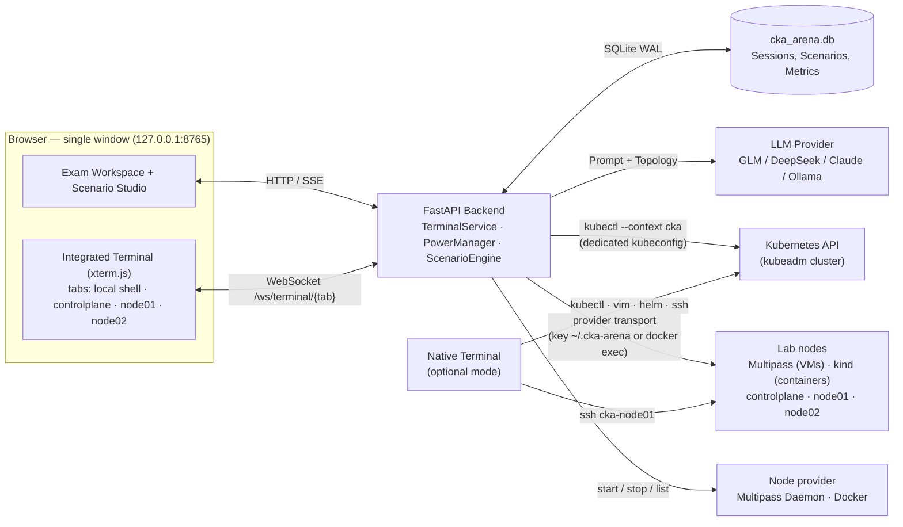
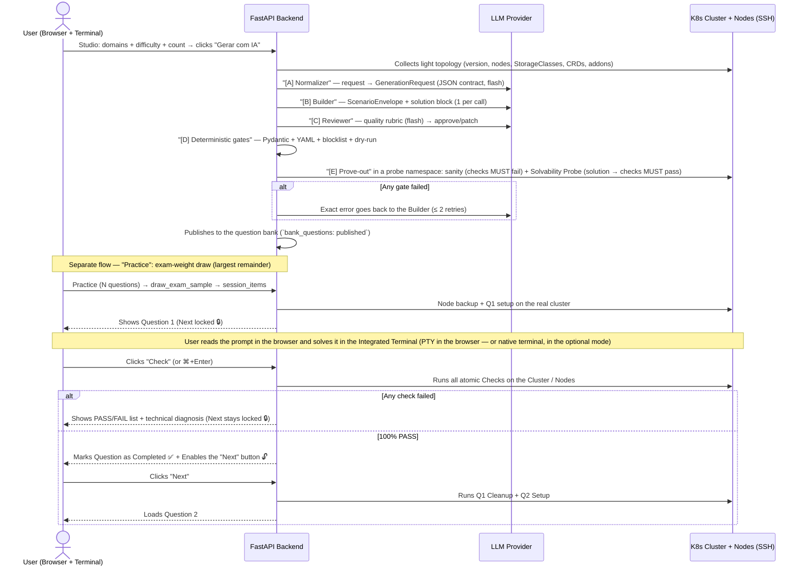
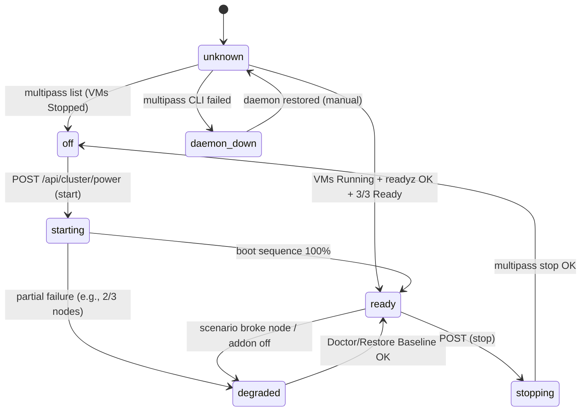

# Technical Architecture — CKA Arena

This document details the system components, the data flow between the browser, the local backend, the LLM, the Kubernetes API, and the lab nodes (Multipass VMs or kind containers), plus the data model and the safe rollback strategy.

> **Reference document** for the code on `main`. Where the text diverges from the code, the code prevails. Software versions, IP addresses and counts cited as environment evidence are examples from the reference lab — everything is discovered at runtime.

---

## 1. Architecture Overview

**CKA Arena** works as a **local orchestrator of state, validation and access**: the browser concentrates the question prompt, the Check, the AI Studio **and the terminal itself** (real host PTY rendered in xterm.js), and manages the lab lifecycle (power on/off/repair). The operating system's native terminal remains an optional mode for those who prefer dual-window.



---

## 2. Full Lifecycle Flow of a Scenario



---

## 3. Cluster Access Bridge (`ClusterBridge & SSH Runner`)

### The Real Multipass Lab Problem
Multipass provisioning (`scripts/cluster/up.sh`) creates 3 VMs (`controlplane`, `node01`, `node02`) with **two network interfaces**:
- Multipass NAT network: used internally by `multipass exec`, which presents intermittent failures (`ssh connection failed: 'Failed to connect: No route to host'`).
- **Bridged** network (IPs on your local network's subnet, assigned via DHCP): directly reachable from the host with low latency, with `PasswordAuthentication yes` + user `ubuntu` configured by cloud-init.

### Architectural Solution
1. **Dynamic IP Discovery:**
   - The backend runs `kubectl --context cka get nodes -o json` and reads `.status.addresses[type=="InternalIP"].address` from each node (`controlplane`, `node01`, `node02`).
   - Since nodes are started with `--node-ip ${PRIMARY_IP}` (Bridged IP), the `InternalIP` returned by `kubectl` is each node's Bridged network IP.
2. **Dedicated SSH Key Provisioning (`~/.cka-arena/id_ed25519`):**
   - At startup (or via the *Configure SSH Access* button in the Cluster Doctor), the platform generates an `ed25519` keypair in `~/.cka-arena/` (no passphrase) and copies the public key to the `ubuntu` user's `~/.ssh/authorized_keys` on the 3 nodes via the Bridged IP.
   - Adds an isolated block to the host's `~/.ssh/config` (IPs rewritten on every boot):
     ```sshconfig
     # >>> CKA-ARENA MANAGED START >>>
     Host cka-controlplane controlplane
       HostName <controlplane-ip>
       User ubuntu
       IdentityFile ~/.cka-arena/id_ed25519
       StrictHostKeyChecking accept-new

     Host cka-node01 node01
       HostName <node01-ip>
       User ubuntu
       IdentityFile ~/.cka-arena/id_ed25519
       StrictHostKeyChecking accept-new

     Host cka-node02 node02
       HostName <node02-ip>
       User ubuntu
       IdentityFile ~/.cka-arena/id_ed25519
       StrictHostKeyChecking accept-new
     # <<< CKA-ARENA MANAGED END <<<
     ```
   - **Double benefit:** the backend can break/inspect `kubelet`, `/etc/kubernetes/manifests` and `etcd` instantly via SSH, and you can type `ssh controlplane` or `ssh node01` directly in your terminal without needing `multipass shell`!
3. **Persistent SSH Execution (`ControlMaster`):**
   - The OpenSSH client runs with `ControlMaster=auto` + `ControlPersist=120` (socket in `~/.cka-arena/ssh-mux-*`), `ConnectTimeout=4`, and an execution timeout of `20s` (`app/config.py`), avoiding hangs when a node is intentionally stopped in a scenario.
4. **Dedicated kubeconfig (`~/.cka-arena/kubeconfig`):**
   - Copied from the controlplane's `/etc/kubernetes/admin.conf` at first provisioning (via SSH) and used by **every** backend `kubectl` with `--kubeconfig ~/.cka-arena/kubeconfig --context cka`.
   - Reason: the user's global `~/.kube/config` tends to accumulate other contexts (work, other clusters) and has a volatile `current-context` — the backend must never depend on it (nor run commands against the wrong cluster).
5. **Key bootstrap without `sshpass` + Dynamic IPs:**
   - `sshpass` does not exist on macOS; the first provisioning uses **`SSH_ASKPASS` with `SSH_ASKPASS_REQUIRE=force`** (OpenSSH ≥ 8.4) to install `~/.cka-arena/id_ed25519.pub` into the `~/.ssh/authorized_keys` of the 3 nodes (mkdir/chmod + idempotent append via `grep -qxF`), with the lab password (`ubuntu`, env `CKA_LAB_PASSWORD`). No expect: the askpass is deterministic and does not depend on matching TTY prompts.
   - Bridged IPs come from **DHCP**: with the cluster powered on, the primary source is `kubectl get nodes -o json` (`InternalIP`); with the cluster off or booting, the source is `multipass list --format json`. On every boot, the `ClusterPowerManager` **regenerates the managed block** in `~/.ssh/config` with the current IPs (§9.3).

---

## 4. Safety, Isolation and Self-Healing (`Safety & Rollback Engine`)

**Troubleshooting (30%)**-level CKA scenarios often modify Control Plane critical files (`/etc/kubernetes/manifests/kube-apiserver.yaml`, `/var/lib/kubelet/config.yaml`, `systemctl stop kubelet`). If something goes wrong during application, or the user gives up, the cluster cannot be left broken.

### 3-Layer Mechanism

1. **Global Baseline Snapshot (Bootstrap):**
   - The first time `ClusterDoctor` runs (with a healthy cluster), an immutable snapshot is taken inside each node at `/var/backups/cka-arena/baseline/`:
     - `/etc/kubernetes/manifests/*`
     - `/etc/systemd/system/kubelet.service.d/*`
     - `/var/lib/kubelet/config.yaml`
     - `/etc/containerd/config.toml`
2. **Pre-Scenario Snapshot (`backup_paths`):**
   - Every node command listed in `setup.node_commands` must declare `backup_paths` (and the parser rejects commands that modify `/etc/kubernetes`, `/var/lib/kubelet` or `/etc/systemd` without a declared `backup_paths`).
   - Before running the break command, the backend runs via SSH:
     `sudo mkdir -p /var/backups/cka-arena/<scenario_id> && sudo cp -a <path> /var/backups/cka-arena/<scenario_id>/`
3. **Destruction Guardrails (Parser-Layer Blocklist):**
   - The `ScenarioValidator` blocks **before execution** any LLM-generated manifest or command containing out-of-scope destructive patterns:
     - `rm -rf /`, `mkfs`, `dd if=`, `kubeadm reset`, global `iptables -F` without restore, deletion of the entire `kube-system`, or removal of `/etc/kubernetes/pki`.
     - Protected namespaces: `kube-system`, `kube-public`, `kube-node-lease`, `default` can never receive `kubectl delete namespace`.
   - **Label policy (single, applied by `apply_setup` to every created resource):** `cka-arena.io/managed: "true"` (global — feeds the L1 teardown sweep) **and** `cka-arena.io/scenario: "<question_id>"` (per question — enables surgical L0 cleanup); ephemeral probes use `cka-arena.io/probe: "true"` (TTL 120s) and the warm probe pod carries `cka-arena.io/warm-probe: "true"`. No other management label exists.
4. **Emergency Button ("Cluster Doctor · Restore Baseline"):**
   - If the Kubernetes API (`6443`) is down (e.g., during a broken `kube-apiserver` scenario) and the user clicks *Reset* or *Restore Cluster*, the backend uses **the provider transport directly on the node** (SSH on Multipass, which does not depend on the `kube-apiserver`; `docker exec` on kind) to restore the files from `/var/backups/cka-arena/<id>/` or `/var/backups/cka-arena/baseline/` and restart `kubelet`/`containerd`.

---

## 5. Directory Structure

```text
cka-arena/
├── setup.sh                     # Universal setup: detects the OS, audits prerequisites, provisions the lab, and starts the server
├── pyproject.toml               # Python dependencies (uv) and `cka-arena` entrypoint
├── llm_config.example.json      # Example LLM provider config (the real file lives in llm_config.json, git-ignored)
├── README.md                    # Overview and quickstart
├── ARCHITECTURE.md              # This document
├── PRODUCT.md                   # Product truth
├── DESIGN.md                    # "Orbital Control Console" design system
├── UX_UI_SPEC.md                # UX/UI specification
├── LLM_SCENARIO_SPEC.md         # JSON contract, check catalog, and prompt rules
├── LLM_PIPELINE_SPEC.md         # Generation pipeline, question bank, Check contract, and teardown
├── PLAN.md · GAP_ANALYSIS.md · IMPLEMENTATION_READINESS.md      # Historical planning records
├── SETUP_PLAN.md · IMPROVEMENT_PLAN.md · ARCHITECTURE_V3_PLAN.md # Historical audit and upgrade records
├── scripts/
│   ├── lib/                     # ui.sh, detect.sh, pkg.sh, state.sh (setup usage: `./setup.sh --help`)
│   └── cluster/                 # up.sh (Multipass) · kind-up.sh (kind)
├── scenarios/seed/              # Curated scenarios (JSON) + assets/ (Helm chart, Kustomize overlay)
├── backups/                     # Portable SQLite snapshot + manifest.json (restored on first start)
├── design/                      # Workspace mockup
├── app/
│   ├── main.py                  # FastAPI: REST + SSE routes, PTY terminal, backup, preferences
│   ├── config.py                # Paths, `CKA_*` env vars, and behavior defaults
│   ├── db.py                    # SQLite schema (WAL), idempotent migrations, and snapshot auto-restore
│   ├── models.py                # Pydantic models: ScenarioEnvelope, CheckSpec, CHECK_TYPES, DOMAINS
│   ├── cluster.py               # kubectl wrapper (always with the dedicated kubeconfig)
│   ├── commands.py              # kubectl/helm dispatcher for setup, solution, and cleanup
│   ├── scenario_engine.py       # apply_setup → smart settle → run_checks → digest → cleanup
│   ├── validator.py             # Deterministic check engine (PASS/FAIL/SKIP/ERROR)
│   ├── provider/                # base.py (interface) · multipass.py (VMs) · kind.py (containers)
│   ├── ssh_runner.py            # Dedicated SSH key, managed ssh/config block, dedicated kubeconfig
│   ├── setup_wire.py            # SSH + kubeconfig bridge for Multipass and kind labs
│   ├── power.py                 # ClusterPowerManager: states, instrumented boot, self-heal
│   ├── doctor.py                # ClusterDoctor: health, addons, file baseline
│   ├── addons.py                # Idempotent addon installation (+ CLI `python -m app.addons`)
│   ├── teardown.py              # L0/L1/L2 teardown (provider-agnostic) + drift check
│   ├── terminal.py              # TerminalService: PTY, isolated exam shell, WebSocket, command logging
│   ├── cluster_lease.py         # ClusterLease: mutual exclusion between practice, generation, reset, and power
│   ├── sessions.py              # Sessions: study, drills, mock exams, hints, post-mortem, partial credit
│   ├── bank.py                  # Bank: dedup, sampling, telemetry, and curation (+ CLI `python -m app.bank`)
│   ├── curriculum.py            # CKA curriculum: archetypes + causal incident blueprints
│   ├── planner.py               # Slot Planner: curriculum coverage and per-slot anti-duplication
│   ├── llm_client.py            # Multi-provider adapter (Anthropic, OpenAI-compatible, Ollama)
│   ├── pipeline/                # prompts.py · gates.py · prober.py · orchestrator.py (+ benchmark CLI)
│   ├── mastery.py               # Spaced repetition, readiness report, daily plan, and Speed Coach
│   ├── study/                   # Study Codex: per-domain content, models, and service (XP, quizzes, drills)
│   ├── telemetry.py             # Per-domain telemetry + pipeline health
│   ├── events.py                # In-memory SSE broker
│   ├── backup.py                # Portable snapshot (create / restore / status; no AI keys)
│   └── seed.py                  # CLI `python -m app.seed [validate [ids] [--gates-only]]`
├── static/
│   ├── index.html               # Single shell: rail, topbar, and views
│   ├── css/                     # tokens · base · layout · components · views
│   ├── js/                      # app · api · ui · icons · markdown · palette · power · workspace · terminal · studio · readiness · study · review · settings
│   └── vendor/xterm/            # xterm.js + addon-fit (vendored, no CDN)
└── tests/                       # pytest: unit and API tests (LLM and cluster stubbed)
```

---

## 6. Database Schema (`SQLite`)

Local state is persisted in `data/cka_arena.db` (`WAL` mode) to preserve your history across server or VM restarts:

| Table | Main Columns | Purpose |
| :--- | :--- | :--- |
| `sessions` | `id`, `title`, `mode` (`study` \| `mock_exam`), `variant` (`study`, `weakness_drill`, `speed_blitz`, `mistake_replay`, `guided_mock`, `blind_exam`), `strict_psi`, `difficulty_filter`, `domains_json`, `sample_json`, `status`, `started_at`, `finished_at`, `total_weight`, `earned_weight`, `earned_weight_exact`, `time_limit_minutes` | Practice session **drawn from the bank** (`sample_json` stores the effective per-domain distribution). |
| `bank_questions` | `id`, `envelope_json`, `envelope_hash`, `title`, `domain`, `subtopics_json`, `difficulty`, `weight_pct`, `estimated_minutes`, `source` (`llm`\|`seed`), `state` (`draft`\|`probed`\|`published`\|`retired`), `archetype_id`, `fingerprint`, `probe_result_json`, `quality_score`, `quality_report_json`, `times_used`, `last_used_at`, `first_try_pass_count`, `avg_solve_seconds`, `generator_meta_json`, `supersedes_question_id`, `retired_reason`, `created_at` | **Question bank**: envelope immutable once published (a fix = a new version), dedup by semantic `envelope_hash`, per-question quality metrics (`LLM_PIPELINE_SPEC.md` §3). |
| `session_items` | `id`, `session_id`, `bank_question_id`, `order_index`, `state` (`pending`\|`active`\|`passed`\|`skipped`), `started_at`, `passed_at`, `attempts`, `flagged`, `mounted_at`, `earned_weight`, `check_pass_ratio`, `notes_text`, `checked_tasks_json`, `hints_used`, `context_name`, `active_seconds`, `last_check_json` | Session queue referencing the bank. `Next` unlocked when `state == 'passed'` (or `skipped` after giving up); stores notepad, checklist, flags, and per-item partial credit. |
| `generation_requests` | `id`, `request_json`, `status`, `scenarios_attempted`, `scenarios_published`, `created_at` | Pipeline audit: what was requested × what survived gates A–E. |
| `check_runs` | `id`, `session_item_id`, `ran_at`, `all_passed`, `duration_ms`, `results_json` | Each **Check** click with per-item status (`PASS`/`FAIL`/`SKIP`/`ERROR` — contract in `LLM_PIPELINE_SPEC.md` §5). |
| `llm_generations` | `id`, `created_at`, `stage`, `job_id`, `provider`, `model`, `prompt_params_json`, `attempts_used`, `raw_response`, `status`, `error_message`, `duration_ms`, `prompt_tokens`, `completion_tokens`, `reasoning_tokens` | Per-stage pipeline audit (enables diagnosing prompts that generated invalid YAML and measuring cost/latency). Excluded from portable snapshots. |
| `terminal_sessions` | `id`, `tab_id`, `preset` (`host` \| `node`), `node_name`, `session_item_id` (nullable), `created_at`, `last_activity`, `closed_at`, `exit_status` | Reserved: not populated today — terminal tab records live in memory in the `TerminalRegistry` and do not survive a backend restart. |
| `command_audit` | `id`, `session_id`, `session_item_id`, `command_text`, `ran_at` | Commands typed in local shell tabs during a session (always-on logging, with secret filtering) — input for Post-Mortem / Speed Coach (§8.4). Local only; excluded from portable snapshots. |
| `archetype_mastery` | `archetype_id`, `domain`, `attempts`, `passes`, `first_try_passes`, `ewma_solve_ratio`, `mastery_score`, `last_practiced_at`, `next_review_at`, `interval_days` | Spaced repetition (SM-2) per archetype; feeds the Skill Tree and the readiness report (`app/mastery.py`). |
| `study_progress` | `topic_id`, `theory_done`, `practice_done`, `cheatsheet_done`, `quiz_passed`, `quiz_attempts`, `xp_earned`, `completed_at`, `updated_at` | Study Codex progress per topic. |
| `study_activity` | `day`, `xp_gained`, `actions_count`, `topics_completed`, `updated_at` | Daily study activity (streak / heatmap). |
| `question_feedback` | `id`, `bank_question_id`, `archetype_id`, `reason_code`, `note`, `created_at` | User feedback on a question; feeds back into the Slot Planner and the Reviewer. |
| `user_settings` | `key`, `value_json`, `updated_at` | Preferences (`/api/settings/preferences`): exam target date, strict PSI profile by default, destructive practice. |

---

## 7. Cluster Add-ons (installed on 2026-11-17)

Current state after installation/validation:

- **metrics-server** (patch `--kubelet-insecure-tls`) — working `kubectl top`.
- **Gateway API 1.2 (CRDs) + Envoy Gateway v1.2.0** (Helm OCI; GatewayClass `eg` + data plane validated with HTTP 200 via ClusterIP).
- **local-path-provisioner v0.0.30** — StorageClass `local-path` (WaitForFirstConsumer).
- **NetworkPolicy enforcement** — `weave-npc` runs as a container of the `weave-net` DaemonSet (per-container detection in the doctor).
- **helm/etcdctl** on host/controlplane; the L2 clean reset preserves addons (no VM snapshots: not supported on the Multipass/macOS backend).

Recommendation history (kept as a coverage reference):

The current cluster has `CoreDNS`, `Weave Net`, and the standard control plane components. So the LLM can generate real scenarios for every topic in the new CKA curriculum, the `ClusterDoctor` will verify and offer 1-click installation of:

1. **`metrics-server`** (needed for `kubectl top nodes/pods` and `HPA` questions in Troubleshooting/Workloads; reference scripts already exist in `certified-kubernetes-administrator-course/metrics-staging-scripts/`).
2. **`helm` CLI on the Mac** (check via `which helm`; install with `brew install helm` if missing).
3. **Gateway API CRDs (`v1.2+`) + an `arm64`-compatible lightweight controller** (e.g., NGINX Gateway Fabric or Envoy Gateway) for real `GatewayClass`, `Gateway`, and `HTTPRoute` scenarios.
4. **Local storage provisioner (Rancher's `local-path-provisioner`)** to enable scenarios with dynamic `StorageClass` (`WaitForFirstConsumer`), plus static PVs (`hostPath`/`local`).
5. **`etcdctl` on the `controlplane` node** (check presence for `etcd` snapshot save/restore scenarios without needing to download during practice).
6. **`weave-npc` (NetworkPolicy enforcement):** without the `weave-npc-*` pods, `NetworkPolicy` scenarios always pass (policy is not enforced). The `ClusterDoctor` reports the addon `network_policy_enforcement: on/off` and the scenario generator only proposes NetworkPolicy when `on`.

---

## 8. Web Terminal in the Browser (`TerminalService`)

> User requirement: run scenario commands **in the browser itself** and request validation (Check) without leaving the platform. Complete component specification.

### 8.1 Design Decision: In-process PTY on the host

| Alternative | Verdict | Reason |
| :--- | :--- | :--- |
| **In-process PTY (`pty.openpty`) + WebSocket + xterm.js** | ✅ **Chosen** | Zero external dependencies (FastAPI/uvicorn already do WS; `pty`/`fcntl` are stdlib); enables telemetry audit, lifecycle control, preset tabs, and reconnection. Runs on the host where `kubectl`, `helm`, and the managed `~/.ssh/config` live. |
| `ttyd` / `gotty` (external binary) | ❌ | Not installed (verified); separate process with no session control, no audit, no integration with node tabs. |
| `tmux` attach | ❌ | Not installed on the host (verified); unnecessary — backend PTY registration already gives persistence across reloads. |
| Browser SSH directly to nodes (asyncssh→WS) | ❌ as the base | The user needs the **host** shell (kubectl/helm/vim); node tabs use the provider transport (`ssh cka-<node>` on Multipass, `docker exec` on kind) inside the same PTY. |

### 8.2 How It Works

1. **Tab creation (lazy spawn):** `POST /api/terminal/tabs` with `{preset: "host"}` or `{preset: "node", node: "node01"}` registers the tab; the shell is only born when the **first xterm connects** to the WebSocket — so the prompt (e.g., powerlevel10k) already finds the terminal ready to answer capability queries.
   - `host` → spawns an **isolated exam shell** on a PTY (`pty.openpty()` + `os.fork` + `setsid`): uses the user's `$SHELL` when it is an executable path (fallback `zsh` on macOS, `bash` on Linux/WSL2), **without loading personal rcfiles** — `ZDOTDIR` (zsh) or `--rcfile` (bash) point to the tab's scratch, where clean `.zshrc`/`.bashrc`, `.cka_env.sh` (`alias k=kubectl`, `$do="--dry-run=client -o yaml"`, `$now="--force --grace-period=0"`, completion) and `.vimrc` are generated. With `strict_psi`, the profile is slimmed down to `set nocompatible` and a strict `.cka_env.sh`.
   - **Isolated PTY environment:** `terminal_env()` removes `EDITOR`/`VISUAL`/`KUBE_EDITOR`/`GIT_EDITOR` inherited from the server, fixes `TERM=xterm-256color`, **overwrites `KUBECONFIG`** to the dedicated kubeconfig (`~/.cka-arena/kubeconfig` — never the user's global config) and, for `host` tabs, points `CKA_ARENA_WORKDIR`, `TMPDIR`, `VIMINIT`, `CKA_EXAM_PROFILE`, and `CKA_ASSETS` to the tab's scratch.
   - `node` → the provider decides the transport: Multipass spawns `ssh cka-<node>` (uses the managed block in `~/.ssh/config`; falls back to a password prompt only if the bridge has not been provisioned yet — the Cluster Doctor guides it); kind runs `docker exec -it <container> bash`.
   - **Per-tab scratch workdir:** every `host` tab is born in `~/.cka-arena/scratch/<tab_id>` (`cwd` + `TMPDIR`) — YAMLs and temporaries created in the terminal land there, never in the project folder. The workdir is deleted on tab `close()` (explicit close, idle-timeout, or prune) with **path guarding** (`remove_scratch` refuses any path outside `SCRATCH_ROOT`); `sweep_scratch()` on server startup removes orphaned workdirs from crashes. Registers `{tab_id, master_fd, pid, preset, workdir, created_at}` in the `TerminalRegistry`.
2. **WebSocket:** `WS /ws/terminal/{tab_id}` — client messages: `{"type":"input","data":"..."}` and `{"type":"resize","cols":N,"rows":N}` (applied via `fcntl.ioctl(master_fd, TIOCSWINSZ, ...)`); from the server: PTY output frames (plain text) and `{"type":"exit","status":N}`.
   - **A single subscriber per PTY:** if the tab already has a connected WebSocket, a second attach receives `4409` (avoids two xterms answering the same prompt queries). Reload only reuses tabs without subscribers.
   - **Sanitized replay:** the replay buffer strips sequences that **request terminal responses** (OSC `4;?`/`10;?`/`11;?`/`12;?`, DA, DSR, DECRQM `$p/$y`, CPR, window-ops, DCS) and color responses (`rgb:...`) — without this, prompts like powerlevel10k re-queried the terminal on every reconnection, generating response loops (`rgb:...`/`$y` in the prompt). SGR/colors, OSC titles, and cursor movements are preserved.
3. **Output streaming:** one asyncio reader per PTY (`loop.add_reader` on the master fd, or a dedicated thread → asyncio queue) publishes bytes to all WebSockets attached to the tab and maintains a **replay ring buffer** (last 256 KB per tab).
4. **Reconnection:** browser reload or network drop → client calls `GET /api/terminal/tabs`, reattaches to the live PTY, and receives the ring buffer replay. Backend restart ends the sessions (documented behavior, signaled in the UI as "terminal restarted").
5. **Limits:** max. 6 active tabs; idle timeout (30 min without input or WS) with a 60s warning; close = `SIGHUP` to the process group.
6. **Correlation with the active scenario:** commands typed in `host` tabs are drained into `command_audit` linked to the session's active item (§8.4).

### 8.3 Frontend (`static/js/terminal.js` + `static/vendor/xterm`)

- `xterm.js` + `addon-fit` **vendored** (no CDN — works offline, like the rest of the platform).
- Tab bar: active tabs + **`+ Shell`** popover with the 4 destinations (Local shell/controlplane/node01/node02) — one control instead of a row of buttons; the active tab focuses the terminal.
- The panel footer shows the **isolated workdir** (`scratch/<tab>`), `Find`, `Zen`, `Native`, `Clear`, and a **Check** button (same action as the question column's Check) — the *edit → verify → fix* loop happens without switching panels.
- Prompt Copy-Pills, when clicked, copy to the clipboard **and** focus the terminal (`⌘V` on macOS, `Ctrl+Shift+V` on Linux/WSL2); behavior identical to the real exam.
- Global shortcuts (`⌘` on macOS; `Ctrl` on Linux/WSL2, `Ctrl+Shift` with the terminal focused): `⌘↵` (Check), `⌘⇧↵` (Next), `⌘K` (Command Palette), `⌘1..5` (Arena/Readiness/Studio/Settings/Study Codex), `⌘B` (Zen Terminal), `⌘F` (scrollback search), `⌘L` (clears the terminal), `⌘` + backslash (shows/hides the embedded terminal), `⌘/` (shortcuts), `Esc` (closes modal/search). Full contract in `UX_UI_SPEC.md` §6 and `DESIGN.md` §4.

### 8.4 Local Command Log (Telemetry)

- **Always on, local only.** In `host` tabs, the exam shell records every command (`preexec` hook on zsh, `PROMPT_COMMAND` on bash) into `.cmd_history.log` inside the tab's scratch.
- On session transitions (Check, Skip, Next, question switch, Finish), `TerminalRegistry.collect_command_history()` drains that log into the `command_audit` table, linked to the active item. Lines matching the secret pattern (`token`, `password`, `api key`, `secret`, `sk-…`, `export *KEY`) are discarded before storing (400-character limit per line).
- Usage: the **Post-Mortem / Speed Coach** (`GET /api/sessions/{id}/postmortem/{item}`) analyzes the approach (use of `k`, `$do`, `$now`, fast imperative commands) and the question's pacing.
- Privacy: stays in local SQLite; `.cmd_history.log` is deleted together with the tab's scratch; the table is excluded from portable snapshots (`app/backup.py`) and the generation pipeline never reads it — the LLM does **not** receive the command history, and grading remains 100% deterministic by state.

## 9. Cluster Lifecycle (`ClusterPowerManager`)

> User requirement: the cluster starts together with the app, with an **on-screen button to power the cluster on and start scenarios**.

### 9.0 Node provider (Multipass × kind)

The platform speaks only **logical names** (`controlplane/node01/node02`); `app/provider/`
translates to the environment: `MultipassProvider` (SSH by bridge IP, `multipass start/stop`,
terminal `ssh cka-<node>`) and `KindProvider` (kind containers, `docker exec`, terminal
`docker exec -it <ctr> bash`, `docker start/stop`, mapping in `~/.cka-arena/nodes.json`).
Selection: `CKA_PROVIDER` → `~/.cka-arena/provider` → per-OS default. Every node execution
(engine, pipeline, validator, doctor, power, terminal) goes through `provider.get()` — no
module calls SSH/Multipass directly. `setup.sh` (repo root, see `SETUP_PLAN.md`)
detects the OS, audits prerequisites with confirmation, provisions (`scripts/cluster/up.sh`
or `kind-up.sh`), installs addons (`app/addons.py`), publishes the seeds, and starts the server.

### 9.1 State Machine



- State sources: `multipass list --format json` (per VM: `Running/Stopped` + IPs), `kubectl --context cka get --raw /readyz`, `kubectl get nodes` (Ready condition).
- State is re-evaluated on app launch, when opening the home view, and every 15s while UI is connected (SSE `cluster.power.state_changed`).

### 9.2 Instrumented Boot Sequence (`action: start` → async job + SSE)

| Step | Command/Criterion | Timeout |
| :--- | :--- | :--- |
1. Power VMs on | `multipass start controlplane node01 node02` | 300s |
2. SSH available | `nc -z <ip> 22` on the 3 nodes (IPs from `multipass list`) | 240s |
3. SSH config regen | Rewrite the managed `~/.ssh/config` block with current IPs | 5s |
4. API up | `kubectl --kubeconfig ~/.cka-arena/kubeconfig --context cka get --raw /readyz` (with self-heal §9.3) | 180s |
5. Nodes ready | `kubectl wait --for=condition=Ready node --all` | 300s |
6. Quick doctor | addons (metrics-server, weave-npc, Gateway API, local-path), `helm`/`etcdctl` on nodes | 30s |
7. Baseline | File baseline on nodes (manifests/kubelet/containerd/systemd) if it does not exist yet (§4) | 60s |

- Each step emits `cluster.power.progress {step, detail}` via SSE; the UI shows the overlay "Powering on cluster… step 4/7".
- Failure at any step → `degraded` state (or `off`/`daemon_down`) with the exact error and a fix suggestion.

### 9.3 Post-DHCP Self-Heal (IP changed after VM reboot)

1. `readyz` failed but SSH answers → downloads `/etc/kubernetes/admin.conf` from the controlplane via SSH.
2. Rewrites `server: https://<current-ip>:6443` and writes it to `~/.cka-arena/kubeconfig`.
3. Revalidates `readyz`. If it still fails, reports `degraded` with a diagnosis (e.g., controlplane kubelet stopped → follows the Doctor flow).
4. The managed `~/.ssh/config` is regenerated at boot step 3 **always** (idempotent).

### 9.4 Shutdown, Restart, and App Boot

- `stop`: UI asks for confirmation ("active scenario will be discarded; VMs will be stopped") → `multipass stop controlplane node01 node02` → `off`. No kubectl cleanup (the cluster vanishes with the VMs; scenario namespaces are ephemeral by design).
- `restart` = `stop` + `start` (useful when a Boss Fight left everything broken and the user wants a bloodless reset).
- **App launch:** `GET /api/cluster/power` on boot; if `off`, the home shows a single CTA **"⏻ Power On & Practice"** (Studio and Workspace stay locked with explanatory pills). `auto_start_on_launch: true` triggers the start automatically when opening the app — **default ON** (decision D3).
   - `daemon_down`: the provider listing failed (e.g., Multipass daemon down) → its own state with the raw error; the platform **never runs sudo** — restarting the daemon is manual (`sudo launchctl kickstart -k system/com.canonical.multipass` on macOS, `snap restart multipass` on Linux).

### 9.5 API

| Endpoint | Method | Response |
| :--- | :--- | :--- |
| `/api/cluster/power` | GET | `{state, vms: [{name, multipass_state, ips}], last_ready_at, active_job?}` |
| `/api/cluster/power` | POST | `{action: "start"\|"stop"\|"restart"}` → `202 {job_id, action}` (one job at a time; `409` if one exists) |
| `/api/events` | SSE | `cluster.power.state_changed`, `cluster.power.progress`, `cluster.reset.done`, `generation.progress` / `heartbeat` / `snapshot` / `done` (Studio) |

## 10. Terminal Security & Network Exposure

1. **Fixed bind on `127.0.0.1`** (`config.HOST`; only the port is configurable, via `CKA_PORT`). The terminal is a host shell: exposing it is RCE by design.
2. **WebSocket origin check:** `/ws/terminal/{tab_id}` refuses (closes with `4403`) connections whose `Origin` header is not the app's own (`http://127.0.0.1:<port>` or `http://localhost:<port>`), unless `CKA_ARENA_ALLOW_REMOTE=1`. Connections without `Origin` (non-browser clients) pass.
3. **Optional token `CKA_ARENA_TOKEN`:** when set, the `/api/*` routes (except `/api/events`) require `Authorization: Bearer <token>`. The token does **not cover** `/ws/terminal/*`, `/` and `/static`, and the embedded UI does not send it — it serves local API clients, not exposing the platform.
4. **Local single-user:** no auth by default. The real protection is the loopback bind: **do not put a proxy/tunnel in front of the port** — whoever reaches the port reaches a shell on your machine.
5. **Dedicated kubeconfig:** every backend and exam shell `kubectl` uses `~/.cka-arena/kubeconfig` (context `cka`), never the global `~/.kube/config`.
6. **Command logging is local-only** (§8.4); the LLM never sees the command history.

---

## 11. Question Bank & Exam-Weight Sampling

**Model:** generation **publishes** to the bank (`bank_questions.state = published`); practice **consumes** with a weighted draw — full decoupling between producing and practicing (`LLM_PIPELINE_SPEC.md` §3–§4).

- **Sampling:** largest remainder over the official weights (Troubleshooting 30 · Cluster Arch 25 · S&N 20 · Workloads 15 · Storage 10), renormalized when the user filters domains/difficulty; within a cell, ordered by `times_used ASC, random()`; the same question never repeats in a session; empty cell → proportional fallback + CTA "Generate more from this domain".
- **API:** `GET /api/bank/coverage` (domain×difficulty grid for the Studio) · `POST /api/practice` `{count, domains?, difficulty?, mode?, variant?, archetype_id?, allow_destructive?, strict_psi?}` (requires cluster `ready`, creates `sessions`+`session_items`, applies Q1) · `POST /api/bank/questions/{id}/retire`.
- **UI preview:** before starting, the modal shows the exact distribution ("5× Troubleshooting · 4× Cluster Architecture · …").

## 12. Session Teardown & Clean Cluster Reset (L0/L1/L2)

> Requirement: at the end of a practice session, the cluster returns **clean**. Three levels (`LLM_PIPELINE_SPEC.md` §6):

| Level | Trigger | Action | Duration |
| :--- | :--- | :--- | :--- |
| **L0** | `Next`/`Skip` (per question) | question cleanup: scenario namespaces, labeled resources, restored node backups, Helm releases, probes | 2–10s |
| **L1** | session end (default) | global sweep by label `cka-arena.io/managed: "true"` + pending backup restoration + **drift check** vs baseline | ~30s |
| **L2 — clean reset** | after `mock_exam` (auto), detected drift, or the "Clean reset" button | L1 + restore of the nodes' file baseline + `restart containerd/kubelet` + wait Ready + drift check (addons preserved; no VM snapshots — unsupported on Multipass/macOS) | ~1–2 min |

- **L2 = clean reset (no VM snapshots):** the Multipass backend on macOS (QEMU) answers `The snapshots feature is not implemented on this backend` — `multipass snapshot/restore` exist in the CLI but do not work here (verified live). The clean reset does: L1 (managed resources + pending backups) → restore of the nodes' **file baseline** (`/var/backups/cka-arena/baseline/`) → `systemctl restart containerd kubelet` on the 3 nodes → wait API/nodes Ready → drift check. Addons in unmanaged namespaces (`kube-system`, `envoy-gateway-system`, `local-path-storage`) remain installed. Verified live: `drift=false`, 3/3 Ready, addons present.
- **API:** `POST /api/sessions/{id}/finish` `{reset: "fast"\|"baseline"}` (L2 is forced when the session contains destructive questions) · `POST /api/cluster/reset-baseline` (drift result in the SSE event `cluster.reset.done`).
- **UI:** end-of-session screen with a summary (first-attempt passes, time, worst domain) + L1/L2 choice (default L1; L2 recommended with drift or after a mock exam).

---

## 13. API Reference (consolidated)

| Endpoint | Method | Payload → Response |
| :--- | :--- | :--- |
| **Cluster** | | |
| `/api/health` | GET | → `{ok, app, version, build}` (liveness probe) |
| `/api/cluster/power` | GET | → `{state, vms[], last_ready_at, active_job?, detail?}` |
| `/api/cluster/power` | POST | `{action: start\|stop\|restart}` → `202 {job_id, action}` (409 if another job/session is active) |
| `/api/cluster/health` | GET | → nodes (Ready, IP, SSH), `kubectl_ok`, addons, `baseline_files`, `bootstrap_plan` |
| `/api/cluster/setup-ssh` | POST | `{password?}` → bootstrap: key + ssh-config + dedicated kubeconfig |
| `/api/cluster/sync-profile` | POST | → syncs the exam profile to the nodes (`{ok, nodes}`) |
| `/api/cluster/install-addons` | POST | → `{ok, results}` (metrics-server, Gateway API, local-path, etcdutl) |
| `/api/cluster/reset-baseline` | POST | → `{started, mode}`; result in the SSE `cluster.reset.done {ok, level, drift, nodes_ready}` (409 if busy) |
| **Backup** | | |
| `/api/backup/status` | GET | → portable snapshot status |
| `/api/backup/create` | POST | → creates `backups/cka_arena_backup.db` + `manifest.json` |
| **Generation (Studio)** | | |
| `/api/generate` | POST | `{domains[], subtopics?, difficulty, count (1–15), focus_hint?, target_archetype_id?, target_archetypes?}` → `202 {job_id, generation_request_id}` (cluster `ready` required; 409 if busy) |
| `/api/generate/cancel` | POST | → `{cancelled}` |
| `/api/generate/fill-gaps` | POST | `?max_count=` → `202` (prioritizes empty cells of the domain×difficulty grid) |
| `/api/generate/fill-archetypes` | POST | `?max_count=` → `202` (archetypes still without a question) |
| `/api/generate/archetype/{archetype_id}` | POST | `?difficulty=` → `202` |
| `/api/generate/status` | GET | → snapshot of the current/last job (recovery on reload) |
| **Readiness and telemetry** | | |
| `/api/readiness` | GET | → Go/No-Go verdict (4 criteria + score) and Skill Tree |
| `/api/study-plan/today` | GET | → daily study plan |
| `/api/telemetry` | GET | → per-domain telemetry + pipeline health |
| **Question bank** | | |
| `/api/bank/coverage` | GET | → domain×difficulty grid |
| `/api/bank/preview` | GET | `?count=&domains=&difficulty=&mode=&variant=&archetype_id=` → largest-remainder allocation + fallbacks |
| `/api/bank/questions` | GET | `?state=&domain=&difficulty=&source=&q=&limit=&offset=` → list with filters |
| `/api/bank/questions/{id}` | GET | → envelope + probe result + metadata |
| `/api/bank/questions/{id}/reprobe` · `/repair` · `/polish` | POST | → revalidates on the cluster · repairs with AI · rewrites the question prompt |
| `/api/bank/questions/{id}/feedback` | POST | `{reason_code, note}` → feedback that feeds back the planner and reviewer |
| `/api/bank/questions/{id}/retire` | POST | `{reason, reason_code}` → leaves the sampling pool |
| `/api/bank/questions/{id}` | DELETE | → deletes the question |
| `/api/bank/audit` | POST | `{apply}` → audits (and optionally retires) legacy questions |
| **Study Codex** | | |
| `/api/study/overview` | GET | → progress, XP, rank, and streak |
| `/api/study/topics/{topic_id}` | GET | → topic theory, playbook, cheatsheet, and quiz |
| `/api/study/topics/{topic_id}/stage` | POST | `{stage: theory\|practice\|cheatsheet, done}` |
| `/api/study/topics/{topic_id}/quiz` | POST | `{choice_index, question_index}` |
| `/api/study/drill` | GET | `?domain=&limit=` → drill deck |
| **Sessions** | | |
| `/api/practice` | POST | `{count, domains?, difficulty?, mode?, variant?, archetype_id?, allow_destructive?, strict_psi?}` → `201` (draw + applies Q1; 409 if busy) |
| `/api/sessions/active` · `/api/sessions/{id}` | GET | → current session (active item, envelope, counters) |
| `/api/sessions/history` | GET | `?limit=` → finished sessions |
| `/api/sessions/{id}/review` | GET | → session review, question by question |
| `/api/sessions/{id}/check` · `/next` · `/prev` · `/skip` · `/reset` | POST | Practice loop (contract in `LLM_PIPELINE_SPEC.md` §5) |
| `/api/sessions/{id}/select/{item_id}` · `/flag/{item_id}` | POST | Free navigation and *flag for review* (mock exams) |
| `/api/sessions/{id}/hint` | POST | `{level: 1..3}` → progressive hint |
| `/api/sessions/{id}/postmortem/{item_id}` | GET | → approach and pacing analysis |
| `/api/sessions/{id}/items/{item_id}/state` | PUT | `{notes_text?, checked_tasks?}` → notepad and checklist |
| `/api/sessions/{id}/retire` | POST | `{reason, reason_code}` → retires the active question |
| `/api/sessions/{id}/finish` | POST | `{reset: fast\|baseline}` → summary + L1/L2 cleanup |
| **Preferences** | | |
| `/api/settings/preferences` | GET/PUT | `{exam_target_date?, strict_psi_default?, allow_destructive_practice?}` |
| **Terminal** | | |
| `/api/terminal/tabs` | POST | `{preset: host\|node, node?, strict_psi?}` → `201 {tab_id}` |
| `/api/terminal/tabs` | GET | → list of live PTYs (reconnect) |
| `/api/terminal/tabs/{tab_id}` | DELETE | → closes the tab and the PTY |
| `/ws/terminal/{tab_id}` | WS | in: `{type: input\|resize, …}` · out: PTY frames + `{type: exit}` |
| **LLM** | | |
| `/api/llm/config` | GET/PUT | Provider config editable in the UI (key **masked**, never returned raw) |
| `/api/llm/status` | GET | → active provider/model |
| `/api/llm/test` | POST | `{...config?}` → real ping with latency |
| **Events** | | |
| `/api/events` | SSE | `cluster.power.state_changed`, `cluster.power.progress`, `cluster.reset.done`, `generation.progress` (A–E/publish), `generation.heartbeat`, `generation.snapshot`, `generation.done` |

- Cross-cutting rules: everything JSON; errors follow `{error: {code, message, detail?}}`; operations that contend for the cluster (practice, generation, reset, power) go through the `ClusterLease` and return `409` when busy; `CKA_ARENA_TOKEN`, when set, protects `/api/*` (except `/api/events`) — see §10.
- Check/Next endpoints of the active session (`POST /api/sessions/{id}/check`, `/next`, `/skip`, `/reset`) follow the loop in `UX_UI_SPEC.md` §3 and the grading contract in `LLM_PIPELINE_SPEC.md` §5.
