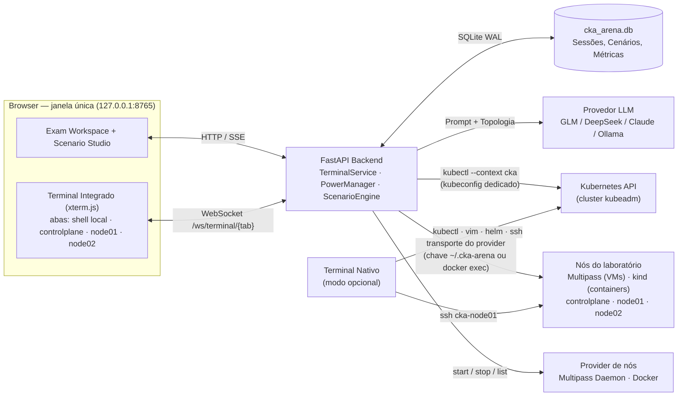
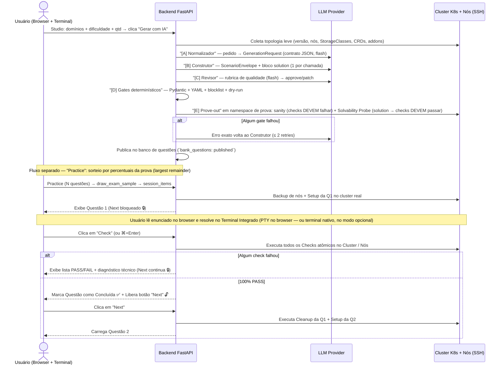
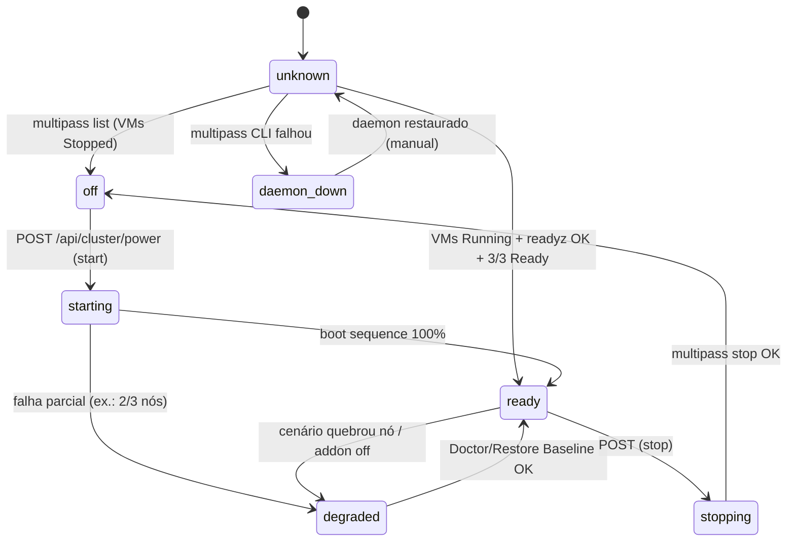

# Arquitetura Técnica — CKA Arena

Este documento detalha os componentes do sistema, o fluxo de dados entre o navegador, o backend local, a LLM, a API do Kubernetes e os nós do laboratório (VMs Multipass ou containers kind), além do modelo de dados e da estratégia de rollback seguro.

> **Documento de referência** do código na `main`. Onde o texto divergir do código, o código prevalece. Versões de software, endereços IP e contagens citados como evidência de ambiente são exemplos do laboratório de referência — tudo é descoberto em runtime.

---

## 1. Visão Geral da Arquitetura

O **CKA Arena** funciona como um **orquestrador local de estado, validação e acesso**: o navegador concentra o enunciado, o Check, o Estúdio IA **e o próprio terminal** (PTY real do host renderizado em xterm.js), além de gerenciar o ciclo de vida do laboratório (ligar/desligar/reparar). O terminal nativo do sistema operacional permanece como modo opcional para quem prefere dual-window.



---

## 2. Fluxo Completo do Ciclo de Vida de um Cenário



---

## 3. Ponte de Acesso ao Cluster (`ClusterBridge & SSH Runner`)

### Problema Real do Laboratório Multipass
O provisionamento Multipass (`scripts/cluster/up.sh`) cria 3 VMs (`controlplane`, `node01`, `node02`) com **duas interfaces de rede**:
- Rede NAT do Multipass: usada internamente por `multipass exec`, que apresenta falhas intermitentes (`ssh connection failed: 'Failed to connect: No route to host'`).
- Rede **Bridged** (IPs na subnet da sua rede local, atribuídos por DHCP): acessível diretamente pelo host com baixa latência, com `PasswordAuthentication yes` + usuário `ubuntu` configurados pelo cloud-init.

### Solução Arquitetural
1. **Descoberta Dinâmica de IPs:**
   - O backend executa `kubectl --context cka get nodes -o json` e lê `.status.addresses[type=="InternalIP"].address` de cada nó (`controlplane`, `node01`, `node02`).
   - Como os nós são iniciados com `--node-ip ${PRIMARY_IP}` (IP Bridged), o `InternalIP` retornado pelo `kubectl` é o IP da rede Bridged de cada nó.
2. **Provisionamento de Chave SSH Dedicada (`~/.cka-arena/id_ed25519`):**
   - Na inicialização (ou via botão *Configurar Acesso SSH* no Cluster Doctor), a plataforma gera um par `ed25519` em `~/.cka-arena/` (sem passphrase) e copia a chave pública para `~/.ssh/authorized_keys` do usuário `ubuntu` nos 3 nós via IP Bridged.
   - Adiciona um bloco isolado no `~/.ssh/config` do host (IPs reescritos a cada boot):
     ```sshconfig
     # >>> CKA-ARENA MANAGED START >>>
     Host cka-controlplane controlplane
       HostName <ip-do-controlplane>
       User ubuntu
       IdentityFile ~/.cka-arena/id_ed25519
       StrictHostKeyChecking accept-new

     Host cka-node01 node01
       HostName <ip-do-node01>
       User ubuntu
       IdentityFile ~/.cka-arena/id_ed25519
       StrictHostKeyChecking accept-new

     Host cka-node02 node02
       HostName <ip-do-node02>
       User ubuntu
       IdentityFile ~/.cka-arena/id_ed25519
       StrictHostKeyChecking accept-new
     # <<< CKA-ARENA MANAGED END <<<
     ```
   - **Benefício duplo:** o backend consegue quebrar/inspecionar `kubelet`, `/etc/kubernetes/manifests` e `etcd` instantaneamente via SSH, e você pode digitar `ssh controlplane` ou `ssh node01` direto no seu terminal sem precisar de `multipass shell`!
3. **Execução SSH Persistente (`ControlMaster`):**
   - O cliente OpenSSH roda com `ControlMaster=auto` + `ControlPersist=120` (socket em `~/.cka-arena/ssh-mux-*`), `ConnectTimeout=4` e timeout de execução de `20s` (`app/config.py`), evitando travamentos caso um nó seja propositalmente parado em um cenário.
4. **Kubeconfig dedicado (`~/.cka-arena/kubeconfig`):**
   - Copiado do `/etc/kubernetes/admin.conf` do controlplane no primeiro provisionamento (via SSH) e usado por **todo** `kubectl` do backend com `--kubeconfig ~/.cka-arena/kubeconfig --context cka`.
   - Motivo: o `~/.kube/config` global do usuário costuma acumular outros contextos (trabalho, outros clusters) e tem um `current-context` volátil — o backend nunca deve depender dele (nem executar comandos contra o cluster errado).
5. **Bootstrap da chave sem `sshpass` + IPs Dinâmicos:**
   - `sshpass` não existe no macOS; o primeiro provisionamento usa **`SSH_ASKPASS` com `SSH_ASKPASS_REQUIRE=force`** (OpenSSH ≥ 8.4) para instalar `~/.cka-arena/id_ed25519.pub` em `~/.ssh/authorized_keys` dos 3 nós (mkdir/chmod + append idempotente via `grep -qxF`), com a senha do lab (`ubuntu`, env `CKA_LAB_PASSWORD`). Sem expect: o askpass é determinístico e não depende de casar prompts de TTY.
   - Os IPs Bridged vêm de **DHCP**: com o cluster ligado, a fonte primária é `kubectl get nodes -o json` (`InternalIP`); com o cluster desligado ou bootando, a fonte é `multipass list --format json`. A cada boot, o `ClusterPowerManager` **regenera o bloco gerenciado** do `~/.ssh/config` com os IPs atuais (§9.3).

---

## 4. Segurança, Isolamento e Auto-Cura (`Safety & Rollback Engine`)

Cenários de CKA de nível **Troubleshooting (30%)** frequentemente modificam arquivos críticos do Control Plane (`/etc/kubernetes/manifests/kube-apiserver.yaml`, `/var/lib/kubelet/config.yaml`, `systemctl stop kubelet`). Se algo der errado na aplicação ou se o usuário quiser desistir, o cluster não pode ficar quebrado.

### Mecanismo em 3 Camadas

1. **Snapshot Baseline Global (Bootstrap):**
   - Ao rodar o `ClusterDoctor` pela primeira vez (com o cluster saudável), é tirado um snapshot imutável dentro de cada nó em `/var/backups/cka-arena/baseline/`:
     - `/etc/kubernetes/manifests/*`
     - `/etc/systemd/system/kubelet.service.d/*`
     - `/var/lib/kubelet/config.yaml`
     - `/etc/containerd/config.toml`
2. **Snapshot Pré-Cenário (`backup_paths`):**
   - Todo comando de nó listado em `setup.node_commands` deve declarar `backup_paths` (e o parser rejeita comandos que alterem `/etc/kubernetes`, `/var/lib/kubelet` ou `/etc/systemd` sem `backup_paths` declarado).
   - Antes de executar o comando de quebra, o backend executa via SSH:
     `sudo mkdir -p /var/backups/cka-arena/<scenario_id> && sudo cp -a <path> /var/backups/cka-arena/<scenario_id>/`
3. **Guardrails de Destruição (Blocklist na Camada de Parser):**
   - O `ScenarioValidator` bloqueia **antes da execução** qualquer manifesto ou comando gerado pela LLM que contenha padrões destrutivos fora de escopo:
     - `rm -rf /`, `mkfs`, `dd if=`, `kubeadm reset`, `iptables -F` global sem restauração, deleção de `kube-system` inteiro ou remoção de `/etc/kubernetes/pki`.
     - Namespaces protegidos: `kube-system`, `kube-public`, `kube-node-lease`, `default` nunca podem receber `kubectl delete namespace`.
   - **Política de labels (única, aplicada pelo `apply_setup` a todo recurso criado):** `cka-arena.io/managed: "true"` (global — alimenta a varredura L1 do teardown) **e** `cka-arena.io/scenario: "<question_id>"` (por questão — habilita o cleanup cirúrgico L0); sondas efêmeras usam `cka-arena.io/probe: "true"` (TTL 120s) e o warm probe pod carrega `cka-arena.io/warm-probe: "true"`. Nenhum outro rótulo de gerenciamento existe.
4. **Botão de Emergência ("Cluster Doctor · Restore Baseline"):**
   - Caso a API do Kubernetes (`6443`) esteja fora do ar (ex.: durante um cenário de `kube-apiserver` quebrado) e o usuário clique em *Reset* ou *Restore Cluster*, o backend usa **o transporte do provider direto no nó** (SSH no Multipass, que não depende do `kube-apiserver`; `docker exec` no kind) para restaurar os arquivos de `/var/backups/cka-arena/<id>/` ou `/var/backups/cka-arena/baseline/` e reiniciar `kubelet`/`containerd`.

---

## 5. Estrutura de Diretórios

```text
cka-arena/
├── setup.sh                     # Setup universal: detecta o S.O., audita pré-requisitos, provisiona o laboratório e sobe o servidor
├── pyproject.toml               # Dependências Python (uv) e entrypoint `cka-arena`
├── llm_config.example.json      # Exemplo de config do provider LLM (o arquivo real fica em llm_config.json, git-ignored)
├── README.md                    # Visão geral e quickstart
├── ARCHITECTURE.md              # Este documento
├── PRODUCT.md                   # Verdade de produto
├── DESIGN.md                    # Design system "Orbital Control Console"
├── UX_UI_SPEC.md                # Especificação de UX/UI
├── LLM_SCENARIO_SPEC.md         # Contrato JSON, catálogo de checks e regras do prompt
├── LLM_PIPELINE_SPEC.md         # Pipeline de geração, banco de questões, contrato do Check e teardown
├── PLAN.md · GAP_ANALYSIS.md · IMPLEMENTATION_READINESS.md      # Registros históricos do planejamento
├── SETUP_PLAN.md · IMPROVEMENT_PLAN.md · ARCHITECTURE_V3_PLAN.md # Registros históricos de auditorias e upgrades
├── scripts/
│   ├── lib/                     # ui.sh, detect.sh, pkg.sh, state.sh (uso do setup: `./setup.sh --help`)
│   └── cluster/                 # up.sh (Multipass) · kind-up.sh (kind)
├── scenarios/seed/              # Cenários curados (JSON) + assets/ (chart Helm, overlay Kustomize)
├── backups/                     # Snapshot SQLite portável + manifest.json (restaurado no primeiro start)
├── design/                      # Mockup do workspace
├── app/
│   ├── main.py                  # FastAPI: rotas REST + SSE, terminal PTY, backup, preferências
│   ├── config.py                # Paths, variáveis de ambiente `CKA_*` e defaults de comportamento
│   ├── db.py                    # Schema SQLite (WAL), migrações idempotentes e auto-restore do snapshot
│   ├── models.py                # Modelos Pydantic: ScenarioEnvelope, CheckSpec, CHECK_TYPES, DOMAINS
│   ├── cluster.py               # Wrapper kubectl (sempre com o kubeconfig dedicado)
│   ├── commands.py              # Dispatcher kubectl/helm para setup, solution e cleanup
│   ├── scenario_engine.py       # apply_setup → smart settle → run_checks → digest → cleanup
│   ├── validator.py             # Motor determinístico dos checks (PASS/FAIL/SKIP/ERROR)
│   ├── provider/                # base.py (interface) · multipass.py (VMs) · kind.py (containers)
│   ├── ssh_runner.py            # Chave SSH dedicada, bloco gerenciado do ssh/config, kubeconfig dedicado
│   ├── setup_wire.py            # Bridge SSH + kubeconfig para laboratórios Multipass e kind
│   ├── power.py                 # ClusterPowerManager: estados, boot instrumentado, self-heal
│   ├── doctor.py                # ClusterDoctor: saúde, addons, baseline de arquivos
│   ├── addons.py                # Instalação idempotente de addons (+ CLI `python -m app.addons`)
│   ├── teardown.py              # Teardown L0/L1/L2 (provider-agnóstico) + drift check
│   ├── terminal.py              # TerminalService: PTY, exam shell isolado, WebSocket, registro de comandos
│   ├── cluster_lease.py         # ClusterLease: exclusão mútua entre prática, geração, reset e power
│   ├── sessions.py              # Sessões: estudo, drills, simulados, hints, post-mortem, crédito parcial
│   ├── bank.py                  # Banco: dedup, amostragem, telemetria e curadoria (+ CLI `python -m app.bank`)
│   ├── curriculum.py            # Currículo CKA: arquétipos + blueprints de incidentes causais
│   ├── planner.py               # Slot Planner: cobertura do currículo e anti-duplicação por slot
│   ├── llm_client.py            # Adaptador multi-provider (Anthropic, OpenAI-compatible, Ollama)
│   ├── pipeline/                # prompts.py · gates.py · prober.py · orchestrator.py (+ CLI de benchmark)
│   ├── mastery.py               # Repetição espaçada, relatório de prontidão, plano diário e Speed Coach
│   ├── study/                   # Study Codex: conteúdo por domínio, modelos e serviço (XP, quizzes, drills)
│   ├── telemetry.py             # Telemetria por domínio + saúde do pipeline
│   ├── events.py                # Broker SSE em memória
│   ├── backup.py                # Snapshot portável (create / restore / status; sem chaves de IA)
│   └── seed.py                  # CLI `python -m app.seed [validate [ids] [--gates-only]]`
├── static/
│   ├── index.html               # Shell único: rail, topbar e views
│   ├── css/                     # tokens · base · layout · components · views
│   ├── js/                      # app · api · ui · icons · markdown · palette · power · workspace · terminal · studio · readiness · study · review · settings
│   └── vendor/xterm/            # xterm.js + addon-fit (vendored, sem CDN)
└── tests/                       # pytest: testes unitários e de API (LLM e cluster stubados)
```

---

## 6. Esquema de Banco de Dados (`SQLite`)

O estado local é persistido em `data/cka_arena.db` (modo `WAL`) para preservar seu histórico entre reinícios do servidor ou das VMs:

| Tabela | Colunas Principais | Propósito |
| :--- | :--- | :--- |
| `sessions` | `id`, `title`, `mode` (`study` \| `mock_exam`), `variant` (`study`, `weakness_drill`, `speed_blitz`, `mistake_replay`, `guided_mock`, `blind_exam`), `strict_psi`, `difficulty_filter`, `domains_json`, `sample_json`, `status`, `started_at`, `finished_at`, `total_weight`, `earned_weight`, `earned_weight_exact`, `time_limit_minutes` | Sessão de prática **sorteada do banco** (`sample_json` guarda a distribuição efetiva por domínio). |
| `bank_questions` | `id`, `envelope_json`, `envelope_hash`, `title`, `domain`, `subtopics_json`, `difficulty`, `weight_pct`, `estimated_minutes`, `source` (`llm`\|`seed`), `state` (`draft`\|`probed`\|`published`\|`retired`), `archetype_id`, `fingerprint`, `probe_result_json`, `quality_score`, `quality_report_json`, `times_used`, `last_used_at`, `first_try_pass_count`, `avg_solve_seconds`, `generator_meta_json`, `supersedes_question_id`, `retired_reason`, `created_at` | **Banco de questões**: envelope imutável após publicado (correção = nova versão), dedup por `envelope_hash` semântico, métricas de qualidade por questão (`LLM_PIPELINE_SPEC.md` §3). |
| `session_items` | `id`, `session_id`, `bank_question_id`, `order_index`, `state` (`pending`\|`active`\|`passed`\|`skipped`), `started_at`, `passed_at`, `attempts`, `flagged`, `mounted_at`, `earned_weight`, `check_pass_ratio`, `notes_text`, `checked_tasks_json`, `hints_used`, `context_name`, `active_seconds`, `last_check_json` | Fila da sessão referenciando o banco. `Next` liberado quando `state == 'passed'` (ou `skipped` após desistência); guarda notepad, checklist, flags e crédito parcial por item. |
| `generation_requests` | `id`, `request_json`, `status`, `scenarios_attempted`, `scenarios_published`, `created_at` | Auditoria do pipeline: o que foi pedido × o que sobreviveu aos gates A–E. |
| `check_runs` | `id`, `session_item_id`, `ran_at`, `all_passed`, `duration_ms`, `results_json` | Cada clique em **Check** com status por item (`PASS`/`FAIL`/`SKIP`/`ERROR` — contrato em `LLM_PIPELINE_SPEC.md` §5). |
| `llm_generations` | `id`, `created_at`, `stage`, `job_id`, `provider`, `model`, `prompt_params_json`, `attempts_used`, `raw_response`, `status`, `error_message`, `duration_ms`, `prompt_tokens`, `completion_tokens`, `reasoning_tokens` | Auditoria por estágio do pipeline (permite diagnosticar prompts que geraram YAML inválido e medir custo/latência). Excluída dos snapshots portáveis. |
| `terminal_sessions` | `id`, `tab_id`, `preset` (`host` \| `node`), `node_name`, `session_item_id` (nullable), `created_at`, `last_activity`, `closed_at`, `exit_status` | Reservada: hoje não é populada — o registro das abas de terminal vive em memória no `TerminalRegistry` e não sobrevive ao restart do backend. |
| `command_audit` | `id`, `session_id`, `session_item_id`, `command_text`, `ran_at` | Comandos digitados nas abas de shell local durante uma sessão (registro sempre ativo, com filtro de segredos) — insumo do Post-Mortem / Speed Coach (§8.4). Só local; excluída dos snapshots portáveis. |
| `archetype_mastery` | `archetype_id`, `domain`, `attempts`, `passes`, `first_try_passes`, `ewma_solve_ratio`, `mastery_score`, `last_practiced_at`, `next_review_at`, `interval_days` | Repetição espaçada (SM-2) por arquétipo; alimenta a Skill Tree e o relatório de prontidão (`app/mastery.py`). |
| `study_progress` | `topic_id`, `theory_done`, `practice_done`, `cheatsheet_done`, `quiz_passed`, `quiz_attempts`, `xp_earned`, `completed_at`, `updated_at` | Progresso do Study Codex por tópico. |
| `study_activity` | `day`, `xp_gained`, `actions_count`, `topics_completed`, `updated_at` | Atividade diária de estudo (streak / heatmap). |
| `question_feedback` | `id`, `bank_question_id`, `archetype_id`, `reason_code`, `note`, `created_at` | Feedback do usuário sobre uma questão; realimenta o Slot Planner e o Revisor. |
| `user_settings` | `key`, `value_json`, `updated_at` | Preferências (`/api/settings/preferences`): data-alvo da prova, perfil PSI estrito por default, prática destrutiva. |

---

## 7. Add-ons do Cluster (instalados em 17/11/2026)

Estado atual após instalação/validação:

- **metrics-server** (patch `--kubelet-insecure-tls`) — `kubectl top` funcional.
- **Gateway API 1.2 (CRDs) + Envoy Gateway v1.2.0** (Helm OCI; GatewayClass `eg` + data plane validado com HTTP 200 via ClusterIP).
- **local-path-provisioner v0.0.30** — StorageClass `local-path` (WaitForFirstConsumer).
- **NetworkPolicy enforcement** — `weave-npc` roda como container do DaemonSet `weave-net` (detecção por container no doctor).
- **helm/etcdctl** no host/controlplane; o reset L2-clean preserva os addons (sem snapshots de VM: não suportados no backend Multipass/macOS).

Histórico de recomendações (mantido como referência de cobertura):

O cluster atual tem `CoreDNS`, `Weave Net` e os componentes padrão de control plane. Para que a LLM possa gerar cenários reais de todos os tópicos do novo currículo CKA, o `ClusterDoctor` verificará e oferecerá instalação em 1 clique de:

1. **`metrics-server`** (necessário para questões de `kubectl top nodes/pods` e `HPA` em Troubleshooting/Workloads; scripts de referência já existem em `certified-kubernetes-administrator-course/metrics-staging-scripts/`).
2. **`helm` CLI no Mac** (verificar via `which helm`; instalar via `brew install helm` se ausente).
3. **Gateway API CRDs (`v1.2+`) + Controlador leve compatível com `arm64`** (ex.: NGINX Gateway Fabric ou Envoy Gateway) para cenários reais de `GatewayClass`, `Gateway` e `HTTPRoute`.
4. **Provisionador local de Storage (`local-path-provisioner` da Rancher)** para permitir cenários com `StorageClass` dinâmica (`WaitForFirstConsumer`), além de PVs estáticos (`hostPath`/`local`).
5. **`etcdctl` no nó `controlplane`** (verificar presença para cenários de `etcd` snapshot save/restore sem precisar baixar durante o treino).
6. **`weave-npc` (NetworkPolicy enforcement):** sem os pods `weave-npc-*`, cenários de `NetworkPolicy` passam sempre (política não é aplicada). O `ClusterDoctor` reporta o addon `network_policy_enforcement: on/off` e o gerador de cenários só propõe NetworkPolicy quando `on`.

---

## 8. Terminal Web no Browser (`TerminalService`)

> Requisito do usuário: executar os comandos dos cenários **no próprio browser** e pedir a validação (Check) sem sair da plataforma. Especificação completa do componente.

### 8.1 Decisão de Design: PTY in-process no host

| Alternativa | Veredito | Motivo |
| :--- | :--- | :--- |
| **PTY in-process (`pty.openpty`) + WebSocket + xterm.js** | ✅ **Escolhida** | Zero dependências externas (FastAPI/uvicorn já fazem WS; `pty`/`fcntl` são stdlib); permite audit de telemetria, controle de ciclo de vida, abas preset e reconexão. Roda no host onde vivem `kubectl`, `helm` e o `~/.ssh/config` gerenciado. |
| `ttyd` / `gotty` (binário externo) | ❌ | Não instalados (verificado); processo separado sem controle de sessão, sem audit, sem integração com abas de nó. |
| `tmux` attach | ❌ | Não instalado no host (verificado); desnecessário — o registro de PTYs no backend já dá persistência entre reloads. |
| SSH do browser direto aos nós (asyncssh→WS) | ❌ como base | O usuário precisa do shell do **host** (kubectl/helm/vim); abas de nó usam o transporte do provider (`ssh cka-<nó>` no Multipass, `docker exec` no kind) dentro do mesmo PTY. |

### 8.2 Como Funciona

1. **Criação de aba (spawn lazy):** `POST /api/terminal/tabs` com `{preset: "host"}` ou `{preset: "node", node: "node01"}` registra a aba; o shell só nasce quando o **primeiro xterm conecta** no WebSocket — assim o prompt (ex.: powerlevel10k) já encontra o terminal pronto para responder às queries de capacidades.
   - `host` → spawn de um **exam shell isolado** num PTY (`pty.openpty()` + `os.fork` + `setsid`): usa o `$SHELL` do usuário quando é um caminho executável (fallback `zsh` no macOS, `bash` no Linux/WSL2), **sem carregar os rcfiles pessoais** — `ZDOTDIR` (zsh) ou `--rcfile` (bash) apontam para a scratch da aba, onde são gerados `.zshrc`/`.bashrc` limpos, `.cka_env.sh` (`alias k=kubectl`, `$do="--dry-run=client -o yaml"`, `$now="--force --grace-period=0"`, completion) e `.vimrc`. Com `strict_psi`, o perfil enxuga para `set nocompatible` e um `.cka_env.sh` estrito.
   - **Ambiente do PTY isolado:** `terminal_env()` remove `EDITOR`/`VISUAL`/`KUBE_EDITOR`/`GIT_EDITOR` herdados do servidor, fixa `TERM=xterm-256color`, **sobrescreve `KUBECONFIG`** para o kubeconfig dedicado (`~/.cka-arena/kubeconfig` — nunca a config global do usuário) e, para abas `host`, aponta `CKA_ARENA_WORKDIR`, `TMPDIR`, `VIMINIT`, `CKA_EXAM_PROFILE` e `CKA_ASSETS` para a scratch da aba.
   - `node` → o provider decide o transporte: Multipass faz spawn de `ssh cka-<node>` (usa o bloco gerenciado do `~/.ssh/config`; cai para password prompt só se o bridge ainda não foi provisionado — o Cluster Doctor orienta); kind executa `docker exec -it <container> bash`.
   - **Workdir scratch por aba:** toda aba `host` nasce em `~/.cka-arena/scratch/<tab_id>` (`cwd` + `TMPDIR`) — YAMLs e temporários criados no terminal ficam lá, nunca na pasta do projeto. A workdir é apagada no `close()` da aba (fechamento explícito, idle-timeout ou prune) com **guarda de caminho** (`remove_scratch` recusa qualquer caminho fora de `SCRATCH_ROOT`); `sweep_scratch()` no startup do servidor remove workdirs órfãs de crashes. Registra `{tab_id, master_fd, pid, preset, workdir, created_at}` no `TerminalRegistry`.
2. **WebSocket:** `WS /ws/terminal/{tab_id}` — mensagens do cliente: `{"type":"input","data":"..."}` e `{"type":"resize","cols":N,"rows":N}` (aplicada via `fcntl.ioctl(master_fd, TIOCSWINSZ, ...)`); do servidor: frames de saída do PTY (texto puro) e `{"type":"exit","status":N}`.
   - **Um único assinante por PTY:** se a aba já tem WebSocket conectado, um segundo attach recebe `4409` (evita dois xterms respondendo às mesmas queries do prompt). Reload reutiliza apenas abas sem assinantes.
   - **Replay sanitizado:** o buffer de replay remove sequências que **solicitam respostas** do terminal (OSC `4;?`/`10;?`/`11;?`/`12;?`, DA, DSR, DECRQM `$p/$y`, CPR, window-ops, DCS) e respostas de cor (`rgb:...`) — sem isso, prompts como powerlevel10k re-perguntavam ao terminal a cada reconexão, gerando loop de respostas (`rgb:...`/`$y` no prompt). SGR/cores, títulos OSC e movimentos de cursor são preservados.
3. **Streaming de saída:** um reader asyncio por PTY (`loop.add_reader` no master fd, ou thread dedicada → asyncio queue) publica os bytes para todos os WS conectados à aba e mantém um **ring buffer de replay** (últimos 256 KB por aba).
4. **Reconexão:** reload do browser ou queda de rede → cliente chama `GET /api/terminal/tabs`, reatacha ao PTY vivo e recebe o replay do ring buffer. Reinício do backend encerra as sessões (comportamento documentado e sinalizado na UI como "terminal reiniciado").
5. **Limites:** máx. 6 abas ativas; timeout de idle (30 min sem input nem WS) com aviso 60s antes; fechamento = `SIGHUP` no grupo do processo.
6. **Correlação com o cenário ativo:** os comandos digitados nas abas `host` são drenados para `command_audit` vinculados ao item ativo da sessão (§8.4).

### 8.3 Frontend (`static/js/terminal.js` + `static/vendor/xterm`)

- `xterm.js` + `addon-fit` **vendored** (sem CDN — funciona offline, igual ao restante da plataforma).
- Barra de abas: abas ativas + popover **`+ Shell`** com os 4 destinos (Local shell/controlplane/node01/node02) — um controle em vez de uma fileira de botões; aba ativa foca o terminal.
- O rodapé do painel mostra a **workdir isolada** (`scratch/<tab>`), `Find`, `Zen`, `Native`, `Clear` e um botão **Check** (mesma ação do Check da coluna da questão) — o ciclo *editar → verificar → corrigir* acontece sem trocar de painel.
- Copy-Pills do enunciado, ao clicar, copiam para o clipboard **e** dão foco no terminal (`⌘V` no macOS, `Ctrl+Shift+V` no Linux/WSL2); comportamento idêntico ao do exame real.
- Atalhos globais (`⌘` no macOS; `Ctrl` no Linux/WSL2, `Ctrl+Shift` com o terminal focado): `⌘↵` (Check), `⌘⇧↵` (Next), `⌘K` (Command Palette), `⌘1..5` (Arena/Readiness/Studio/Settings/Study Codex), `⌘B` (Zen Terminal), `⌘F` (busca no scrollback), `⌘L` (limpa o terminal), `⌘` + barra invertida (mostra/esconde o terminal embutido), `⌘/` (atalhos), `Esc` (fecha modal/busca). Contrato completo em `UX_UI_SPEC.md` §6 e `DESIGN.md` §4.

### 8.4 Registro Local de Comandos (Telemetria)

- **Sempre ativo, só local.** Nas abas `host`, o exam shell grava cada comando (hook `preexec` no zsh, `PROMPT_COMMAND` no bash) em `.cmd_history.log` dentro da scratch da aba.
- Nas transições da sessão (Check, Skip, Next, troca de questão, Finish), `TerminalRegistry.collect_command_history()` drena esse log para a tabela `command_audit`, vinculado ao item ativo. Linhas que casam com o padrão de segredo (`token`, `password`, `api key`, `secret`, `sk-…`, `export *KEY`) são descartadas antes de gravar (limite de 400 caracteres por linha).
- Uso: o **Post-Mortem / Speed Coach** (`GET /api/sessions/{id}/postmortem/{item}`) analisa a abordagem (uso de `k`, `$do`, `$now`, comandos imperativos rápidos) e o ritmo da questão.
- Privacidade: fica no SQLite local; o `.cmd_history.log` é apagado junto com a scratch da aba; a tabela é excluída dos snapshots portáveis (`app/backup.py`) e o pipeline de geração não a lê — a LLM **não** recebe o histórico de comandos e a avaliação continua 100% determinística por estado.

## 9. Ciclo de Vida do Cluster (`ClusterPowerManager`)

> Requisito do usuário: o cluster é inicializado junto com a aplicação, com um **botão na tela para ligar o cluster e iniciar os cenários**.

### 9.0 Provider de nós (Multipass × kind)

A plataforma fala apenas **nomes lógicos** (`controlplane/node01/node02`); `app/provider/`
traduz para o ambiente: `MultipassProvider` (SSH por IP de bridge, `multipass start/stop`,
terminal `ssh cka-<node>`) e `KindProvider` (containers kind, `docker exec`, terminal
`docker exec -it <ctr> bash`, `docker start/stop`, mapeamento em `~/.cka-arena/nodes.json`).
Seleção: `CKA_PROVIDER` → `~/.cka-arena/provider` → default por S.O. Toda execução de nó
(engine, pipeline, validator, doctor, power, terminal) passa por `provider.get()` — nenhum
módulo chama SSH/Multipass diretamente. O `setup.sh` (raiz do repo, ver `SETUP_PLAN.md`)
detecta o S.O., audita pré-requisitos com confirmação, provisiona (`scripts/cluster/up.sh`
ou `kind-up.sh`), instala addons (`app/addons.py`), publica os seeds e sobe o servidor.

### 9.1 Máquina de Estados



- Fontes de estado: `multipass list --format json` (por VM: `Running/Stopped` + IPs), `kubectl --context cka get --raw /readyz`, `kubectl get nodes` (condição Ready).
- O estado é reavaliado no launch da app, ao abrir a home e a cada 15s enquanto houver UI conectada (SSE `cluster.power.state_changed`).

### 9.2 Sequência de Boot Instrumentada (`action: start` → job assíncrono + SSE)

| Passo | Comando/Critério | Timeout |
| :--- | :--- | :--- |
1. Ligar VMs | `multipass start controlplane node01 node02` | 300s |
2. SSH disponível | `nc -z <ip> 22` nos 3 nós (IPs de `multipass list`) | 240s |
3. SSH config regen | Reescrever bloco gerenciado `~/.ssh/config` com IPs atuais | 5s |
4. API de pé | `kubectl --kubeconfig ~/.cka-arena/kubeconfig --context cka get --raw /readyz` (com self-heal §9.3) | 180s |
5. Nós prontos | `kubectl wait --for=condition=Ready node --all` | 300s |
6. Doctor rápido | addons (metrics-server, weave-npc, Gateway API, local-path), `helm`/`etcdctl` nos nós | 30s |
7. Baseline | Baseline de arquivos nos nós (manifests/kubelet/containerd/systemd) se ainda não existir (§4) | 60s |

- Cada passo emite `cluster.power.progress {step, detail}` via SSE; a UI mostra overlay "Ligando cluster… passo 4/7".
- Falha em qualquer passo → estado `degraded` (ou `off`/`daemon_down`) com o erro exato e sugestão de correção.

### 9.3 Self-Heal Pós-DHCP (IP mudou após reboot das VMs)

1. `readyz` falhou mas SSH responde → baixa `/etc/kubernetes/admin.conf` do controlplane via SSH.
2. Reescreve `server: https://<ip-atual>:6443` e grava em `~/.cka-arena/kubeconfig`.
3. Revalida `readyz`. Se ainda falhar, reporta `degraded` com diagnóstico (ex.: kubelet do controlplane parado → segue fluxo Doctor).
4. O `~/.ssh/config` gerenciado é regenerado no passo 3 do boot **sempre** (idempotente).

### 9.4 Desligar, Reiniciar e Boot da Aplicação

- `stop`: UI pede confirmação ("cenário ativo será descartado; VMs serão paradas") → `multipass stop controlplane node01 node02` → `off`. Nada de cleanup kubectl (cluster some com as VMs; namespaces de cenário são efêmeros por design).
- `restart` = `stop` + `start` (útil quando um Boss Fight deixou tudo quebrado e o usuário quer bloodless reset).
- **Launch da app:** `GET /api/cluster/power` no boot; se `off`, a home mostra CTA único **"⏻ Power On & Practice"** (Studio e Workspace ficam bloqueados com pills explicativos). `auto_start_on_launch: true` dispara o start automaticamente ao abrir a app — **default ON** (decisão D3).
   - `daemon_down`: a listagem do provider falhou (ex.: daemon do Multipass fora do ar) → estado próprio com o erro bruto; a plataforma **não executa sudo** — reiniciar o daemon é manual (`sudo launchctl kickstart -k system/com.canonical.multipass` no macOS, `snap restart multipass` no Linux).

### 9.5 API

| Endpoint | Método | Retorno |
| :--- | :--- | :--- |
| `/api/cluster/power` | GET | `{state, vms: [{name, multipass_state, ips}], last_ready_at, active_job?}` |
| `/api/cluster/power` | POST | `{action: "start"\|"stop"\|"restart"}` → `202 {job_id, action}` (job único por vez; `409` se já houver) |
| `/api/events` | SSE | `cluster.power.state_changed`, `cluster.power.progress`, `cluster.reset.done`, `generation.progress` / `heartbeat` / `snapshot` / `done` (Studio) |

## 10. Segurança do Terminal & Exposição de Rede

1. **Bind fixo em `127.0.0.1`** (`config.HOST`; só a porta é configurável, via `CKA_PORT`). O terminal é um shell do host: expô-lo é RCE por design.
2. **Origin check no WebSocket:** `/ws/terminal/{tab_id}` recusa (fecha com `4403`) conexões cujo header `Origin` não seja o da própria app (`http://127.0.0.1:<porta>` ou `http://localhost:<porta>`), a menos que `CKA_ARENA_ALLOW_REMOTE=1`. Conexões sem `Origin` (clientes não-browser) passam.
3. **Token opcional `CKA_ARENA_TOKEN`:** quando definido, as rotas `/api/*` (exceto `/api/events`) exigem `Authorization: Bearer <token>`. O token **não cobre** `/ws/terminal/*`, `/` e `/static`, e a UI embutida não o envia — serve para clientes de API locais, não para expor a plataforma.
4. **Single-user local:** sem auth por padrão. A proteção real é o bind em loopback: **não coloque proxy/túnel na frente da porta** — quem alcançar a porta alcança um shell da sua máquina.
5. **Kubeconfig dedicado:** todo `kubectl` do backend e do exam shell usa `~/.cka-arena/kubeconfig` (context `cka`), nunca o `~/.kube/config` global.
6. **Registro de comandos é local-only** (§8.4); a LLM nunca vê o histórico de comandos.

---

## 11. Banco de Questões & Amostragem por Percentuais da Prova

**Modelo:** a geração **publica** no banco (`bank_questions.state = published`); a prática **consome** com sorteio ponderado — desacoplamento total entre produzir e praticar (`LLM_PIPELINE_SPEC.md` §3–§4).

- **Amostragem:** largest remainder sobre os pesos oficiais (Troubleshooting 30 · Cluster Arch 25 · S&N 20 · Workloads 15 · Storage 10), renormalizados quando o usuário filtra domínios/dificuldade; dentro da célula ordena por `times_used ASC, random()`; mesma questão nunca repete na sessão; célula vazia → fallback proporcional + CTA "Gerar mais deste domínio".
- **API:** `GET /api/bank/coverage` (grade domínio×dificuldade p/ Studio) · `POST /api/practice` `{count, domains?, difficulty?, mode?, variant?, archetype_id?, allow_destructive?, strict_psi?}` (valida cluster `ready`, cria `sessions`+`session_items`, aplica Q1) · `POST /api/bank/questions/{id}/retire`.
- **Preview na UI:** antes de iniciar, o modal mostra a distribuição exata ("5× Troubleshooting · 4× Cluster Architecture · …").

## 12. Teardown de Sessão & Reset Limpo do Cluster (L0/L1/L2)

> Requisito: ao final da sessão de prática, o cluster volta **limpo**. Três níveis (`LLM_PIPELINE_SPEC.md` §6):

| Nível | Gatilho | Ação | Duração |
| :--- | :--- | :--- | :--- |
| **L0** | `Next`/`Pular` (por questão) | cleanup da questão: namespaces do cenário, recursos labelados, backups de nó restaurados, releases Helm, probes | 2–10s |
| **L1** | fim de sessão (default) | varredura global por label `cka-arena.io/managed: "true"` + restauração de backups pendentes + **drift check** vs baseline | ~30s |
| **L2 — clean reset** | pós-`mock_exam` (auto), drift detectado, ou botão "Clean reset" | L1 + restauração do baseline de arquivos dos nós + `restart containerd/kubelet` + wait Ready + drift check (addons preservados; sem snapshots de VM — não suportados no Multipass/macOS) | ~1–2 min |

- **L2 = clean reset (não usa snapshots de VM):** o backend do Multipass no macOS (QEMU) responde `The snapshots feature is not implemented on this backend` — `multipass snapshot/restore` existem no CLI mas não funcionam aqui (verificado ao vivo). O reset limpo faz: L1 (recursos gerenciados + backups pendentes) → restauração do **baseline de arquivos** dos nós (`/var/backups/cka-arena/baseline/`) → `systemctl restart containerd kubelet` nos 3 nós → espera API/nós Ready → drift check. Addons em namespaces não gerenciados (`kube-system`, `envoy-gateway-system`, `local-path-storage`) permanecem instalados. Validado ao vivo: `drift=false`, 3/3 Ready, addons presentes.
- **API:** `POST /api/sessions/{id}/finish` `{reset: "fast"\|"baseline"}` (L2 é forçado quando a sessão contém questões destrutivas) · `POST /api/cluster/reset-baseline` (resultado do drift no evento SSE `cluster.reset.done`).
- **UI:** tela de fim de sessão com resumo (acertos 1ª tentativa, tempo, pior domínio) + escolha L1/L2 (default L1; L2 recomendado com drift ou pós-simulado).

---

## 13. Referência de API (consolidada)

| Endpoint | Método | Payload → Resposta |
| :--- | :--- | :--- |
| **Cluster** | | |
| `/api/health` | GET | → `{ok, app, version, build}` (probe de vida) |
| `/api/cluster/power` | GET | → `{state, vms[], last_ready_at, active_job?, detail?}` |
| `/api/cluster/power` | POST | `{action: start\|stop\|restart}` → `202 {job_id, action}` (409 se outro job/sessão estiver ativo) |
| `/api/cluster/health` | GET | → nós (Ready, IP, SSH), `kubectl_ok`, addons, `baseline_files`, `bootstrap_plan` |
| `/api/cluster/setup-ssh` | POST | `{password?}` → bootstrap: chave + ssh-config + kubeconfig dedicado |
| `/api/cluster/sync-profile` | POST | → sincroniza o perfil de exame nos nós (`{ok, nodes}`) |
| `/api/cluster/install-addons` | POST | → `{ok, results}` (metrics-server, Gateway API, local-path, etcdutl) |
| `/api/cluster/reset-baseline` | POST | → `{started, mode}`; resultado no SSE `cluster.reset.done {ok, level, drift, nodes_ready}` (409 se ocupado) |
| **Backup** | | |
| `/api/backup/status` | GET | → status do snapshot portável |
| `/api/backup/create` | POST | → cria `backups/cka_arena_backup.db` + `manifest.json` |
| **Geração (Studio)** | | |
| `/api/generate` | POST | `{domains[], subtopics?, difficulty, count (1–15), focus_hint?, target_archetype_id?, target_archetypes?}` → `202 {job_id, generation_request_id}` (cluster `ready` obrigatório; 409 se ocupado) |
| `/api/generate/cancel` | POST | → `{cancelled}` |
| `/api/generate/fill-gaps` | POST | `?max_count=` → `202` (prioriza células vazias da grade domínio×dificuldade) |
| `/api/generate/fill-archetypes` | POST | `?max_count=` → `202` (arquétipos ainda sem questão) |
| `/api/generate/archetype/{archetype_id}` | POST | `?difficulty=` → `202` |
| `/api/generate/status` | GET | → snapshot do job atual/último (recuperação em reload) |
| **Prontidão e telemetria** | | |
| `/api/readiness` | GET | → veredito Go/No-Go (4 critérios + score) e Skill Tree |
| `/api/study-plan/today` | GET | → plano de estudo diário |
| `/api/telemetry` | GET | → telemetria por domínio + saúde do pipeline |
| **Banco de questões** | | |
| `/api/bank/coverage` | GET | → grade domínio×dificuldade |
| `/api/bank/preview` | GET | `?count=&domains=&difficulty=&mode=&variant=&archetype_id=` → alocação largest-remainder + fallbacks |
| `/api/bank/questions` | GET | `?state=&domain=&difficulty=&source=&q=&limit=&offset=` → lista com filtros |
| `/api/bank/questions/{id}` | GET | → envelope + resultado do probe + metadados |
| `/api/bank/questions/{id}/reprobe` · `/repair` · `/polish` | POST | → revalida no cluster · repara com IA · reescreve o enunciado |
| `/api/bank/questions/{id}/feedback` | POST | `{reason_code, note}` → feedback que realimenta planner e revisor |
| `/api/bank/questions/{id}/retire` | POST | `{reason, reason_code}` → sai da amostragem |
| `/api/bank/questions/{id}` | DELETE | → remove a questão |
| `/api/bank/audit` | POST | `{apply}` → audita (e opcionalmente aposenta) questões legadas |
| **Study Codex** | | |
| `/api/study/overview` | GET | → progresso, XP, rank e streak |
| `/api/study/topics/{topic_id}` | GET | → teoria, playbook, cheatsheet e quiz do tópico |
| `/api/study/topics/{topic_id}/stage` | POST | `{stage: theory\|practice\|cheatsheet, done}` |
| `/api/study/topics/{topic_id}/quiz` | POST | `{choice_index, question_index}` |
| `/api/study/drill` | GET | `?domain=&limit=` → drill deck |
| **Sessões** | | |
| `/api/practice` | POST | `{count, domains?, difficulty?, mode?, variant?, archetype_id?, allow_destructive?, strict_psi?}` → `201` (sorteio + aplica Q1; 409 se ocupado) |
| `/api/sessions/active` · `/api/sessions/{id}` | GET | → sessão corrente (item ativo, envelope, contadores) |
| `/api/sessions/history` | GET | `?limit=` → sessões finalizadas |
| `/api/sessions/{id}/review` | GET | → revisão da sessão, questão a questão |
| `/api/sessions/{id}/check` · `/next` · `/prev` · `/skip` · `/reset` | POST | Ciclo de prática (contrato em `LLM_PIPELINE_SPEC.md` §5) |
| `/api/sessions/{id}/select/{item_id}` · `/flag/{item_id}` | POST | Navegação livre e *flag for review* (simulados) |
| `/api/sessions/{id}/hint` | POST | `{level: 1..3}` → dica progressiva |
| `/api/sessions/{id}/postmortem/{item_id}` | GET | → análise de abordagem e ritmo |
| `/api/sessions/{id}/items/{item_id}/state` | PUT | `{notes_text?, checked_tasks?}` → notepad e checklist |
| `/api/sessions/{id}/retire` | POST | `{reason, reason_code}` → aposenta a questão ativa |
| `/api/sessions/{id}/finish` | POST | `{reset: fast\|baseline}` → resumo + limpeza L1/L2 |
| **Preferências** | | |
| `/api/settings/preferences` | GET/PUT | `{exam_target_date?, strict_psi_default?, allow_destructive_practice?}` |
| **Terminal** | | |
| `/api/terminal/tabs` | POST | `{preset: host\|node, node?, strict_psi?}` → `201 {tab_id}` |
| `/api/terminal/tabs` | GET | → lista de PTYs vivos (reconnect) |
| `/api/terminal/tabs/{tab_id}` | DELETE | → fecha a aba e o PTY |
| `/ws/terminal/{tab_id}` | WS | in: `{type: input\|resize, …}` · out: frames do PTY + `{type: exit}` |
| **LLM** | | |
| `/api/llm/config` | GET/PUT | Config do provider editável na UI (chave **mascarada**, nunca retornada crua) |
| `/api/llm/status` | GET | → provider/modelo ativos |
| `/api/llm/test` | POST | `{...config?}` → ping real com latência |
| **Eventos** | | |
| `/api/events` | SSE | `cluster.power.state_changed`, `cluster.power.progress`, `cluster.reset.done`, `generation.progress` (A–E/publish), `generation.heartbeat`, `generation.snapshot`, `generation.done` |

- Regras transversais: tudo JSON; erros seguem `{error: {code, message, detail?}}`; operações que disputam o cluster (prática, geração, reset, power) passam pelo `ClusterLease` e devolvem `409` quando ocupado; `CKA_ARENA_TOKEN`, quando definido, protege `/api/*` (exceto `/api/events`) — ver §10.
- Endpoints de Check/Next da sessão ativa (`POST /api/sessions/{id}/check`, `/next`, `/skip`, `/reset`) seguem o ciclo do `UX_UI_SPEC.md` §3 e o contrato de avaliação do `LLM_PIPELINE_SPEC.md` §5.
