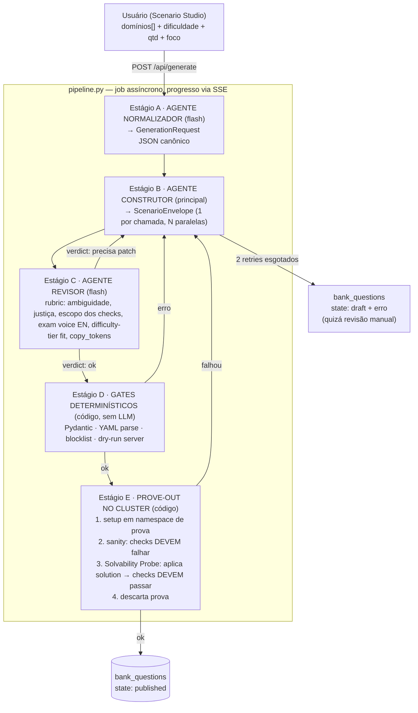

# Especificação do Pipeline de Geração LLM, Banco de Questões, Check e Reset — CKA Arena

> Segunda revisão de design, cobrindo: (1) avaliação **LangGraph/LangChain × pipeline determinístico** para o fluxo de geração multi-agente proposto pelo usuário; (2) **banco de questões** persistente com sorteio pelas **percentagens oficiais da prova**; (3) **contrato formal de avaliação (Check)** — correto/incorreto com semântica exata; (4) **teardown e reset limpo do cluster** ao final da sessão de prática.
>
> Complementa `LLM_SCENARIO_SPEC.md` (contrato `ScenarioEnvelope` e catálogo de checks — permanece válido) e `ARCHITECTURE.md` (componentes e banco).

---

## 1. Decisão Executiva: Pipeline Determinístico com "Agentes-Estágio" (sem LangGraph/LangChain)

### 1.1 O que o usuário propôs (e está correto)

O fluxo de 3 agentes proposto — **Normalizador** (padroniza o pedido num contrato JSON) → **Construtor** (elabora o cenário com YAMLs a aplicar, ex.: YAML defeituoso de troubleshooting) → **Validador** (garante o padrão antes de inserir no banco) — **é a arquitetura certa**. A questão não é *se* usar estágios, é *como orquestrá-los*.

### 1.2 Avaliação: framework de agentes × orquestração própria

| Critério | LangGraph/LangChain | Pipeline próprio (async Python) |
| :--- | :--- | :--- |
| Natureza do fluxo | Projetado para **grafos cíclicos** com tool-use autônomo, human-in-the-loop e checkpointing durável | Fluxo **linear com retries limitados** e gates determinísticos — basta uma máquina de estados de ~200 linhas |
| Independência de LLM | Sim, via integrações LangChain | **Já resolvida**: cliente multi-provider próprio (GLM/OpenCode/DeepSeek/Claude/OpenAI-compat, verificado em produção local) |
| Saída estrita (JSON contrato) | Suporta, mas com camadas de abstração sobre prompts | Pydantic + JSON schema direto no prompt; parse/repair sob controle total |
| Debug & auditoria | Estado interno do framework | Cada estágio/chamada já é logada em `llm_generations` (SQLite) — sem caixa-preta |
| Custo de dependência | `langgraph` + `langchain-core` + integrações: árvore pesada, **churn de API intenso** (breaking changes frequentes) | Zero dependências novas (FastAPI/httpx/anthropic já no projeto) |
| Latência/overhead | Overhead de runtime e serialização de estado | Processo direto, mesmo throughput |
| Quando o framework ganha | Agente autor rodando `kubectl` num sandbox para auto-testar (tool-loop dinâmico), fluxos resumíveis com aprovação humana | — |

### 1.3 Recomendação (fixada)

1. **Não usar LangGraph/LangChain na Fase atual.** O pipeline é linear com no máximo 2 ciclos de auto-reparo por estágio — grafos e checkpointing seriam peso morto, e o churn de versões dos frameworks é risco real num projeto de longo prazo mantido por 1 pessoa.
2. **Manter os 3 "agentes" como estágios LLM com contrato estrito** (`pipeline.py`), intercalados com **gates determinísticos de código** e um **prove-out real no cluster**. O termo técnico para o padrão: *cascaded generation with validation gates* — a prática recomendada (Anthropic/OpenAI guidance para structured outputs) para esta classe de tarefa.
3. **Gatilhos para revisitar LangGraph** (documentados, não implementar antes): (a) permitir que o Construtor **teste o próprio cenário autonomamente** com tool-use (`kubectl` em namespace sandbox) em vez de só emitir JSON; (b) revisão humana resumível de cenários "Boss Fight" antes de publicar; (c) pipeline com >3 ciclos condicionais dinâmicos.
4. **Roteamento de modelo por estágio** (economia + qualidade): Normalizador e Revisor usam o modelo **flash** (tarefa mecânica/rubrica); Construtor usa o modelo **principal**. Fallback automático de provider em timeout/429 (próximo da lista do catálogo).

---

## 2. O Pipeline de Geração (`pipeline.py`) — 5 Estágios



### Estágio A — Agente Normalizador (modelo flash)
- **Entrada:** seleção bruta da UI: `domains[]`, `subtopics[]` (opcional), `difficulty`, `count`, `focus_hint` (texto livre de 1 linha — aceito em qualquer idioma; o agente o traduz em constraints **em inglês**). Idioma fixo de saída do pipeline inteiro: **`en-US`** (o sistema é 100% inglês).
- **Saída:** `GenerationRequest` — contrato JSON canônico (Pydantic): pesos renormalizados dos domínios escolhidos, sub-tópicos válidos por domínio (catálogo fechado), dificuldade normalizada (`exam_standard|killer_hardcore|boss_fight`), restrições do foco convertidas em constraints declarativas (ex.: *"excluir Helm"* → `exclude_tools: ["helm"]`).
- **Por que um agente:** o `focus_hint` é linguagem natural; o contrato tem que ser inequívoco e auditável. O Normalizador é a única tradução NL→contrato, com validação Pydantic e retry com erro exato.
- **Idempotência:** mesmo input → mesmo contrato (temperature 0).

### Estágio B — Agente Construtor (modelo principal)
- Gera **um cenário por chamada** (`ScenarioEnvelope`); N cenários = N chamadas paralelas com `seed`/`temperature` levemente variados para diversidade.
- System prompt = template do `LLM_SCENARIO_SPEC.md` §4 + topologia real coletada do cluster + `GenerationRequest` do Estágio A.
- Extensão obrigatória do envelope (nova): bloco **`solution`** (manifests + comandos da solução de referência **aplicáveis de forma automatizada** — não prosa) — insumo do Solvability Probe (§5). O `prompt` sai em **inglês no formato exato da prova** (anatomia killer.sh/PSI — `LLM_SCENARIO_SPEC.md` §1.2); prosa didática vai em `reference_solution`.

### Estágio C — Agente Revisor (modelo flash) — "crítico frio"
- Recebe o envelope + a **rubrica** e devolve `{verdict: approve|patch, issues[], patch_suggestions[]}`.
- Rubrica fixa: (1) requisito é objetivamente verificável pelos checks declarados? (2) armadilhas são justas (não traps de interpretação)? (3) checks testam estado resultante e não comandos? (4) todo identificador crítico está em `copy_tokens` e entre crases? (5) `solution` realmente resolve cada check? (6) **exam voice:** o texto todo está em inglês técnico no formato/voz do exame real (título imperativo, contexto-sintoma, "Perform the following tasks", restrições — §1.2 do spec)? **Eixos numéricos de banda ficam FORA da rubrica** (v2): o gate D os mede exatamente e faz clamp de `weight`/`minutes` — o Revisor foi visto rejeitando `estimated_minutes=4.0` "fora da banda 1–4" (falso), e cada falso `patch` custava um rebuild com thinking.
- **O Revisor não é gate final** — ele melhora qualidade; os gates que decidem são D e E (determinísticos). Máx. 1 ciclo B←C por cenário (depois segue para D com as issues anotadas; D/E são quem reprova de verdade). C roda **em paralelo** com D (v2).

### Estágio D — Gates Determinísticos (sem LLM)
1. Schema Pydantic do envelope (campos, tipos, enums).
2. `yaml.safe_load_all` em todos os manifests (setup + solution).
3. Blocklist de segurança (`LLM_SCENARIO_SPEC.md` §3) + `backup_paths` obrigatórios.
4. `kubectl apply --dry-run=server` dos manifests (quando o alvo da quebra não for o apiserver).
5. Checks sintaticamente executáveis (kinds existentes no cluster v1.37.2, imagens multi-arch/arm64 da whitelist).

### Estágio E — Prove-Out no Cluster (a inovação-chave deste design)
Roda **no cluster real, em namespace efêmero de prova** (`cka-arena-prove-<uuid>`, descartado ao final):
1. **Setup de prova:** aplica `setup.manifests` (adaptados ao namespace de prova quando o cenário for namespace-scoped) e `setup.node_commands` **não** rodam aqui — comandos de nó são provados apenas nos níveis `boss_fight` e com backup automático (custo maior, taxa menor).
2. **Sanity Check (regra de ouro):** todos os checks devem **FALHAR** logo após o setup. Se algum passar → cenário trivia → reprova.
3. **Solvability Probe:** aplica `solution.manifests`/`solution.commands` e verifica que **100% dos checks PASSAM**. Cenário insolúvel (ou solução errada) → reprova com o erro exato de volta ao Construtor.
4. Descarte do namespace de prova.
- **Custo/benefício:** adiciona ~10–30s por cenário; elimina a classe de erro mais custosa para o usuário (questão impossível descoberta no meio da prática). Configurável: sempre ligado; `boss_fight` com node_commands pula o probe de nó e valida só estágios A–D (documentado na questão).
- Cenários que falham E voltam ao Construtor com a **evidência por check** (expected/got/exit/stderr, ≤2 retries); esgotados → `bank_questions.state = draft` com o erro registrado (nunca servem para prática; úteis para tuning de prompt).

### Notas de implementação — modelos de reasoning (Fase 3, verificadas ao vivo)

- **DeepSeek V4.1 Flash / V4 Pro são modelos de reasoning:** uma geração de envelope gasta ~10–16k tokens de raciocínio antes do JSON. Com `max_tokens` baixo a resposta chega **vazia ou truncada** (`finish_reason: length`) — não é falha de parsing.
- **Receita que funciona (validada):** `response_format: {"type": "json_object"}` + `max_tokens = 40000` para o Construtor, 6000 para o Revisor, 4000 para o Normalizador; timeout do provider elevado para 300s no DeepSeek; `finish_reason: length` tratado como erro de provider; `reasoning_content` como fallback quando `content` vazio.

### Otimizações de velocidade (Fase 3, medidas ao vivo)

| Alavanca | Medida | Efeito medido |
| :--- | :--- | :--- |
| **Desligar thinking** | `thinking: {"type": "disabled"}` (default do DeepSeek no cliente; env `CKA_LLM_THINKING=on` religa) | **45.8s → 4.7s** por chamada do Construtor (~10×), JSON válido — `reasoning_effort` é ignorado pelo provider |
| **Deep condicional (v2)** | thinking no retry **só quando a falha exige raciocínio** (`schema` ou `probe`); correções de gates/revisão são mecânicas e rodam fast | correções de ~45s passam a ~5s |
| **Gates ∥ Revisor (v2)** | D e C são leitura independente e rodam em paralelo após o schema | −~4s por tentativa |
| **Clamp de banda (v2)** | `weight`/`estimated_minutes` fora da banda são **clamped deterministicamente** — nunca custam rodada de LLM | elimina a classe inteira de correções numéricas |
| **Revisor sem banda numérica (v2)** | rubrica C proíbe julgar eixos numéricos (`DO NOT judge numeric band`) — a banda é do gate D | mata o falso `patch` ("minutes=4 fora de 1–4") que forçava rebuild thinking em 100% das questões do run baseline |
| **Orçamento por tier (v3)** | killer/boss: **4 ciclos de correção / 8 tentativas** (exam mantém 2/6); thinking ligado em toda correção após a 1ª nas tiers duras | mais chance de convergir onde a quarentena se concentrava (8 boss + 10 killer de 21 drafts) |
| **Veredito anti-oscilação (v3)** | probe final aceita com **2 rodadas all-PASS consecutivas** ou **todo check PASS em ≥2 dos últimos 3 rounds** | blips de DNS/endpoint deixam de condenar cenário solucionável (caso real: 4↔5/6 oscilando até o deadline) |
| **`-f` estrito (v3)** | gate rejeita **qualquer** target que não seja `-` — incluindo `/tmp/x.yaml` (paths absolutos escapavam) e URLs | fecha a classe boss `apply -f /tmp/atlas-configmap.yaml` |
| **node_commands idempotentes (v3)** | gate reescreve `mkdir` → `mkdir -p` e dá auto-sudo a mutação em path absoluto fora de /home (/tmp incluído) — a tentativa anterior pode ter criado o dir como root | fecha a classe `mkdir /tmp/cka-boss-checks: Permission denied` (última quarentena do run de verificação) |
| **Addendum hard-tier (v3)** | prompt das tiers duras ganha regras A–F (YAML em manifests, upsert vs expose, SSH/sudo/backup, checks determinísticos com retry-loop no comando, padrão boss multi-camada, mapeamento falha↔check 1:1) + **exemplar real publicado** (seed `sn-networkpolicy-dns`) injetado | ancora o builder num formato que passa gates+probe — carregado do seed, nunca diverge da verdade |
| **Normalizador fast-path** | pedido já estruturado (domínios/dificuldade válidos, sem `focus_hint`) pula a chamada LLM | −1 chamada por job no caso comum |
| **Slots paralelos** | até 3 Construtores concorrentes (semáforo); **probe serializado** por lock (cluster é um recurso só) | job de N questões ≈ max(LLM) + N×probe, em vez de N×(LLM+probe) |
| **Settle 1× por fase (v2)** | settle após o apply do setup (cap 45s) e após a solution (cap 15s — o poll cobre a convergência); **polls de checks rodam com `settle=False`** — antes `run_checks(settle=True)` re-settlava (≤60s) a cada ciclo de poll | probes com pods Pending-de-propósito deixam de pagar 60s por ciclo |
| **Poll progressivo + fast-fail (v2)** | cadência 2s (4 primeiros) → 5s; sanity deadline 90→45s com trivial fast-fail após 2 polls; solution 120→90s; timeouts de comando 180→60s | menos tempo ocioso por probe |
| **Repair informado (v4.4)** | o repair recebe **todos os checks** (PASS/FAIL/ERROR + evidência) e um **digest vivo** dos namespaces (pods/ready/reason, selectors, endpoints) — antes só via os checks que falharam | elimina o ponto cego do repair: causa real (selector/port/Pending/CrashLoop) visível → correção certeira |
| **Orçamento boss 10/5 + settle final 15s (v4.4)** | boss: 10 tentativas/5 correções; settle pós-solution encurtado (o poll de 90s cobre convergência) | convergência com menos tempo morto por probe |
| **jsonpath sem chaves (v4.2)** | `normalize_params` envolve jsonpath em `{}` quando o modelo esquece (`.spec.x` → `{.spec.x}`) e o gate aplica a mesma normalização | classe real de quarentena boss: kubectl imprimia o literal e o check dava FAIL falso |
| **Infra dentro da janela (v4.1)** | sanity/final tratam check `ERROR` como **retryável dentro do deadline** (3s), não como veredito; rounds com ERROR não entram no histórico anti-oscilação; retries de infra no cenário 2→3 | elimina aborto precoce por cluster lento/pod subindo (classe dominante nos drafts) |
| **Infra × conteúdo (v4)** | probe devolve `ok/content/infra`; erro de infraestrutura (cluster/ssh/timeout) é **retentado no mesmo envelope até 2×** sem consumir orçamento de correção nem culpar o modelo; só infra persistente quarentena como `infra:` | elimina a classe dominante observada: "erro de infraestrutura no sanity check" queimando 4 ciclos e virando quarentena |
| **Solver-repair (v4)** | probe falho por conteúdo → LLM **repara só `solution`/`checks`** com a evidência (setup/prompt congelados), re-valida gates + probe inline; até 2 repairs; ao esgotar o orçamento há um **salvage** final nessa mesma via | converte quase-acertos em publicados sem relaxar a validação; menos tokens e zero regressão de setup |
| **jsonpath LIST mode (v4)** | `kubectl_jsonpath` aceita `kind + label_selector` sem `name` (ex.: "todos os pods do Deployment rodam em node01") — checker monta `get <kind> -l ...` | corrige a classe killer "pods-on-node01 got=None" (o validador antigo exigia objeto único) |
| **host_file_contains com sudo (v4)** | leitura de arquivos do nó tenta `cat` e, se falhar, `sudo cat`; evidência distingue *permission denied* de *not found*; gate exige path absoluto sob raízes reais (`/etc/kubernetes`, `/var/lib/kubelet`, `/opt`…) | corrige falsos "arquivo não existe" em manifests root-only (boss) |
| **Namespace consistency (v4)** | todo `metadata.namespace` de manifests deve constar em `setup.namespaces` (gate) — o engine só espera/reaproveita namespaces declarados | evita `Forbidden: … terminating`/cross-ns em retries |
| **Evidência na correção (v2)** | falha de probe devolve **expected/got/exit/stderr por check** (`_failure_detail`), não só os ids | a LLM corrige de primeira — alvo direto da taxa de quarentena (60% histórica: "solução não resolve os checks") |

- **Provider por config:** `llm_config.json` do projeto (editável em **Settings → AI provider**) → env `CKA_LLM_*`; GLM primário quando a chave existir; DeepSeek como fallback/principal conforme disponibilidade.
- **Modelos são escolhidos por dropdown** (catálogo por provider, sem digitação): GLM Coding Plan `glm-5.3`/`glm-5.3-flash` no endpoint OpenAI-compatible `https://api.z.ai/api/coding/paas/v4` (reasoning sempre ativo; `reasoning_effort` low no fast path, max no deep); DeepSeek `deepseek-v4-pro`/`deepseek-flash`; Claude Fable/Opus/Sonnet/Haiku 5.5/5.2; GPT-6.2 Sol/Astra, GPT-6.1 Terra, GPT-6 Luna; OpenCode Zen (DeepSeek/GLM/Claude/GPT).

### Concorrência
- Um job de geração por vez (o cluster é um recurso só); N cenários do job provados **sequencialmente** (share do cluster de prova) com paralelismo apenas nas chamadas LLM.

---

### 2.1 Geração por composição (v5) — tiers duras sem quarentena por construção

A partir da v5, **killer_hardcore e boss_fight são geradas por composição de
fault-units pré-validadas** (`app/fault_units.py` + `app/composer.py`), não por autoria
livre da LLM:

- **Fault-unit** = bloco (setup que quebra · checks que falham · solution que resolve)
  extraído 1:1 dos seeds **PROBE OK** (16 unidades; SN/TS/WL/ST/CA, incluindo unidades
  de nó: kubelet e etcd-snapshot). Cada unidade carrega sintoma/tarefa/tokens.
- **Composer** seleciona unidades (boss 5 c/ ≥1 de nó · killer 3 c/ limite de checks da
  banda), gera namespaces únicos parametrizados, monta o envelope completo com
  weight/minutes derivados da contagem (clamp na banda) e texto determinístico.
- **A LLM só escreve a narrativa** (título/prompt em inglês de exame, 1 chamada flash
  ~1.4k tokens); validamos identificadores/contagem de tasks e há **fallback
  determinístico** — a geração funciona até sem chave de LLM.
- **Anti-quarentena por construção**: probe falho por conteúdo → **a unidade culpada
  (prefixo do check id) é trocada** e o cenário remontado (≤2 swaps), sem regeneração
  por LLM; infra → retry sem consumir orçamento; fallback ao caminho autoral só se a
  biblioteca inteira esgotar.
- **Integridade garantida por teste**: todo manifesto é YAML válido com kind; todo
  payload `-p` de patch é JSON válido (pegou um `}` faltante real na biblioteca).
- **Dedup de variedade**: combos recentes (40 últimos publicados, via
  `generator_meta_json.units`) são evitados na amostragem.
- Medição (19/11/2026, build final): **boss×3 + killer×2 → 5/5 publicados, 0
  quarentena, ~60–65s por questão** (antes: boss com até 40min e quarentena).

## 3. Banco de Questões (`bank_questions`)

### 3.1 Mudança de Modelo (era: geração → sessão acoplada)

No design anterior, `scenarios` pertencia a `sessions` (a fila gerada era a sessão). Agora: **geração alimenta o banco; prática consome o banco** — desacoplamento total entre "produzir questões" e "praticar".

| Tabela | Colunas | Papel |
| :--- | :--- | :--- |
| `bank_questions` | `id`, `envelope_json`, `envelope_hash`, `domain`, `subtopics_json`, `difficulty`, `weight_pct`, `estimated_minutes`, `source` (`llm`\|`seed`), `state` (`draft`\|`probed`\|`published`\|`retired`), `probe_result_json`, `times_used`, `last_used_at`, `first_try_pass_count`, `avg_solve_seconds`, `generator_meta_json` (`provider`, `model`, `generation_request_id`), `created_at`, `retired_reason` | O banco. Envelope **imutável após publicado** (correção = nova linha `supersedes_question_id`). |
| `session_items` | `id`, `session_id`, `bank_question_id`, `order_index`, `state` (`pending`\|`active`\|`passed`\|`skipped`), `started_at`, `passed_at`, `attempts` | Substitui a antiga `scenarios`: a sessão só referencia questões do banco. |
| `generation_requests` | `id`, `request_json`, `status`, `scenarios_attempted`, `scenarios_published`, `created_at` | Auditoria do pipeline (o que foi pedido × o que sobreviveu aos gates). |
| `llm_generations` | *(já existe)* | Uma linha por chamada LLM (estágio, provider, tentativa, raw). |

- **Dedup semântico:** fingerprint = hash normalizado de `(domain, subtopics ordenados, título lowercase sem acento, hash dos manifests do setup)`. Colisão com questão `published` → descarta a nova (evita o banco enchendo de clones).
- **Ciclo de vida do estado:** `draft` (saiu do pipeline sem passar em E, ou revisão manual pendente) → `probed` (passou em E; publicado automaticamente se `auto_publish`, default **on**) → `published` → `retired` (bug descoberto em uso, via botão "Reportar problema na questão" — entra `retired_reason` e sai da amostragem).
- **Métricas por questão** alimentam o dashboard: `first_try_pass_count/times_used`, `avg_solve_seconds` vs `estimated_minutes` (detecta questões mal calibradas em tempo).
- **Enxoval mínimo recomendado:** ≥3 questões `published` por célula domínio×dificuldade (grade 5×3); o Studio mostra a grade de cobertura e sugere gerar onde estiver vazio.

---

## 4. Sorteio por Percentuais da Prova (amostragem)

### 4.1 Algoritmo (`bank.py · draw_exam_sample`)

1. **Pesos oficiais CNCF:** Troubleshooting 30 · Cluster Architecture 25 · Services & Networking 20 · Workloads & Scheduling 15 · Storage 10.
2. **Renormalização por filtro:** se o usuário restringir domínios (ex.: só Troubleshooting + Storage) ou dificuldade, os pesos renormalizam sobre o subconjunto elegível do banco.
3. **Alocação inteira por largest remainder:** `raw_i = N · w_i / Σw`; `floor` em todos; distribui as vagas restantes pelos maiores restos (tie-break: peso maior).
4. **Seleção dentro da célula:** elegível = `published` ∧ não usada na sessão atual ∧ dificuldade compatível; ordena por `(times_used ASC, random())` — favorece questões menos usadas sem ser determinístico.
5. **Fallback de célula vazia:** completa proporcionalmente das outras células, sinaliza na UI (*"Storage: sem questões Killer.sh Hardcore no banco — completado com Cluster Architecture"*) e oferece CTA "Gerar mais deste domínio".

### 4.2 Exemplos Numéricos (prova completa, 5 domínios)

| N | Raw (T/CA/SN/WS/ST) | Alocação final |
| :--- | :--- | :--- |
| 15 (simulado) | 4.5 / 3.75 / 3.0 / 2.25 / 1.5 | **5 / 4 / 3 / 2 / 1** |
| 5 (bateria) | 1.5 / 1.25 / 1.0 / 0.75 / 0.5 | **2 / 1 / 1 / 1 / 0** |
| 3 (rápida) | 0.9 / 0.75 / 0.6 / 0.45 / 0.3 | **1 / 1 / 1 / 0 / 0** |

### 4.3 Fluxo de UI "Practice"

`[Practice]` → modal: quantidade (`3 · 5 · 15 · custom`), filtros opcionais (domínios, dificuldade — default: todos, pesos completos) → **preview da distribuição antes de iniciar** (*"You will get: 5× Troubleshooting · 4× Cluster Architecture · …"*, com badge de fallback quando houver) → `[Start Session]` → sorteio, `session_items` criados, Q1 aplicada no cluster, tela de questão ao lado do terminal (fluxo do `UX_UI_SPEC.md` já especificado).

---

## 5. Contrato Formal de Avaliação (Check) — Correto / Incorreto sem Ambiguidade

> Princípio inalterado e reforçado: **a LLM nunca avalia**. O Check é 100% determinístico, por estado resultante. Esta seção formaliza a semântica que faltava (status, retry, veredito, evidência).

### 5.1 Ciclo de vida de um check individual

| Status | Significado | Conta para o veredito? | Retry? |
| :--- | :--- | :--- | :--- |
| `PASS` | Predicado verdadeiro no cluster | sim (a favor) | — |
| `FAIL` | Predicado falso — **estado do usuário**, não infra | sim (contra) | **Nunca** re-executa sozinho (o estado não muda sem o usuário agir) |
| `SKIP` | Pré-condição não satisfeita (ex.: recurso pai ausente) com `reason` | contra (exibido como "não avaliável — resolva o item anterior") | re-avaliado no próximo Check |
| `ERROR` | Falha de infra (apiserver unreachable, SSH down, timeout de execução) | **não** — a rodada é inválida | 2× com backoff 1s; persistindo → rodada inteira marcada `infra_error` |

- **Timeout por check:** 10s default (`pod_exec_*`: 20s); `node_command_*`: 15s. Timeout vira `ERROR`, nunca `FAIL`.
- **Provas negativas** (`pod_exec_must_fail`): obrigatoriamente embutem o próprio limite no comando (ex.: `curl --max-time 5`, `nc -w 3`, `timeout 5 wget …`) — a spec do Construtor rejeita `must_fail` sem timeout embutido (gate D).
- **Read-only:** checks não mutam workloads do usuário; sondas efêmeras (`ephemeral_probe`) rodam com label `cka-arena.io/probe: "true"` e TTL de limpeza de 120s.

### 5.2 Veredito da questão (all-or-nothing, como na CKA real)

- `PASS` ⇔ **100% dos checks `PASS`** (`SKIP` e `FAIL` bloqueiam; `ERROR` persistente invalida a rodada sem consumir tentativa).
- Feedback **itemizado** estilo KodeKloud no drawer: cada check com status + **evidência** (`expected`, `actual`, comando/jsonpath executado) + `failure_hint` com **revelação progressiva**: hint aparece a partir da 2ª rodada de FAIL do mesmo check (1ª rodada mostra só a evidência — força diagnóstico antes da dica).
- Cada rodada gravada em `check_runs` (duração, resultados) — base do dashboard por domínio.

### 5.3 Execução e anti-flakiness

- **Settle antes da rodada:** pods alvo devem estar em estado estável (`Running`/`CrashLoopBackOff`/`ImagePullBackOff`) ou 60s de teto — evita FAIL transiente por scheduling/pull.
- **Grupos com paralelismo interno:** G1 leituras de API (`kubectl_resource_exists`, `kubectl_jsonpath`, `kubectl_auth_can_i`, `helm_release_state`) em paralelo; G2 pods (`pod_status_ready`, `pod_exec_*`) em paralelo; G3 SSH/host (`node_command_exit_zero`, `host_file_contains`) paralelo. Grupos sequenciais (barato → caro).
- **Determinismo:** mesma resposta para o mesmo estado do cluster; nenhuma aleatoriedade fora do `random()` nunca usado no caminho de check.

---

## 6. Fim de Sessão: Teardown e Reset Limpo do Cluster

> Requisito do usuário: *"quando a sessão de prática for finalizada, o cluster deve ser zerado e reiniciado limpo"*. Três níveis, com política clara de quando cada um roda.

### 6.1 Níveis de limpeza (`teardown.py`)

| Nível | Quando | O quê faz | Duração típica | Garantia |
| :--- | :--- | :--- | :--- | :--- |
| **L0 — por questão** | automático, ao clicar `Next`/`Pular` | cleanup da questão atual (namespaces do cenário, recursos com label, backups de nó restaurados, helm releases do cenário, probes) | 2–10s | questão seguinte começa sem herança da anterior |
| **L1 — fim de sessão (default)** | automático ao finalizar/abortar sessão | L0 da última questão + varredura global: remove **tudo** com label `cka-arena.io/managed: "true"` (namespaces, probes, releases Helm, ConfigMaps de prova) + restaura backups de nó pendentes + **drift check** (compara arquivos de nós vs baseline) | ~30s | cluster funcionalmente limpo para a próxima sessão |
| **L2 — clean reset** | sob demanda ou automático pós-simulado | L1 + restauração do baseline de arquivos dos nós + `restart containerd/kubelet` + wait Ready + drift check | ~1–2 min | cluster funcionalmente limpo; **addons preservados** (sem snapshots de VM — backend Multipass/macOS não os implementa) |

### 6.2 L2 clean reset (snapshots de VM indisponíveis no ambiente)

- **Descoberta ao vivo (Fase 5):** o CLI do Multipass 1.17.0 lista snapshot/restore, mas o backend do macOS (QEMU) responde `The snapshots feature is not implemented on this backend` — **snapshots de VM não são viáveis aqui**. O L2 foi redefinido como **clean reset** determinístico, sem depender de snapshots.
- **Composição do clean reset:** (1) L1 completo (namespaces/recursos com label gerenciado, probes, PVs; restauração de backups pendentes); (2) em cada nó, restauração de `/etc/kubernetes/manifests`, kubelet config, containerd config e drop-ins a partir do baseline; (3) `systemctl restart containerd` + `kubelet`; (4) espera `/readyz` e 3/3 nós Ready; (5) drift check e remoção de taints de prática. Addons em namespaces não gerenciados permanecem.
- **Manutenção do baseline de arquivos:** após upgrades intencionais do cluster, o ClusterDoctor pode recapturar o baseline de arquivos (`ensure_baseline_files` com diretório limpo). Validado ao vivo: `drift=false`, 3/3 Ready e addons presentes após o L2.
- **L2 automático:** após sessões `mock_exam` (simulado completo) — fidelidade máxima para a próxima; após sessões `study`, L1 basta (mais rápido) e a tela final oferece L2 como opção.

### 6.3 Tela de Fim de Sessão (UX)

```
┌──────────────────────────────────────────────────┐
│  SESSÃO FINALIZADA · 11/15 · 68% acerto 1ª tent. │
│  Tempo total 78 min · pior domínio: Storage      │
│ ──────────────────────────────────────────────── │
│  Limpar cluster agora?                           │
│  [✓ Limpeza Rápida (L1 · ~30s)]  ← default       │
│  [⟳ Reset Total p/ Baseline (L2 · 3–6 min)]      │
│  (drift detectado: recomendamos L2)              │
└──────────────────────────────────────────────────┘
```

- Se o drift check do L1 detectar divergência vs baseline (arquivo de nó alterado, namespace órfão), a UI **recomenda L2** explicitamente.
- Fim de sessão **abortada** (bug no meio de um Boss Fight) → mesma tela; L2 recomendado por padrão.

---

## 7. Alterações que Este Design Propaga

| Documento | Alteração |
| :--- | :--- |
| `LLM_SCENARIO_SPEC.md` | Novo bloco `solution` no envelope; regra 10 do prompt (solução automatizável); seção "Contrato de Avaliação" aponta para §5 daqui. |
| `ARCHITECTURE.md` | §6: tabelas `bank_questions`/`session_items`/`generation_requests` (substituem `scenarios`); §11 Banco & Amostragem; §12 Teardown L0/L1/L2-clean; árvore ganha `pipeline.py`, `bank.py`, `teardown.py`. |
| `UX_UI_SPEC.md` | §4 Studio publica no banco (grade de cobertura 5×3); seção "Practice from Bank" (modal + preview de distribuição); tela de fim de sessão (L1/L2). |
| `PLAN.md` | Fase 3 vira "Pipeline multi-estágio + banco"; Fase 5 usa o banco; verificação ganha casos de amostragem e teardown. |
| `GAP_ANALYSIS.md` | Segunda auditoria (G13–G18) com a matriz de rastreabilidade desta revisão. |
