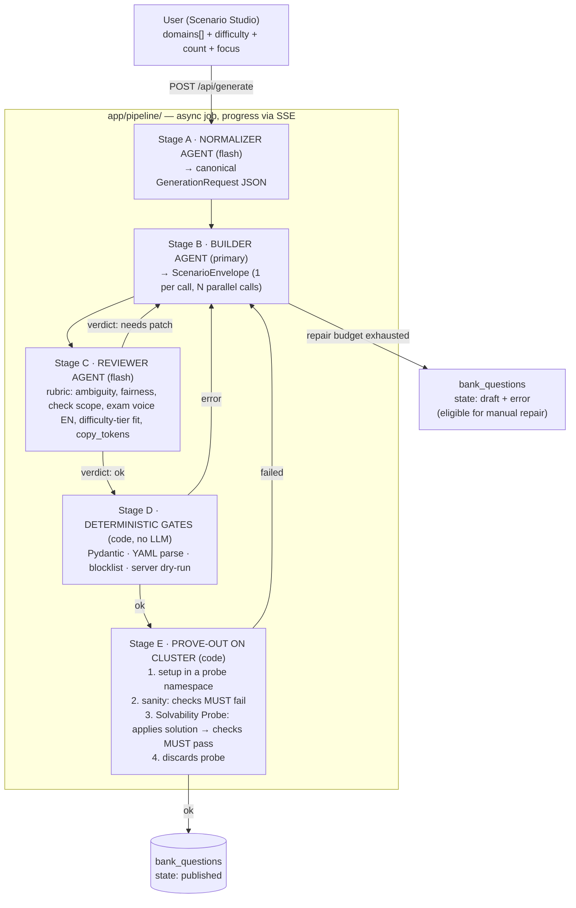

# LLM Generation Pipeline, Question Bank, Check and Reset Specification — CKA Arena

> Second design revision, covering: (1) the **LangGraph/LangChain × deterministic pipeline** evaluation for the user-proposed multi-agent generation flow; (2) a persistent **question bank** with draw by the **official exam percentages**; (3) the **formal evaluation contract (Check)** — pass/fail with exact semantics; (4) **teardown and clean cluster reset** at the end of a practice session.
>
> Complements `LLM_SCENARIO_SPEC.md` (`ScenarioEnvelope` contract and check catalog — still valid) and `ARCHITECTURE.md` (components and database).

> **Reference document.** The concepts (contracts, gates, teardown levels) describe the design; notes marked `(v2)`/`(v3)`/`(v4.x)` and "live" measurements are historical increments, with numbers from the reference lab. Where they diverge, the code prevails: `app/pipeline/`, `app/bank.py`, `app/sessions.py` and `app/teardown.py`.

---

## 1. Executive Decision: Deterministic Pipeline with "Stage Agents" (no LangGraph/LangChain)

### 1.1 What the user proposed (and is right)

The proposed 3-agent flow — **Normalizer** (standardizes the request into a JSON contract) → **Builder** (elaborates the scenario with YAMLs to apply, e.g. a troubleshooting broken YAML) → **Validator** (enforces the standard before inserting into the bank) — **is the right architecture**. The question is not *whether* to use stages, it's *how to orchestrate them*.

### 1.2 Evaluation: agent framework × own orchestration

| Criterion | LangGraph/LangChain | Own pipeline (async Python) |
| :--- | :--- | :--- |
| Flow nature | Designed for **cyclic graphs** with autonomous tool-use, human-in-the-loop and durable checkpointing | **Linear flow with limited retries** and deterministic gates — a ~200-line state machine suffices |
| LLM independence | Yes, via LangChain integrations | **Already solved**: own multi-provider client (GLM/OpenCode/DeepSeek/Claude/OpenAI-compat, verified live in production) |
| Strict output (JSON contract) | Supported, but with abstraction layers over prompts | Pydantic + JSON schema directly in the prompt; parse/repair under full control |
| Debug & auditability | Framework internal state | Every stage/call is already logged in `llm_generations` (SQLite) — no black box |
| Dependency cost | `langgraph` + `langchain-core` + integrations: heavy tree, **intense API churn** (frequent breaking changes) | Zero new dependencies (FastAPI/httpx/anthropic already in the project) |
| Latency/overhead | Runtime and state serialization overhead | Direct process, same throughput |
| When the framework wins | An authoring agent running `kubectl` in a sandbox to self-test (dynamic tool-loop), resumable flows with human approval | — |

### 1.3 Recommendation (fixed)

1. **Do not use LangGraph/LangChain in the current Phase.** The pipeline is linear with at most 2 self-repair cycles per stage — graphs and checkpointing would be dead weight, and framework version churn is a real risk in a long-lived project maintained by 1 person.
2. **Keep the 3 "agents" as LLM stages with a strict contract** (`pipeline.py`), interleaved with **deterministic code gates** and a **real prove-out on the cluster**. The technical term for the pattern: *cascaded generation with validation gates* — the recommended practice (Anthropic/OpenAI guidance for structured outputs) for this class of task.
3. **Triggers to revisit LangGraph** (documented, do not implement before): (a) letting the Builder **test its own scenario autonomously** with tool-use (`kubectl` in a sandbox namespace) instead of only emitting JSON; (b) resumable human review of "Boss Fight" scenarios before publishing; (c) pipeline with >3 dynamic conditional cycles.
4. **Model routing per stage** (cost savings + quality): Normalizer and Reviewer use the **flash** model (mechanical task/rubric); Builder uses the **primary** model. Automatic provider fallback on timeout/429 (next in the catalog list).

---

## 2. The Generation Pipeline (`app/pipeline/`) — 5 Stages



### Stage A — Normalizer Agent (flash model)
- **Input:** raw UI selection: `domains[]`, `subtopics[]` (optional), `difficulty`, `count`, `focus_hint` (free-form 1-line text — accepted in any language; the agent translates it into **English** constraints). Fixed output language of the whole pipeline: **`en-US`** (the system is 100% English).
- **Output:** `GenerationRequest` — canonical JSON contract (Pydantic): renormalized weights of the chosen domains, valid sub-topics per domain (closed catalog), normalized difficulty (`exam_standard|killer_hardcore|boss_fight`), focus restrictions converted into declarative constraints (e.g. *"exclude Helm"* → `exclude_tools: ["helm"]`).
- **Why an agent:** the `focus_hint` is natural language; the contract must be unambiguous and auditable. The Normalizer is the only NL→contract translation, with Pydantic validation and retry with the exact error.
- **Idempotency:** same input → same contract (temperature 0).

### Stage B — Builder Agent (primary model)
- Generates **one scenario per call** (`ScenarioEnvelope`); N scenarios = N parallel calls with slightly varied `seed`/`temperature` for diversity.
- System prompt = template from `LLM_SCENARIO_SPEC.md` §4 + real topology collected from the cluster + the Stage A `GenerationRequest`.
- Mandatory envelope extension (new): the **`solution`** block (manifests + commands of the reference solution **applicable in an automated way** — not prose) — input for the Solvability Probe (§5). The `prompt` comes out **in English in the exact exam format** (killer.sh/PSI anatomy — `LLM_SCENARIO_SPEC.md` §1.2); didactic prose goes in `reference_solution`.

### Stage C — Reviewer Agent (flash model) — "cold critic"
- Receives the envelope + the **rubric** and returns `{verdict: approve|patch, issues[], patch_suggestions[]}`.
- Fixed rubric: (1) is the requirement objectively verifiable by the declared checks? (2) are the traps fair (not interpretation traps)? (3) do checks test resulting state rather than commands? (4) is every critical identifier in `copy_tokens` and between backticks? (5) does `solution` actually solve every check? (6) **exam voice:** is the entire text in technical English in the real exam's format/voice (imperative title, context-symptom, "Perform the following tasks", restrictions — §1.2 of the spec)? **Numeric band axes stay OUT of the rubric** (v2): gate D measures them exactly and clamps `weight`/`minutes` — the Reviewer was seen rejecting `estimated_minutes=4.0` as "outside the 1–4 band" (false), and each false `patch` cost a thinking rebuild.
- **The Reviewer is not the final gate** — it improves quality; the deciding gates are D and E (deterministic). Max. 1 B←C cycle per scenario (afterwards it proceeds to D with the issues annotated; D/E are the ones that truly reject). C runs **in parallel** with D (v2).

### Stage D — Deterministic Gates (no LLM)
1. Envelope Pydantic schema (fields, types, enums).
2. `yaml.safe_load_all` on all manifests (setup + solution).
3. Security blocklist (`LLM_SCENARIO_SPEC.md` §3) + mandatory `backup_paths`.
4. `kubectl apply --dry-run=server` on the manifests (when the break target is not the apiserver).
5. Checks syntactically executable (kinds existing in the v1.37.2 cluster, multi-arch/arm64 images from the whitelist).

### Stage E — Prove-Out on the Cluster (the key innovation of this design)
Runs **on the real cluster, in an ephemeral probe namespace** (`cka-arena-prove-<uuid>`, discarded at the end):
1. **Probe setup:** applies `setup.manifests` (adapted to the probe namespace when the scenario is namespace-scoped) and `setup.node_commands` do **not** run here — node commands are only proved at the `boss_fight` levels and with automatic backup (higher cost, lower rate).
2. **Sanity Check (golden rule):** all checks must **FAIL** right after setup. If any passes → trivial scenario → reject.
3. **Solvability Probe:** applies `solution.manifests`/`solution.commands` and verifies that **100% of the checks PASS**. Unsolvable scenario (or wrong solution) → reject with the exact error back to the Builder.
4. Discard the probe namespace.
- **Cost/benefit:** adds ~10–30s per scenario; eliminates the most costly class of error for the user (an impossible question discovered mid-practice). Configurable: always on; `boss_fight` with node_commands skips the node probe and validates only stages A–D (documented in the question).
- Scenarios that fail E go back to the Builder with **per-check evidence** (expected/got/exit/stderr, ≤2 retries); budget exhausted → `bank_questions.state = draft` with the error recorded (never served for practice; useful for prompt tuning).

### Implementation notes — reasoning models (Phase 3, verified live)

- **DeepSeek V4.1 Flash / V4 Pro are reasoning models:** one envelope generation spends ~10–16k reasoning tokens before the JSON. With a low `max_tokens` the answer arrives **empty or truncated** (`finish_reason: length`) — not a parsing failure.
- **Recipe that works (validated):** `response_format: {"type": "json_object"}` + `max_tokens = 40000` for the Builder, 6000 for the Reviewer, 4000 for the Normalizer; provider timeout raised to 300s on DeepSeek; `finish_reason: length` treated as a provider error; `reasoning_content` as fallback when `content` is empty.

### Speed optimizations (Phase 3, measured live)

| Lever | Measure | Measured effect |
| :--- | :--- | :--- |
| **Disable thinking** | `thinking: {"type": "disabled"}` (DeepSeek default in the client; env `CKA_LLM_THINKING=on` re-enables) | **45.8s → 4.7s** per Builder call (~10×), valid JSON — `reasoning_effort` is ignored by the provider |
| **Conditional deep (v2)** | thinking on retry **only when the failure demands reasoning** (`schema` or `probe`); gate/review fixes are mechanical and run fast | fixes go from ~45s to ~5s |
| **Gates ∥ Reviewer (v2)** | D and C are independent reads and run in parallel after the schema | −~4s per attempt |
| **Band clamp (v2)** | `weight`/`estimated_minutes` outside the band are **clamped deterministically** — never cost an LLM round | eliminates the entire class of numeric fixes |
| **Reviewer without numeric band (v2)** | C rubric forbids judging numeric axes (`DO NOT judge numeric band`) — the band belongs to gate D | kills the false `patch` ("minutes=4 outside 1–4") that forced a thinking rebuild on 100% of the baseline run's questions |
| **Per-tier budget (v3)** | killer/boss: **4 repair cycles / 8 attempts** (exam keeps 2/6); thinking enabled on every repair after the 1st on the hard tiers | more chance of converging where quarantine concentrated (8 boss + 10 killer of 21 drafts) |
| **Anti-oscillation verdict (v3)** | final probe accepts with **2 consecutive all-PASS rounds** or **every check PASS in ≥2 of the last 3 rounds** | DNS/endpoint blips no longer condemn a solvable scenario (real case: 4↔5/6 oscillating until the deadline) |
| **Strict `-f` (v3)** | gate rejects **any** target that is not `-` — including `/tmp/x.yaml` (absolute paths escaped) and URLs | closes the boss class `apply -f /tmp/atlas-configmap.yaml` |
| **Idempotent node_commands (v3)** | gate rewrites `mkdir` → `mkdir -p` and auto-sudos a mutation at an absolute path outside /home (/tmp included) — the previous attempt may have created the dir as root | closes the class `mkdir /tmp/cka-boss-checks: Permission denied` (last quarantine of the verification run) |
| **Hard-tier addendum (v3)** | the hard-tier prompt gains rules A–F (YAML in manifests, upsert vs expose, SSH/sudo/backup, deterministic checks with retry-loop in the command, multi-layer boss pattern, 1:1 failure↔check mapping) + a **published real exemplar** (seed `sn-networkpolicy-dns`) injected | anchors the builder on a format that passes gates+probe — loaded from the seed, never diverges from ground truth |
| **Normalizer fast-path** | already-structured request (valid domains/difficulty, no `focus_hint`) skips the LLM call | −1 call per job in the common case |
| **Parallel slots** | up to 3 concurrent Builders (semaphore); **probe serialized** by lock (the cluster is a single resource) | job of N questions ≈ max(LLM) + N×probe, instead of N×(LLM+probe) |
| **Settle 1× per phase (v2)** | settle after the setup apply (cap 45s) and after the solution (cap 15s — the poll covers convergence); **check polls run with `settle=False`** — previously `run_checks(settle=True)` re-settled (≤60s) every poll cycle | probes with intentional-Pending pods stop paying 60s per cycle |
| **Progressive poll + fast-fail (v2)** | cadence 2s (first 4) → 5s; sanity deadline 90→45s with trivial fast-fail after 2 polls; solution 120→90s; command timeouts 180→60s | less idle time per probe |
| **Informed repair (v4.4)** | the repair receives **all checks** (PASS/FAIL/ERROR + evidence) and a **live digest** of the namespaces (pods/ready/reason, selectors, endpoints) — previously it only saw the failed checks | eliminates the repair blind spot: real cause (selector/port/Pending/CrashLoop) visible → precise fix |
| **Boss budget 10/5 + final settle 15s (v4.4)** | boss: 10 attempts/5 repairs; post-solution settle shortened (the 90s poll covers convergence) | convergence with less dead time per probe |
| **Keyless jsonpath (v4.2)** | `normalize_params` wraps jsonpath in `{}` when the model forgets (`.spec.x` → `{.spec.x}`) and the gate applies the same normalization | real boss quarantine class: kubectl printed the literal and the check gave a false FAIL |
| **Infra within the window (v4.1)** | sanity/final treat an `ERROR` check as **retryable within the deadline** (3s), not as a verdict; rounds with ERROR don't enter the anti-oscillation history; infra retries in the scenario 2→3 | eliminates early abort from a slow cluster/pod coming up (dominant class in drafts) |
| **Infra × content (v4)** | the probe returns `ok/content/infra`; an infrastructure error (cluster/ssh/timeout) is **retried on the same envelope up to 2×** without consuming the repair budget or blaming the model; only persistent infra quarantines as `infra:` | eliminates the observed dominant class: "infrastructure error in the sanity check" burning 4 cycles and turning into quarantine |
| **Solver-repair (v4)** | probe failed on content → LLM **repairs only `solution`/`checks`** with the evidence (setup/prompt frozen), re-validates gates + probe inline; up to 2 repairs; budget exhausted → a final **salvage** through this same path | converts near-misses into published without relaxing validation; fewer tokens and zero setup regression |
| **jsonpath LIST mode (v4)** | `kubectl_jsonpath` accepts `kind + label_selector` without `name` (e.g. "all pods of the Deployment run on node01") — the checker builds `get <kind> -l ...` | fixes the killer class "pods-on-node01 got=None" (the old validator required a single object) |
| **host_file_contains with sudo (v4)** | node file reading tries `cat` and, on failure, `sudo cat`; evidence distinguishes *permission denied* from *not found*; gate requires an absolute path under real roots (`/etc/kubernetes`, `/var/lib/kubelet`, `/opt`…) | fixes false "file does not exist" in root-only manifests (boss) |
| **Namespace consistency (v4)** | every `metadata.namespace` of manifests must appear in `setup.namespaces` (gate) — the engine only waits/reuses declared namespaces | avoids `Forbidden: … terminating`/cross-ns on retries |
| **Evidence in the repair (v2)** | a probe failure returns **expected/got/exit/stderr per check** (`_failure_detail`), not just the ids | the LLM fixes on the first pass — direct target of the quarantine rate (60% historical: "solution doesn't solve the checks") |

- **Provider by config:** the project's `llm_config.json` (editable in **Settings → AI provider**) → env `CKA_LLM_*`; GLM primary when the key exists; DeepSeek as fallback/primary according to availability.
- **Models are chosen via dropdown** (catalog per provider in `app/llm_client.py`, no typing — the list below is a snapshot and may go stale): GLM Coding Plan `glm-5.3`/`glm-5.3-flash` at the OpenAI-compatible endpoint `https://api.z.ai/api/coding/paas/v4` (reasoning always on; `reasoning_effort` low on the fast path, max on deep); DeepSeek `deepseek-v4-pro`/`deepseek-flash`; Claude Fable/Opus/Sonnet/Haiku; GPT-6.2 Sol/Astra, GPT-6.1 Terra, GPT-6 Luna; OpenCode Zen (DeepSeek/GLM/Claude/GPT); local Ollama (OpenAI-compatible endpoint at `http://127.0.0.1:11434/v1`).

### Concurrency
- One generation job at a time (the cluster is a single resource); up to 3 Builders in parallel (`asyncio.Semaphore(3)`); purely *namespace-scoped* scenarios are proved in ephemeral namespaces, with up to 2 simultaneous probes (`Semaphore(2)`); scenarios with `node_commands`, cluster-scoped resources or `destructive` take the exclusive probe lock.

---

### 2.1 Archetype- and causal-incident-guided generation (CKA Arena v3+)

From the v3 architectural upgrade on, the Builder doesn't start from a generic prompt: every job slot is born planned.

- **Curriculum (`app/curriculum.py`):** CKA archetype catalog — domain, sub-topics, required kinds and check types, topic traps, required addons — plus **causal incident blueprints** for `boss_fight` (multiple failures in the same system, with a cause-and-effect chain).
- **Slot Planner (`app/planner.py`):** distributes the N slots of the request prioritizing the empty cells of the domain×difficulty grid, avoids recent archetypes and titles, and assigns a neutral business namespace per slot.
- **Builder with slot brief:** the prompt receives the archetype brief, the difficulty band and a same-domain/level few-shot exemplar; the `archetype_alignment_errors()` gate rejects envelopes that fail `required_kinds`, `required_check_types` and `required_keywords`.
- **Reviewer and feedback:** the Reviewer judges the envelope against the brief; user feedback on a question (`question_feedback`) feeds back into the planner.
- **Targeted generation:** `POST /api/generate/fill-gaps`, `POST /api/generate/fill-archetypes` and `POST /api/generate/archetype/{archetype_id}`.

> History: before that, the hard tiers were generated by composing pre-validated *fault-units* (`app/composer.py` + `app/fault_units.py`, pipeline iteration v5). Those modules were removed; the record is in `IMPROVEMENT_PLAN.md` and `ARCHITECTURE_V3_PLAN.md`.

## 3. Question Bank (`bank_questions`)

### 3.1 Model Change (was: generation → coupled session)

In the previous design, `scenarios` belonged to `sessions` (the generated queue was the session). Now: **generation feeds the bank; practice consumes the bank** — full decoupling between "producing questions" and "practicing".

| Table | Columns | Role |
| :--- | :--- | :--- |
| `bank_questions` | `id`, `envelope_json`, `envelope_hash`, `domain`, `subtopics_json`, `difficulty`, `weight_pct`, `estimated_minutes`, `source` (`llm`\|`seed`), `state` (`draft`\|`probed`\|`published`\|`retired`), `probe_result_json`, `times_used`, `last_used_at`, `first_try_pass_count`, `avg_solve_seconds`, `generator_meta_json` (`provider`, `model`, `generation_request_id`), `created_at`, `retired_reason` | The bank. Envelope **immutable after published** (a fix = new row with `supersedes_question_id`). |
| `session_items` | `id`, `session_id`, `bank_question_id`, `order_index`, `state` (`pending`\|`active`\|`passed`\|`skipped`), `started_at`, `passed_at`, `attempts` | Replaces the old `scenarios`: the session only references bank questions. |
| `generation_requests` | `id`, `request_json`, `status`, `scenarios_attempted`, `scenarios_published`, `created_at` | Pipeline audit (what was requested × what survived the gates). |
| `llm_generations` | *(already exists)* | One row per LLM call (stage, provider, attempt, raw). |

- **Semantic dedup:** fingerprint = normalized hash of `(domain, sorted subtopics, lowercase accent-free title, hash of the setup manifests)`. Collision with a `published` question → discards the new one (keeps the bank from filling with clones).
- **State lifecycle:** `draft` (came out of the pipeline without passing E, or pending manual review) → `probed` (passed E; published automatically if `auto_publish`, default **on**) → `published` → `retired` (bug discovered in use, via the "Report a problem with the question" button — `retired_reason` is entered and it leaves sampling).
- **Per-question metrics** feed the dashboard: `first_try_pass_count/times_used`, `avg_solve_seconds` vs `estimated_minutes` (detects poorly time-calibrated questions).
- **Recommended minimum stock:** ≥3 `published` questions per domain×difficulty cell (5×3 grid); the Studio shows the coverage grid and suggests generating where it's empty.

---

## 4. Exam-Percentage Draw (sampling)

### 4.1 Algorithm (`bank.py · draw_exam_sample`)

1. **Official CNCF weights:** Troubleshooting 30 · Cluster Architecture 25 · Services & Networking 20 · Workloads & Scheduling 15 · Storage 10.
2. **Renormalization by filter:** if the user restricts domains (e.g. only Troubleshooting + Storage) or difficulty, the weights renormalize over the bank's eligible subset.
3. **Integer allocation by largest remainder:** `raw_i = N · w_i / Σw`; `floor` on all; distributes the remaining slots by the largest remainders (tie-break: higher weight).
4. **Selection within the cell:** eligible = `published` ∧ not used in the current session ∧ compatible difficulty; sorts by `(times_used ASC, random())` — favors less-used questions without being deterministic.
5. **Empty-cell fallback:** completes proportionally from other cells, flags it in the UI (*"Storage: no Killer.sh Hardcore questions in the bank — completed with Cluster Architecture"*) and offers a "Generate more of this domain" CTA.

### 4.2 Numeric Examples (full exam, 5 domains)

| N | Raw (T/CA/SN/WS/ST) | Final allocation |
| :--- | :--- | :--- |
| 15 (mock exam) | 4.5 / 3.75 / 3.0 / 2.25 / 1.5 | **5 / 4 / 3 / 2 / 1** |
| 5 (battery) | 1.5 / 1.25 / 1.0 / 0.75 / 0.5 | **2 / 1 / 1 / 1 / 0** |
| 3 (quick) | 0.9 / 0.75 / 0.6 / 0.45 / 0.3 | **1 / 1 / 1 / 0 / 0** |

### 4.3 "Practice" UI Flow

`[Practice]` → modal: quantity (`3 · 5 · 15 · custom`), optional filters (domains, difficulty — default: all, full weights) → **distribution preview before starting** (*"You will get: 5× Troubleshooting · 4× Cluster Architecture · …"*, with a fallback badge when present) → `[Start Session]` → draw, `session_items` created, Q1 applied to the cluster, question screen beside the terminal (flow already specified in `UX_UI_SPEC.md`).

---

## 5. Formal Evaluation Contract (Check) — Pass / Fail without Ambiguity

> Unchanged and reinforced principle: **the LLM never evaluates**. The Check is 100% deterministic, on resulting state. This section formalizes the semantics that were missing (status, retry, verdict, evidence).

### 5.1 Lifecycle of an individual check

| Status | Meaning | Counts toward the verdict? | Retry? |
| :--- | :--- | :--- | :--- |
| `PASS` | Predicate true on the cluster | yes (in favor) | — |
| `FAIL` | Predicate false — **user state**, not infra | yes (against) | **Never** re-runs by itself (the state doesn't change without the user acting) |
| `SKIP` | Unmet precondition (e.g. missing parent resource) with `reason` | against (shown as "not evaluable — resolve the previous item") | re-evaluated on the next Check |
| `ERROR` | Infra failure (apiserver unreachable, SSH down, execution timeout) | **no** — the round is invalid | 2× with 1s backoff; persisting → whole round marked `infra_error` |

- **Per-check timeout:** 10s default (`pod_exec_*`: 45s; `helm_release_state`: 20s); `node_command_*`: 15s. A timeout becomes `ERROR`, never `FAIL`.
- **Negative checks** (`pod_exec_must_fail`): must embed their own limit in the command (e.g. `curl --max-time 5`, `nc -w 3`, `timeout 5 wget …`) — the Builder spec rejects `must_fail` without an embedded timeout (gate D).
- **Read-only:** checks don't mutate user workloads; ephemeral probes (`ephemeral_probe`) run with label `cka-arena.io/probe: "true"` and a 120s cleanup TTL.

### 5.2 Question verdict (all-or-nothing, like the real CKA)

- `PASS` ⇔ **100% of the checks `PASS`** (`SKIP` and `FAIL` block; persistent `ERROR` invalidates the round without consuming an attempt).
- **Itemized** KodeKloud-style feedback in the drawer: each check with status + **evidence** (`expected`, `actual`, executed command/jsonpath) + `failure_hint` with **progressive reveal**: the hint appears from the 2nd FAIL round of the same check (1st round shows only the evidence — forces diagnosis before the hint).
- Each round recorded in `check_runs` (duration, results) — the basis of the per-domain dashboard.

### 5.3 Execution and anti-flakiness

- **Settle before the round:** target pods must be in a stable state (`Running`/`CrashLoopBackOff`/`ImagePullBackOff`) or 60s ceiling — avoids transient FAIL from scheduling/pull.
- **Groups with internal parallelism:** G1 API reads (`kubectl_resource_exists`, `kubectl_jsonpath`, `kubectl_auth_can_i`, `helm_release_state`) in parallel; G2 pods (`pod_status_ready`, `pod_exec_*`) in parallel; G3 SSH/host (`node_command_exit_zero`, `host_file_contains`) parallel. Sequential groups (cheap → expensive).
- **Determinism:** same answer for the same cluster state; no randomness outside the `random()` never used in the check path.

---

## 6. End of Session: Teardown and Clean Cluster Reset

> User requirement: *"when the practice session is finished, the cluster must be wiped and restarted clean"*. Three levels, with a clear policy of when each runs.

### 6.1 Cleanup levels (`teardown.py`)

| Level | When | What it does | Typical duration | Guarantee |
| :--- | :--- | :--- | :--- | :--- |
| **L0 — per question** | automatic, on clicking `Next`/`Skip` | cleanup of the current question (scenario namespaces, labeled resources, restored node backups, scenario helm releases, probes) | 2–10s | next question starts with no inheritance from the previous one |
| **L1 — end of session (default)** | automatic at session finish/abort | L0 of the last question + global sweep: removes **everything** labeled `cka-arena.io/managed: "true"` (namespaces, probes, Helm releases, probe ConfigMaps) + restores pending node backups + **drift check** (compares node files vs baseline) | ~30s | functionally clean cluster for the next session |
| **L2 — clean reset** | on demand or automatic post-mock exam | L1 + restoration of the node file baseline + `restart containerd/kubelet` + wait Ready + drift check | ~1–2 min | functionally clean cluster; **addons preserved** (no VM snapshots — the Multipass/macOS backend doesn't implement them) |

### 6.2 L2 clean reset (VM snapshots unavailable in the environment)

- **Live discovery (Phase 5):** the Multipass 1.17.0 CLI lists snapshot/restore, but the macOS backend (QEMU) answers `The snapshots feature is not implemented on this backend` — **VM snapshots are not viable here**. L2 was redefined as a deterministic **clean reset**, without depending on snapshots.
- **Clean reset composition:** (1) full L1 (labeled namespaces/resources, probes, PVs; restoration of pending backups); (2) on each node, restoration of `/etc/kubernetes/manifests`, kubelet config, containerd config and drop-ins from the baseline; (3) `systemctl restart containerd` + `kubelet`; (4) wait for `/readyz` and 3/3 nodes Ready; (5) drift check and removal of practice taints. Addons in unmanaged namespaces remain.
- **File baseline maintenance:** after intentional cluster upgrades, the ClusterDoctor can recapture the file baseline (`ensure_baseline_files` with a clean directory). Verified live: `drift=false`, 3/3 Ready and addons present after L2.
- **Automatic L2:** after `mock_exam` sessions (full mock exam) — maximum fidelity for the next one; after `study` sessions, L1 suffices (faster) and the final screen offers L2 as an option.

### 6.3 End-of-Session Screen (UX)

```
┌──────────────────────────────────────────────────────┐
│  SESSION COMPLETE · 11/15 · 68% first-try passes     │
│  Total time 78 min · weakest: Storage (2/5)          │
│ ──────────────────────────────────────────────────── │
│  Clean up the cluster now?                           │
│  [✓ Fast Cleanup (L1 · ~30s)]     ← default          │
│  [⟳ Clean Reset (L2 · ~2 min)]                        │
│   (drift detected → L2 recommended; mock exams       │
│    always run L2 automatically)                      │
└──────────────────────────────────────────────────────┘
```

- If the L1 drift check detects divergence vs the baseline (node file changed, orphan namespace), the UI **recommends L2** explicitly.
- End of an **aborted** session (bug in the middle of a Boss Fight) → same screen; L2 recommended by default.

---

## 7. Changes This Design Propagates

| Document | Change |
| :--- | :--- |
| `LLM_SCENARIO_SPEC.md` | New `solution` block in the envelope; prompt rule 10 (automatable solution); "Evaluation Contract" section points to §5 here. |
| `ARCHITECTURE.md` | §6: `bank_questions`/`session_items`/`generation_requests` tables (replace `scenarios`); §11 Bank & Sampling; §12 Teardown L0/L1/L2-clean; tree gains `pipeline.py`, `bank.py`, `teardown.py`. |
| `UX_UI_SPEC.md` | §4 Studio publishes to the bank (5×3 coverage grid); "Practice from Bank" section (modal + distribution preview); end-of-session screen (L1/L2). |
| `PLAN.md` | Phase 3 becomes "Multi-stage pipeline + bank"; Phase 5 uses the bank; verification gains sampling and teardown cases. |
| `GAP_ANALYSIS.md` | Second audit (G13–G18) with this revision's traceability matrix. |
