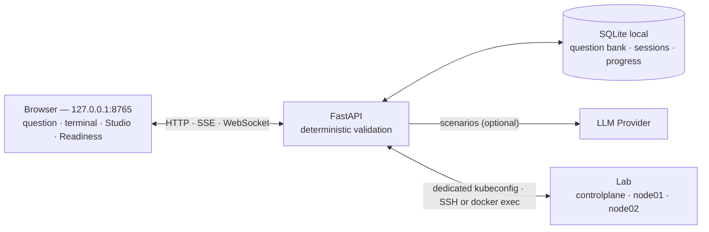

# CKA Arena — Local CKA simulator: real lab, real terminal, AI-generated scenarios

> **English quickstart** — the rest of this README is in Portuguese (pt-BR), like the project's internal docs.

## Quickstart (English)

One command provisions a real 3-node Kubernetes lab, seeds the question bank and
starts the platform:

```bash
git clone https://github.com/Fabi0x01/cka-arena.git && cd cka-arena
./setup.sh
```

The script detects your OS/distro, audits prerequisites and **asks before installing**
anything missing (`--yes` to skip prompts, `--check` to audit only). Supported:

| Environment | Lab driver |
| :--- | :--- |
| macOS (arm64/x86_64) | Multipass VMs (bridged network) |
| Ubuntu / Debian (x86_64/arm64) | Multipass VMs (bridged network) |
| **WSL2 (Windows 11, systemd)** | **kind containers inside WSL** (no Docker Desktop, no nested VM) |
| Fedora / Arch | best effort (Multipass when available) |

When it finishes it prints the URL to open — normally **http://127.0.0.1:8765** —
plus what you can optionally configure:

- **AI generation (optional):** open **Settings → AI provider**, pick a provider
  (GLM, DeepSeek, OpenCode, Anthropic, OpenAI-compatible, Ollama), pick a **model from the
  dropdown**, paste your key and hit **Test connection**. The key is stored locally in
  `llm_config.json` (git-ignored, masked in the UI) — or copy `llm_config.example.json`
  to `llm_config.json` and edit it by hand. Practice from the bundled question bank works
  without it.
- **Lab password:** VMs use `ubuntu` / `ubuntu` (override with `CKA_LAB_PASSWORD`).
- **Power:** stop/start the lab from the cluster menu at the bottom of the left rail.

Requirements: 8 GB RAM minimum (16 GB recommended), ~30 GB free disk, internet access
for images and packages, and a bridged network for the Multipass VMs (WSL2 uses Docker
instead). Python ≥ 3.12 is managed by `uv`. Logs: `~/.cka-arena/setup.log`.
All flags: `./setup.sh --help`.

### What you get

- **Real lab, real terminal.** A `kubeadm` lab with three nodes (`controlplane`, `node01`,
  `node02`) and a terminal in the browser (xterm.js over a host PTY) with an exam-like shell
  profile, one tab per node and a **Check** button that grades the resulting cluster state —
  never the commands you typed.
- **Practice from a curated bank.** 30 seed scenarios ship in `scenarios/seed/` (all five CKA
  domains, exam-standard and killer-hardcore tiers). Sessions are drawn with the official exam
  weights (30 / 25 / 20 / 15 / 10).
- **Scenario Studio (AI).** An optional multi-stage pipeline (plan by curriculum archetype →
  build → deterministic gates → review → solvability probe on the cluster) that publishes only
  scenarios proven to be solvable.
- **Readiness and Study Codex.** Spaced repetition per archetype, a Go/No-Go readiness report
  with a skill tree, six session variants (study, weakness drill, speed blitz, mistake replay,
  guided and blind mock exams), progressive hints, a post-session Speed Coach, and a 36-topic
  study codex with quizzes and a daily plan.

### Security — read this before running it

CKA Arena is a **single-user, local-only** tool that opens a **real shell on your machine**
in the browser.

- The server binds to `127.0.0.1` only. **Never put a proxy, tunnel or port-forward in front
  of it**: anything that can reach the port can run commands as your user. There is no login,
  and the optional `CKA_ARENA_TOKEN` does not protect the terminal WebSocket.
- Scenarios run commands on the **lab nodes** and can deliberately break the kubelet, static
  pods or etcd there. Only wire it to a lab you can rebuild — the one `setup.sh` creates.
  At runtime the app never escalates privileges on your host (it does use `sudo` inside the
  lab nodes) and uses its own kubeconfig (`~/.cka-arena/kubeconfig`), never `~/.kube/config`.
- `setup.sh` installs missing prerequisites (Multipass, kind, kubectl, `uv`, …) and may use
  `sudo` or your package manager to do so — only after asking, unless you pass `--yes`.
- AI generation is optional. It sends the **lab topology** (node names and internal IP
  addresses, Kubernetes version, machine architecture, installed addons) and your request to
  the LLM provider you configure.
- Commands typed in the built-in local shell are recorded in the local SQLite database
  (lines containing tokens, passwords or keys are dropped) to power the post-session Speed
  Coach. The record stays on your machine and is excluded from portable backups.

### Portable DB backup & auto-restore

- Your state (question bank, sessions, mastery, study progress) lives in `data/cka_arena.db`
  (git-ignored).
- The repository ships a snapshot at `backups/cka_arena_backup.db` (no API keys). On a fresh
  clone the first start restores it automatically, so practice works immediately with a
  pre-populated bank. The snapshot **also carries sample progress history** (sessions,
  mastery, study progress) — see the counts in `backups/manifest.json`.
- Snapshot your own state (another machine, or an updated bank):

  ```bash
  uv run python -m app.backup create
  ```

- Force-restore the snapshot onto an existing database (the current one is kept as
  `*.pre-restore-*.bak`):

  ```bash
  uv run python -m app.backup restore --force
  ```

### Stopping and removing the lab

- **Stop / start:** cluster menu in the left rail (Multipass VMs are stopped and started; the
  kind containers are stopped and started).
- **Remove everything the platform created:**

  ```bash
  # Multipass lab
  multipass delete controlplane node01 node02 --purge
  # kind lab
  kind delete cluster --name cka
  # local state, SSH key, kubeconfig, logs, terminal scratch dirs
  rm -rf ~/.cka-arena data
  ```

  Finally delete the managed block between `# >>> CKA-ARENA MANAGED START >>>` and
  `# <<< CKA-ARENA MANAGED END <<<` in `~/.ssh/config` (Multipass only).

## License

MIT — see [LICENSE](./LICENSE). Third-party notices live in [NOTICE](./NOTICE).

*CKA Arena is an independent study tool. "Certified Kubernetes Administrator" and "CKA" are
trademarks of The Linux Foundation. Killer.sh, KodeKloud and PSI are names of their
respective owners. This project is not affiliated with or endorsed by any of them, and ships
no official exam content.*

---


## Overview

Local web platform to prepare for the **Certified Kubernetes Administrator (CKA)**
exam against a real lab cluster — `kubeadm` on Multipass VMs (macOS/Linux) or kind
containers (WSL2/Linux with Docker). Validation is **deterministic, based on resulting
state** (like exam simulators): the **Check** inspects the cluster and the nodes, not
the commands typed. On top of that: an **LLM-powered scenario generator**, a **real
terminal in the browser**, and **lab lifecycle management** (start, stop, clean reset).

The UI, question prompts and feedback are **100% in English** — the exam's language.

## How it works



1. The backend applies the question's **setup** to the lab (manifests, commands on nodes via
   backup + controlled breakage).
2. You solve it in the browser terminal (or a native terminal) and click **Check**.
3. Each criterion returns `PASS`/`FAIL` with evidence; **Next** only unlocks at 100%.
4. On advancing, the question cleanup (L0) restores backups and removes what it created; on
   finishing, session cleanup (L1) or a clean reset (L2) returns the lab to baseline,
   preserving the addons.

Details in [`ARCHITECTURE.md`](./ARCHITECTURE.md).

## Workflow

Shortcuts use `⌘` on macOS and `Ctrl` on Linux/WSL2 (with the terminal focused: `Ctrl+Shift`).

1. **Arena (`⌘1`)** — exam-format question prompt, domain and weight, timer, Copy-Pills,
   checklist, notepad and links to the allowed documentation. **Check** evaluates the cluster
   state; **Next** unlocks only when every criterion passes. Mock exams award partial credit
   per criterion.
2. **Terminal in the browser** — local shell with an exam profile (`k` = `kubectl`,
   `$do` = `--dry-run=client -o yaml`, `$now` = `--force --grace-period=0`), isolated workdir
   per tab, tabs `controlplane` / `node01` / `node02`, scrollback search (`⌘F`), Zen mode
   (`⌘B`) and Native mode (`` ⌘\ `` hides the embedded terminal).
3. **Lab at the click of a button** — state in the rail's cluster menu (Ready / Off / Starting /
   Degraded), instrumented boot and clean reset (L2).
4. **Readiness (`⌘2`)** — six session variants (Study, Weakness Drill, Speed Blitz,
   Mistake Replay, Guided Mock, Blind Mock), spaced repetition by archetype, Skill Tree and a
   Go/No-Go report.
5. **Scenario Studio (`⌘3`)** — pick domains and difficulty; the pipeline plans slots per
   curriculum archetype, generates with the LLM, applies deterministic gates and proves the
   solution on the cluster before publishing. Includes question-bank inspection, repair,
   feedback and question retirement.
6. **Study Codex (`⌘5`)** — theory, playbooks, cheatsheets and quizzes per topic, with XP,
   ranks and streaks; daily study plan.
7. **Cluster & Settings (`⌘4`)** — AI provider (presets, models, connection test, masked key),
   lab health and access, preferences.

## Configuration (environment variables)

| Variable | Default | Effect |
| :--- | :--- | :--- |
| `CKA_PORT` | `8765` | Server port (always on `127.0.0.1`). |
| `CKA_PROVIDER` | auto per OS | `multipass` or `kind`; can also be persisted in `~/.cka-arena/provider`. |
| `CKA_AUTO_START` | `1` | `0` disables the automatic lab boot when the app opens. |
| `CKA_LAB_PASSWORD` | `ubuntu` | Password of the `ubuntu` user on the lab VMs. |
| `CKA_BRIDGE_PREFIX` | detected | Bridged subnet prefix (Multipass provider). |
| `CKA_LLM_CONFIG` | `./llm_config.json` | Path to the LLM provider configuration file. |
| `CKA_LLM_PROVIDER`, `CKA_LLM_API_KEY`, `CKA_LLM_BASE_URL`, `CKA_LLM_MODEL`, `CKA_LLM_MODEL_FLASH`, `CKA_LLM_THINKING`, `CKA_LLM_REASONING_EFFORT` | — | Environment-based alternative to the LLM configuration file. |
| `CKA_ARENA_TOKEN` | unset | Requires `Authorization: Bearer` on the `/api/*` routes (except `/api/events`). Does not cover the terminal WebSocket, and the embedded UI does not send it. |
| `CKA_ARENA_ALLOW_REMOTE` | disabled | Relaxes the `Origin` check of the terminal WebSocket. Do not use without deliberately exposing the platform. |
| `NO_COLOR` | — | `setup.sh` without colors. |

## Where things live

| Path | Contents |
| :--- | :--- |
| `data/cka_arena.db` | Local database: question bank, sessions, progress (git-ignored). |
| `llm_config.json` | LLM provider key (git-ignored). |
| `~/.cka-arena/kubeconfig` | Dedicated lab kubeconfig (contexts `cka`, `cka-ops`, `cka-edge`). |
| `~/.cka-arena/id_ed25519` | Lab SSH key (Multipass provider). |
| `~/.cka-arena/nodes.json` | Logical node → container mapping (kind provider). |
| `~/.cka-arena/assets/` | Helm chart and Kustomize overlay used in scenarios. |
| `~/.cka-arena/scratch/<tab>/` | Isolated workdir of each terminal tab. |
| `~/.cka-arena/setup.log` | `setup.sh` log. |
| `~/.ssh/config` | Managed block between `# >>> CKA-ARENA MANAGED START >>>` and `# <<< CKA-ARENA MANAGED END <<<` (Multipass provider). |

## Command line

```bash
uv run pytest -q                                   # tests (unit and API; no cluster)
uv run python -m app.seed validate [--gates-only]  # validates the seeds: with the lab, or gates only
uv run python -m app.bank audit [--apply]          # audits (and optionally retires) legacy questions
uv run python -m app.bank prune --apply            # prunes drafts and duplicates from the bank
uv run python -m app.backup status                 # portable snapshot status
```

## Project documentation

**Reference** (tracks the code; in case of divergence, the code prevails):

| Document | Purpose |
| :--- | :--- |
| [`ARCHITECTURE.md`](./ARCHITECTURE.md) | Technical architecture: components, lab access, security and rollback, terminal, cluster lifecycle, database, teardown and API reference. |
| [`LLM_SCENARIO_SPEC.md`](./LLM_SCENARIO_SPEC.md) | `ScenarioEnvelope` contract (JSON), exam question format, check catalog, guardrails, system prompt rules and difficulty rubric. |
| [`LLM_PIPELINE_SPEC.md`](./LLM_PIPELINE_SPEC.md) | Generation pipeline, question bank, exam-weight draw (largest remainder), Check contract (`PASS`/`FAIL`/`SKIP`/`ERROR`) and L0/L1/L2 teardown. |
| [`UX_UI_SPEC.md`](./UX_UI_SPEC.md) | UX specification: question workspace + terminal, Check → Next cycle, Studio, practice and shortcuts. |
| [`DESIGN.md`](./DESIGN.md) | "Orbital Control Console" design system: tokens, typography, overlays and shortcuts. |
| [`PRODUCT.md`](./PRODUCT.md) | Product truth: what it is, who it is for, and brand commitments. |

**Historical records** (frozen; describe the process, not the current state):

| Document | Purpose |
| :--- | :--- |
| [`PLAN.md`](./PLAN.md) | Original master plan: reference research, curriculum matrix and 5-phase roadmap, with acceptance evidence. |
| [`GAP_ANALYSIS.md`](./GAP_ANALYSIS.md) | Gap audits (G1–G21) that originated the specifications. |
| [`IMPLEMENTATION_READINESS.md`](./IMPLEMENTATION_READINESS.md) | Readiness gate before implementation and decisions D1–D4. |
| [`SETUP_PLAN.md`](./SETUP_PLAN.md) | Design of the universal `setup.sh` and the provider abstraction (Multipass × kind). |
| [`IMPROVEMENT_PLAN.md`](./IMPROVEMENT_PLAN.md) | Forensic audit of the pipeline and improvement plan, already implemented. |
| [`ARCHITECTURE_V3_PLAN.md`](./ARCHITECTURE_V3_PLAN.md) | Report of the v3 architecture upgrade (in English). |

## Status and scope

- **Personal, single-user, local-only** tool: no authentication, no multi-user, no
  remote-exposure support — by design, because the terminal is a real host shell.
- The lab is **disposable**: use only a cluster you can rebuild.
- Accessibility is out of scope in this phase (`prefers-reduced-motion` is still respected).
