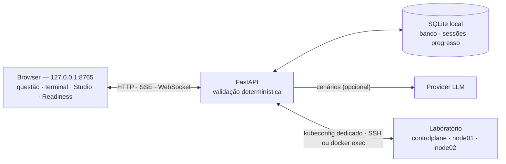

# CKA Arena — Local CKA simulator: real lab, real terminal, AI-generated scenarios

> **English quickstart** — the rest of this README is in Portuguese (pt-BR), like the project's internal docs.

## Quickstart (English)

One command provisions a real 3-node Kubernetes lab, seeds the question bank and
starts the platform:

```bash
git clone https://github.com/Fabi0x01/cka-arena.git && cd cka-arena
./setup.sh
```

The script detects your OS/distro, audits prerequisites and **asks before installing**
anything missing (`--yes` to skip prompts, `--check` to audit only). Supported:

| Environment | Lab driver |
| :--- | :--- |
| macOS (arm64/x86_64) | Multipass VMs (bridged network) |
| Ubuntu / Debian (x86_64/arm64) | Multipass VMs (bridged network) |
| **WSL2 (Windows 11, systemd)** | **kind containers inside WSL** (no Docker Desktop, no nested VM) |
| Fedora / Arch | best effort (Multipass when available) |

When it finishes it prints the URL to open — normally **http://127.0.0.1:8765** —
plus what you can optionally configure:

- **AI generation (optional):** open **Settings → AI provider**, pick a provider
  (GLM, DeepSeek, OpenCode, Anthropic, OpenAI-compatible, Ollama), pick a **model from the
  dropdown**, paste your key and hit **Test connection**. The key is stored locally in
  `llm_config.json` (git-ignored, masked in the UI) — or copy `llm_config.example.json`
  to `llm_config.json` and edit it by hand. Practice from the bundled question bank works
  without it.
- **Lab password:** VMs use `ubuntu` / `ubuntu` (override with `CKA_LAB_PASSWORD`).
- **Power:** stop/start the lab from the cluster menu at the bottom of the left rail.

Requirements: 8 GB RAM minimum (16 GB recommended), ~30 GB free disk, internet access
for images and packages, and a bridged network for the Multipass VMs (WSL2 uses Docker
instead). Python ≥ 3.12 is managed by `uv`. Logs: `~/.cka-arena/setup.log`.
All flags: `./setup.sh --help`.

### What you get

- **Real lab, real terminal.** A `kubeadm` lab with three nodes (`controlplane`, `node01`,
  `node02`) and a terminal in the browser (xterm.js over a host PTY) with an exam-like shell
  profile, one tab per node and a **Check** button that grades the resulting cluster state —
  never the commands you typed.
- **Practice from a curated bank.** 30 seed scenarios ship in `scenarios/seed/` (all five CKA
  domains, exam-standard and killer-hardcore tiers). Sessions are drawn with the official exam
  weights (30 / 25 / 20 / 15 / 10).
- **Scenario Studio (AI).** An optional multi-stage pipeline (plan by curriculum archetype →
  build → deterministic gates → review → solvability probe on the cluster) that publishes only
  scenarios proven to be solvable.
- **Readiness and Study Codex.** Spaced repetition per archetype, a Go/No-Go readiness report
  with a skill tree, six session variants (study, weakness drill, speed blitz, mistake replay,
  guided and blind mock exams), progressive hints, a post-session Speed Coach, and a 36-topic
  study codex with quizzes and a daily plan.

### Security — read this before running it

CKA Arena is a **single-user, local-only** tool that opens a **real shell on your machine**
in the browser.

- The server binds to `127.0.0.1` only. **Never put a proxy, tunnel or port-forward in front
  of it**: anything that can reach the port can run commands as your user. There is no login,
  and the optional `CKA_ARENA_TOKEN` does not protect the terminal WebSocket.
- Scenarios run commands on the **lab nodes** and can deliberately break the kubelet, static
  pods or etcd there. Only wire it to a lab you can rebuild — the one `setup.sh` creates.
  At runtime the app never escalates privileges on your host (it does use `sudo` inside the
  lab nodes) and uses its own kubeconfig (`~/.cka-arena/kubeconfig`), never `~/.kube/config`.
- `setup.sh` installs missing prerequisites (Multipass, kind, kubectl, `uv`, …) and may use
  `sudo` or your package manager to do so — only after asking, unless you pass `--yes`.
- AI generation is optional. It sends the **lab topology** (node names and internal IP
  addresses, Kubernetes version, machine architecture, installed addons) and your request to
  the LLM provider you configure.
- Commands typed in the built-in local shell are recorded in the local SQLite database
  (lines containing tokens, passwords or keys are dropped) to power the post-session Speed
  Coach. The record stays on your machine and is excluded from portable backups.

### Portable DB backup & auto-restore

- Your state (question bank, sessions, mastery, study progress) lives in `data/cka_arena.db`
  (git-ignored).
- The repository ships a snapshot at `backups/cka_arena_backup.db` (no API keys). On a fresh
  clone the first start restores it automatically, so practice works immediately with a
  pre-populated bank. The snapshot **also carries sample progress history** (sessions,
  mastery, study progress) — see the counts in `backups/manifest.json`.
- Snapshot your own state (another machine, or an updated bank):

  ```bash
  uv run python -m app.backup create
  ```

- Force-restore the snapshot onto an existing database (the current one is kept as
  `*.pre-restore-*.bak`):

  ```bash
  uv run python -m app.backup restore --force
  ```

### Stopping and removing the lab

- **Stop / start:** cluster menu in the left rail (Multipass VMs are stopped and started; the
  kind containers are stopped and started).
- **Remove everything the platform created:**

  ```bash
  # Multipass lab
  multipass delete controlplane node01 node02 --purge
  # kind lab
  kind delete cluster --name cka
  # local state, SSH key, kubeconfig, logs, terminal scratch dirs
  rm -rf ~/.cka-arena data
  ```

  Finally delete the managed block between `# >>> CKA-ARENA MANAGED START >>>` and
  `# <<< CKA-ARENA MANAGED END <<<` in `~/.ssh/config` (Multipass only).

## License

MIT — see [LICENSE](./LICENSE). Third-party notices live in [NOTICE](./NOTICE).

*CKA Arena is an independent study tool. "Certified Kubernetes Administrator" and "CKA" are
trademarks of The Linux Foundation. Killer.sh, KodeKloud and PSI are names of their
respective owners. This project is not affiliated with or endorsed by any of them, and ships
no official exam content.*

---

## Visão geral

Plataforma web local para treinar para a prova **Certified Kubernetes Administrator (CKA)**
contra um cluster de laboratório real — `kubeadm` em VMs Multipass (macOS/Linux) ou em
containers kind (WSL2/Linux com Docker). A validação é **determinística, por estado
resultante** (como nos simuladores de prova): o **Check** inspeciona o cluster e os nós, não
os comandos digitados. Somam-se a isso um **gerador de cenários via LLM**, um **terminal real
no navegador** e a **gestão do ciclo de vida do laboratório** (ligar, desligar, reset limpo).

A UI, os enunciados e o feedback são **100% em inglês** — o idioma da prova. A documentação
interna do projeto é em pt-BR.

## Como funciona



1. O backend aplica o **setup** da questão no laboratório (manifestos, comandos em nós via
   backup + quebra controlada).
2. Você resolve no terminal do navegador (ou num terminal nativo) e clica em **Check**.
3. Cada critério retorna `PASS`/`FAIL` com evidência; **Next** só libera com 100%.
4. Ao avançar, o cleanup da questão (L0) restaura backups e remove o que ela criou; ao
   encerrar, a limpeza da sessão (L1) ou o reset limpo (L2) devolvem o laboratório ao
   baseline, preservando os addons.

Detalhes em [`ARCHITECTURE.md`](./ARCHITECTURE.md).

## Fluxo de trabalho

Atalhos usam `⌘` no macOS e `Ctrl` no Linux/WSL2 (com o terminal focado: `Ctrl+Shift`).

1. **Arena (`⌘1`)** — enunciado no formato da prova, domínio e peso, cronômetro, Copy-Pills,
   checklist, notepad e links da documentação permitida. **Check** avalia o estado do cluster;
   **Next** libera só com todos os critérios. Simulados dão crédito parcial por critério.
2. **Terminal no navegador** — shell local com perfil de exame (`k` = `kubectl`,
   `$do` = `--dry-run=client -o yaml`, `$now` = `--force --grace-period=0`), workdir isolada
   por aba, abas `controlplane` / `node01` / `node02`, busca no scrollback (`⌘F`), modo Zen
   (`⌘B`) e modo Native (`` ⌘\ `` esconde o terminal embutido).
3. **Laboratório no botão** — estado no menu de cluster do rail (Ready / Off / Starting /
   Degraded), boot instrumentado e reset limpo (L2).
4. **Readiness (`⌘2`)** — seis variantes de sessão (Study, Weakness Drill, Speed Blitz,
   Mistake Replay, Guided Mock, Blind Mock), repetição espaçada por arquétipo, Skill Tree e
   relatório Go/No-Go.
5. **Scenario Studio (`⌘3`)** — selecione domínios e dificuldade; o pipeline planeja os slots
   por arquétipo do currículo, gera com LLM, aplica gates determinísticos e prova a solução no
   cluster antes de publicar. Inclui inspeção do banco, reparo, feedback e aposentadoria de
   questões.
6. **Study Codex (`⌘5`)** — teoria, playbooks, cheatsheets e quizzes por tópico, com XP,
   ranks e streak; plano de estudo diário.
7. **Cluster & Settings (`⌘4`)** — provider de IA (presets, modelos, teste de conexão, chave
   mascarada), saúde e acesso ao laboratório, preferências.

## Configuração (variáveis de ambiente)

| Variável | Default | Efeito |
| :--- | :--- | :--- |
| `CKA_PORT` | `8765` | Porta do servidor (sempre em `127.0.0.1`). |
| `CKA_PROVIDER` | automático por S.O. | `multipass` ou `kind`; também pode ficar gravado em `~/.cka-arena/provider`. |
| `CKA_AUTO_START` | `1` | `0` desliga o boot automático do laboratório ao abrir a app. |
| `CKA_LAB_PASSWORD` | `ubuntu` | Senha do usuário `ubuntu` nas VMs do laboratório. |
| `CKA_BRIDGE_PREFIX` | detectado | Prefixo da subnet bridged (provider Multipass). |
| `CKA_LLM_CONFIG` | `./llm_config.json` | Caminho do arquivo de configuração do provider LLM. |
| `CKA_LLM_PROVIDER`, `CKA_LLM_API_KEY`, `CKA_LLM_BASE_URL`, `CKA_LLM_MODEL`, `CKA_LLM_MODEL_FLASH`, `CKA_LLM_THINKING`, `CKA_LLM_REASONING_EFFORT` | — | Alternativa por ambiente ao arquivo de configuração do LLM. |
| `CKA_ARENA_TOKEN` | indefinido | Exige `Authorization: Bearer` nas rotas `/api/*` (exceto `/api/events`). Não cobre o WebSocket do terminal, e a UI embutida não o envia. |
| `CKA_ARENA_ALLOW_REMOTE` | desligado | Relaxa a checagem de `Origin` do WebSocket do terminal. Não use sem expor a plataforma de propósito. |
| `NO_COLOR` | — | `setup.sh` sem cores. |

## Onde as coisas vivem

| Caminho | Conteúdo |
| :--- | :--- |
| `data/cka_arena.db` | Banco local: banco de questões, sessões, progresso (git-ignored). |
| `llm_config.json` | Chave do provider LLM (git-ignored). |
| `~/.cka-arena/kubeconfig` | Kubeconfig dedicado do laboratório (contextos `cka`, `cka-ops`, `cka-edge`). |
| `~/.cka-arena/id_ed25519` | Chave SSH do laboratório (provider Multipass). |
| `~/.cka-arena/nodes.json` | Mapeamento nó lógico → container (provider kind). |
| `~/.cka-arena/assets/` | Chart Helm e overlay Kustomize usados nos cenários. |
| `~/.cka-arena/scratch/<tab>/` | Workdir isolada de cada aba de terminal. |
| `~/.cka-arena/setup.log` | Log do `setup.sh`. |
| `~/.ssh/config` | Bloco gerenciado entre `# >>> CKA-ARENA MANAGED START >>>` e `# <<< CKA-ARENA MANAGED END <<<` (provider Multipass). |

## Linha de comando

```bash
uv run pytest -q                                   # testes (unitários e de API; sem cluster)
uv run python -m app.seed validate [--gates-only]  # valida os seeds: com laboratório, ou só os gates
uv run python -m app.bank audit [--apply]          # audita (e opcionalmente aposenta) questões legadas
uv run python -m app.bank prune --apply            # limpa rascunhos e duplicatas do banco
uv run python -m app.backup status                 # status do snapshot portável
```

## Documentação do projeto

**Referência** (acompanha o código; em caso de divergência, o código prevalece):

| Documento | Finalidade |
| :--- | :--- |
| [`ARCHITECTURE.md`](./ARCHITECTURE.md) | Arquitetura técnica: componentes, acesso ao laboratório, segurança e rollback, terminal, ciclo de vida do cluster, banco de dados, teardown e referência da API. |
| [`LLM_SCENARIO_SPEC.md`](./LLM_SCENARIO_SPEC.md) | Contrato `ScenarioEnvelope` (JSON), formato de questão da prova, catálogo de checks, guardrails, regras do system prompt e rubrica de dificuldade. |
| [`LLM_PIPELINE_SPEC.md`](./LLM_PIPELINE_SPEC.md) | Pipeline de geração, banco de questões, sorteio pelos pesos da prova, contrato do Check (`PASS`/`FAIL`/`SKIP`/`ERROR`) e teardown L0/L1/L2. |
| [`UX_UI_SPEC.md`](./UX_UI_SPEC.md) | Especificação de UX: workspace questão + terminal, ciclo Check → Next, Studio, practice e atalhos. |
| [`DESIGN.md`](./DESIGN.md) | Design system "Orbital Control Console": tokens, tipografia, overlays e atalhos. |
| [`PRODUCT.md`](./PRODUCT.md) | Verdade de produto: o que é, para quem e compromissos de marca. |

**Registros históricos** (congelados; descrevem o processo, não o estado atual):

| Documento | Finalidade |
| :--- | :--- |
| [`PLAN.md`](./PLAN.md) | Plano mestre original: pesquisa de referências, matriz curricular e roadmap em 5 fases, com evidências de aceite. |
| [`GAP_ANALYSIS.md`](./GAP_ANALYSIS.md) | Auditorias de gaps (G1–G21) que originaram as especificações. |
| [`IMPLEMENTATION_READINESS.md`](./IMPLEMENTATION_READINESS.md) | Gate de prontidão antes da implementação e decisões D1–D4. |
| [`SETUP_PLAN.md`](./SETUP_PLAN.md) | Design do `setup.sh` universal e da abstração de provider (Multipass × kind). |
| [`IMPROVEMENT_PLAN.md`](./IMPROVEMENT_PLAN.md) | Auditoria forense do pipeline e plano de melhorias, já implementado. |
| [`ARCHITECTURE_V3_PLAN.md`](./ARCHITECTURE_V3_PLAN.md) | Relatório do upgrade arquitetural v3 (em inglês). |

## Status e escopo

- Ferramenta **pessoal, single-user, local-only**: sem autenticação, sem multiusuário e sem
  suporte a exposição remota — por design, porque o terminal é um shell real do host.
- O laboratório é **descartável**: use apenas um cluster que você pode reconstruir.
- Acessibilidade está fora de escopo nesta fase (`prefers-reduced-motion` continua respeitado).
